# Лабораторная работа №3

## Облачные сети. Amazon VPC

| Данные         | Значение                                                                    |
| -------------- | --------------------------------------------------------------------------- |
| ФИО            | Дмитрий Головичихин                                                         |
| Группа         | IA2403                                                                      |
| Специальность  | Informatică aplicată                                                        |
| Номер в группе | k = 16, X = 16 % 30 = 16                                                    |
| Уровень        | Продвинутый, задания 1–14                                                   |
| Приложение     | TimeCapsule                                                                 |
| Репозиторий    | [dumkaguv-cloud/timecapsule](https://github.com/dumkaguv-cloud/timecapsule) |
| Регион         | eu-central-1 (Frankfurt)                                                    |

## Теория

VPC задаёт частное адресное пространство, а подсети размещают ресурсы в зонах доступности. Таблицы маршрутов определяют путь пакетов; Internet Gateway даёт путь публичным подсетям, а NAT Gateway позволяет приватному серверу инициировать исходящие соединения. Security Group фильтрует трафик экземпляра с учётом состояния соединения, Network ACL действует на границе подсети и не отслеживает состояние. Приватная зона Route 53 даёт внутреннее имя базе.

Обязательные теги ресурсов: `Project=timecapsule`, `Environment=dev`, `Lab=lab3`, `Owner` со своим nickname и `Name` с полным именем ресурса.

# Часть 1. Базовый уровень

## Задание 1. План адресов

VPC: `timecapsule-dev-vpc`, `10.16.0.0/16`. Подсети не пересекаются.

| Подсеть                     | Зона          | Диапазон        | Адреса для экземпляров      | Количество |
| --------------------------- | ------------- | --------------- | --------------------------- | ---------: |
| `timecapsule-dev-public-a`  | eu-central-1a | `10.16.0.0/24`  | `10.16.0.4`–`10.16.0.254`   |        251 |
| `timecapsule-dev-public-b`  | eu-central-1b | `10.16.1.0/24`  | `10.16.1.4`–`10.16.1.254`   |        251 |
| `timecapsule-dev-private-a` | eu-central-1a | `10.16.10.0/24` | `10.16.10.4`–`10.16.10.254` |        251 |
| `timecapsule-dev-private-b` | eu-central-1b | `10.16.11.0/24` | `10.16.11.4`–`10.16.11.254` |        251 |

### Контрольный вопрос

**Почему не 256 адресов, какие заняты и сколько подсетей осталось?**

Ответ: AWS резервирует в каждом `/24` первые четыре и последний адрес: например, `10.16.0.0` — адрес сети, `.1` — маршрутизатор VPC, `.2` — резерв AWS (DNS VPC использует адрес VPC+2, здесь `10.16.0.2`), `.3` — на будущее, `.255` — broadcast. Поэтому `256 − 5 = 251` адрес для ресурсов. В `/16` помещается `2^(24−16) = 256` подсетей `/24`; после четырёх запланированных остаётся 252 свободных диапазона.

## Задание 2. VPC и подсети

Создать VPC `10.16.0.0/16` без IPv6, включить DNS resolution и DNS hostnames, затем создать четыре подсети из таблицы и проставить обязательные теги.

### Контрольный вопрос

**Является ли `public-a` публичной сразу после создания?**

Ответ: Нет. Название и CIDR не делают подсеть публичной: пока её таблица маршрутов не направляет `0.0.0.0/0` на Internet Gateway, прямого пути в интернет нет. Экземпляру также потребуется публичный IPv4.

## Задание 3. Internet Gateway и маршруты

Подключить `timecapsule-dev-igw` к VPC. `timecapsule-dev-public-rt`: `10.16.0.0/16 → local`, `0.0.0.0/0 → timecapsule-dev-igw`, связи с `public-a` и `public-b`. `timecapsule-dev-private-rt`: только `10.16.0.0/16 → local`, связи с `private-a` и `private-b`; на публичных подсетях включить автоназначение публичного IPv4.

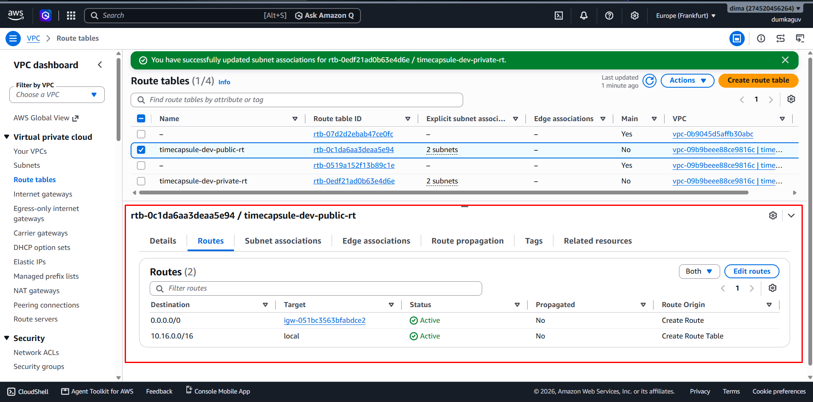

В `public-rt` локальный маршрут `10.16.0.0/16` и маршрут `0.0.0.0/0` через Internet Gateway находятся в состоянии `Active`.

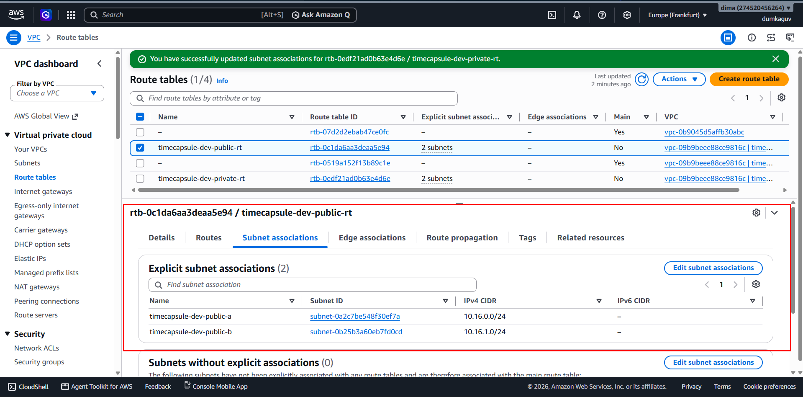

С `public-rt` явно связаны `public-a` (`10.16.0.0/24`) и `public-b` (`10.16.1.0/24`).

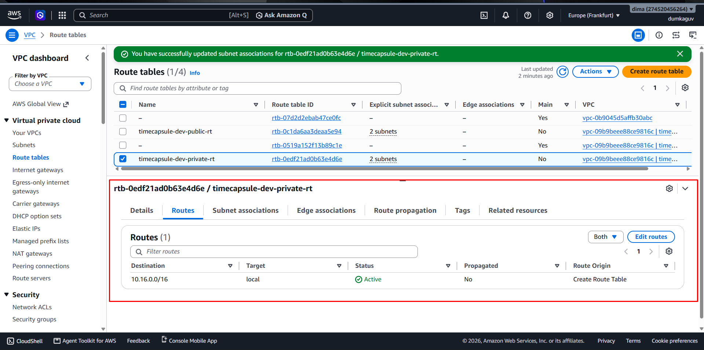

В `private-rt` есть только локальный маршрут `10.16.0.0/16`; маршрута `0.0.0.0/0` нет.

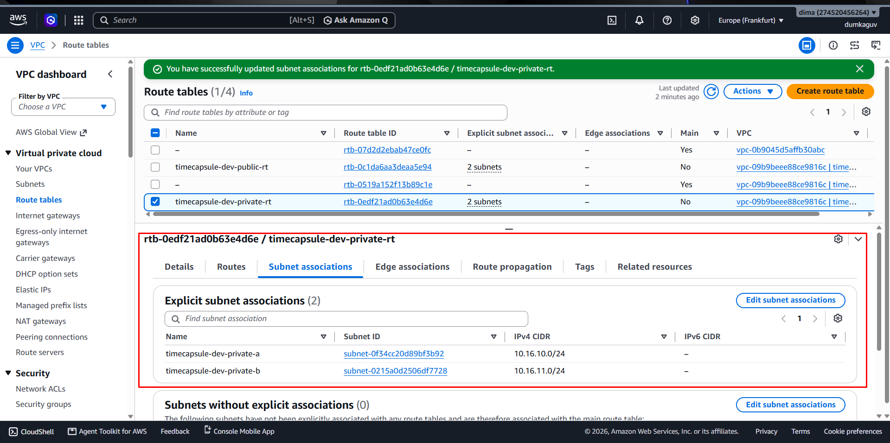

С `private-rt` явно связаны `private-a` (`10.16.10.0/24`) и `private-b` (`10.16.11.0/24`).

### Контрольный вопрос

**Что за маршрут есть в обеих таблицах и куда пойдёт пакет к `8.8.8.8` из `private-a`?**

Ответ: AWS автоматически добавляет маршрут `10.16.0.0/16 → local`, который обеспечивает связь между подсетями одной VPC. У приватной таблицы нет подходящего маршрута к `8.8.8.8`, поэтому пакет не выйдет в интернет.

## Задание 4. Security Group

| Группа                       | Входящий порт   | Источник                     |
| ---------------------------- | --------------- | ---------------------------- |
| `timecapsule-dev-bastion-sg` | SSH 22          | мой внешний IP `/32`         |
| `timecapsule-dev-web-sg`     | HTTP 80         | `0.0.0.0/0`                  |
| `timecapsule-dev-web-sg`     | SSH 22          | `timecapsule-dev-bastion-sg` |
| `timecapsule-dev-db-sg`      | PostgreSQL 5432 | `timecapsule-dev-web-sg`     |
| `timecapsule-dev-db-sg`      | SSH 22          | `timecapsule-dev-bastion-sg` |

Для каждой группы заданы `Security group name` и одноимённый тег `Name`.

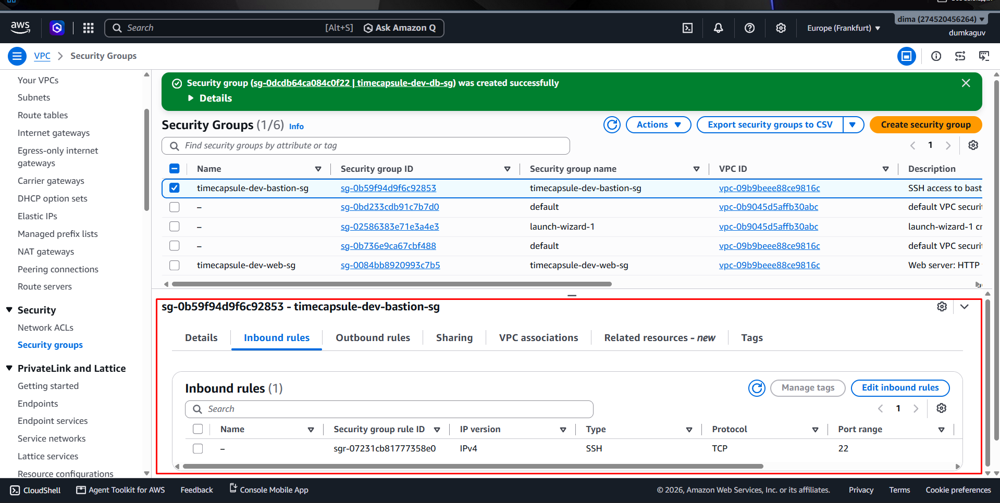

У `bastion-sg` видно одно входящее правило: SSH по TCP-порту 22.

На снимке должен быть виден источник SSH-правила `bastion-sg`: мой внешний IP `/32` с замаскированным адресом.

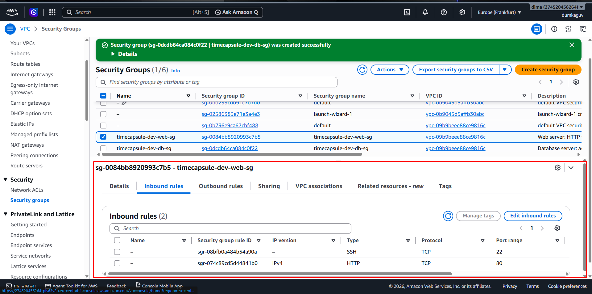

У `web-sg` видны два входящих правила: SSH по TCP-порту 22 и HTTP по TCP-порту 80.

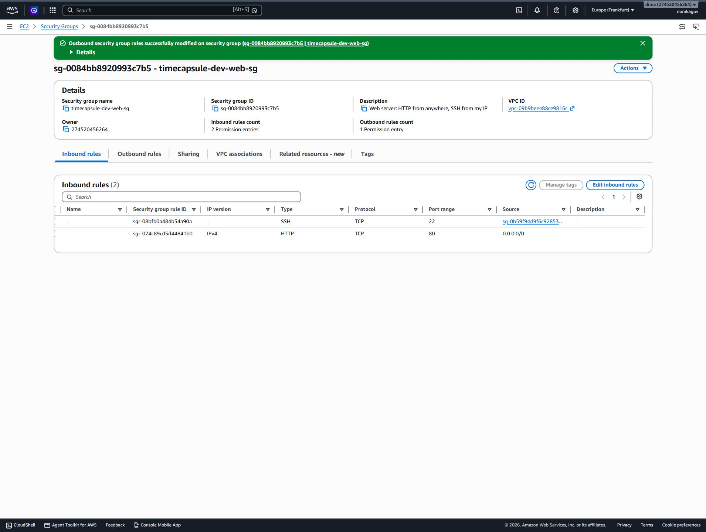

Источники `web-sg`: `bastion-sg` для SSH и `0.0.0.0/0` для HTTP.

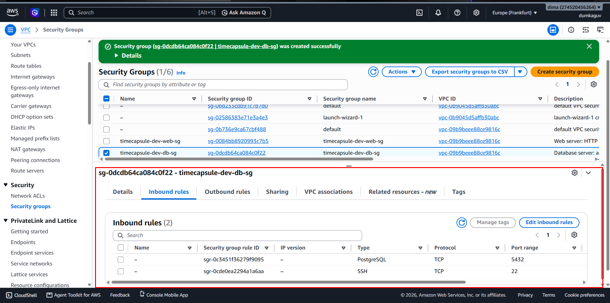

У `db-sg` видны два входящих правила: PostgreSQL по TCP-порту 5432 и SSH по TCP-порту 22.

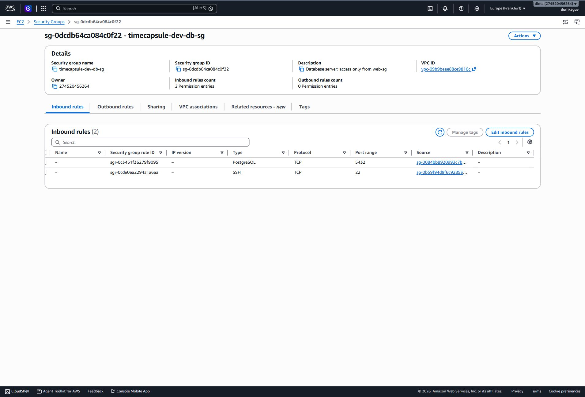

Источники `db-sg`: `web-sg` для PostgreSQL и `bastion-sg` для SSH.

### Контрольный вопрос

**Почему для БД источник — `web-sg`?**

Ответ: Правило относится к сетевым интерфейсам экземпляров с этой группой, поэтому при замене app-server и изменении его IP правило менять не придётся. Вариант `10.16.0.0/16` разрешил бы доступ всем экземплярам VPC, включая bastion, а фиксированный IP был бы хрупким.

## Задание 5. Экземпляры

Запустить экземпляры Amazon Linux 2023 типа `t3.micro` с ключом из ЛР2: `timecapsule-dev-bastion` в `public-b` с публичным IP и `bastion-sg`; `timecapsule-dev-web` в `public-a` с публичным IP и `web-sg`; `timecapsule-dev-db` в `private-a` без публичного IP и с `db-sg`. Для EC2 и EBS добавить обязательные теги. На web-server через User data установить nginx; для SSH на web/db использовать `ProxyJump bastion`, не копируя приватный ключ на bastion.

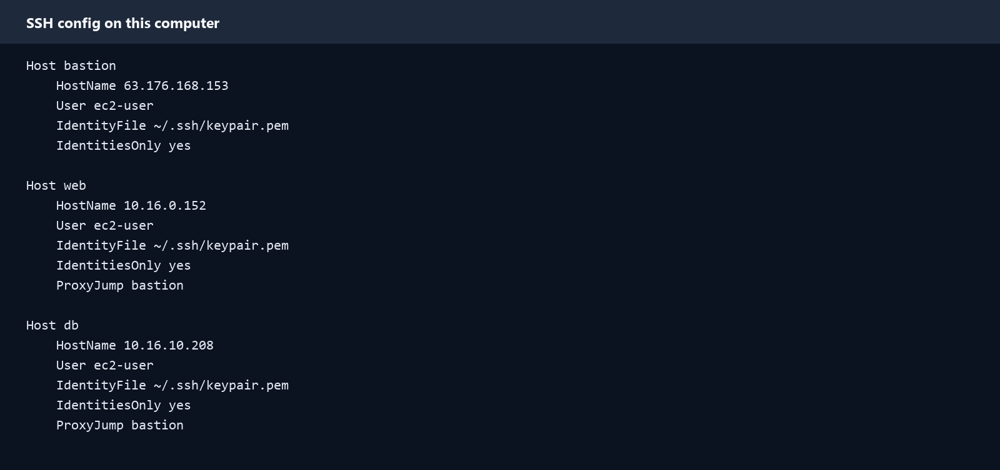

В `C:\Users\golov\.ssh\config` настроены короткие имена `bastion`, `web` и `db`; приватный ключ остаётся на компьютере.

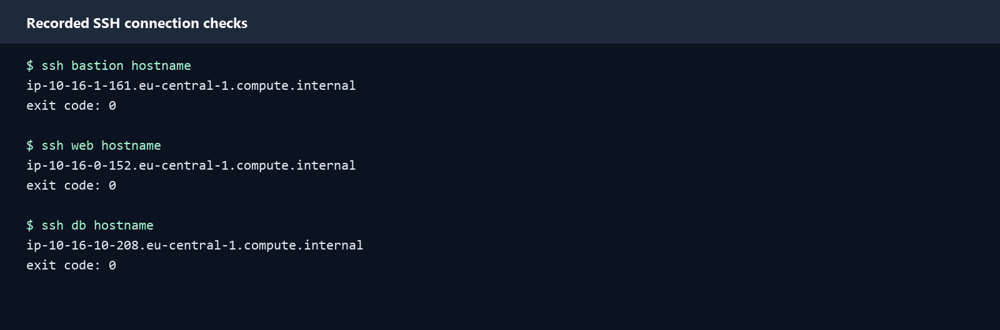

Команды `ssh bastion hostname`, `ssh web hostname` и `ssh db hostname` вернули имена трёх экземпляров с кодом 0.

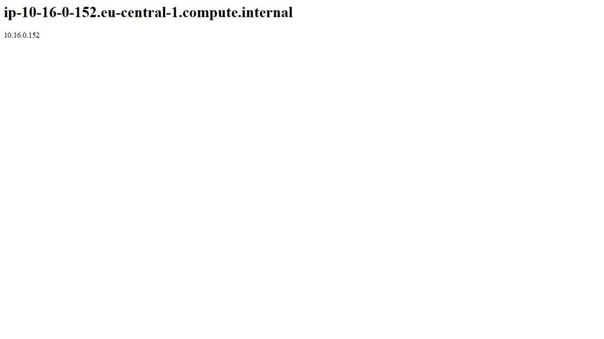

Страница web-server показывает имя `ip-10-16-0-152.eu-central-1.compute.internal` и приватный адрес `10.16.0.152`.

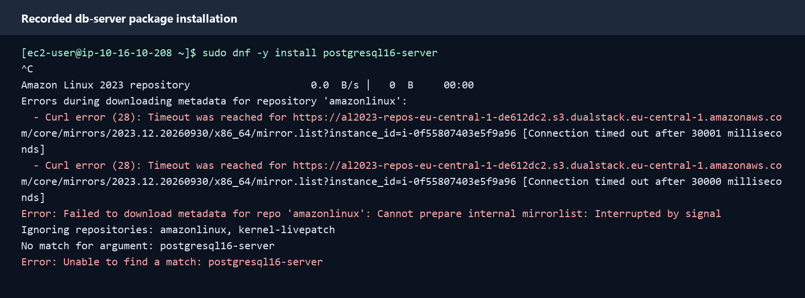

`dnf` на db-server не смог скачать метаданные Amazon Linux (`Curl error (28): Connection timed out`); после ожидания команда прервана `Ctrl+C`. Изображение составлено из [сохранённого вывода терминала](evidence/05-db-dnf-timeout.txt).

### Контрольный вопрос

**Почему db-server не скачивает пакеты и что добавить?**

Ответ: В `private-rt` нет внешнего маршрута, а у db-server нет публичного IPv4. Нужны временный NAT Gateway в `public-a`, маршрут `0.0.0.0/0` через него в `private-rt` и исходящее правило HTTPS/TCP 443 в `db-sg`, где сейчас нет исходящих правил. NAT даст возможность скачивать пакеты, но не откроет входящие подключения из интернета к db-server.

## Задание 6. Временный NAT Gateway

Создать `timecapsule-dev-nat-a` в `public-a`, выделить и отдельно подписать `timecapsule-dev-nat-a-eip`, добавить в `private-rt` маршрут `0.0.0.0/0` на NAT и в `db-sg` исходящее правило HTTPS/TCP 443. На db-server выполнить `curl https://checkip.amazonaws.com`, `sudo dnf -y update`, `sudo dnf -y install postgresql16-server`; инициализировать PostgreSQL, включить прослушивание сетевого интерфейса и доступ из `10.16.0.0/24`. Для задания 7 создать пользователя `student` и базу `lab3`. После установки удалить NAT, снять скриншот Blackhole, удалить маршрут и освободить EIP NAT.

Вывод `curl https://checkip.amazonaws.com` на db-server совпадает с Elastic IP временного NAT Gateway.

После удаления NAT Gateway маршрут `0.0.0.0/0` в `private-rt` находится в состоянии `Blackhole`.

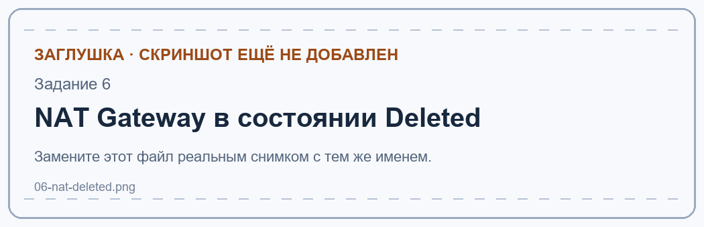

В списке NAT gateways временный шлюз находится в состоянии `Deleted`.

### Контрольный вопрос

**Почему `curl` возвращает EIP NAT?**

Ответ: db-server отправляет запрос через NAT Gateway, который заменяет адрес источника своим публичным адресом. У db-server собственного публичного IPv4 нет, поэтому внешняя служба видит адрес NAT, а не приватный адрес `10.16.10.x`.

### Контрольный вопрос

**Что ограничивают маршрут, SG и `pg_hba.conf`?**

Ответ: Отсутствие публичного IP и маршрута через Internet Gateway исключает прямое интернет-подключение; `db-sg` допускает TCP/5432 только от `web-sg`; `pg_hba.conf` решает, каким пользователям/базам и с каких IP разрешена аутентификация. Ошибка в одном слое может либо открыть лишний путь, либо заблокировать законное подключение, поэтому проверять надо все три.

### Контрольный вопрос

**Почему PostgreSQL работает после удаления NAT и как обновлять пакеты?**

Ответ: Приложение и база общаются по локальному маршруту VPC, который остаётся. Для очередного `dnf update` нужно временно поднять NAT и маршрут, выполнить обновление, затем убрать маршрут, NAT и его EIP.

## Задание 7. Проверки

Проверки: с web-server выполнить `psql` с приватным IP db-server, пользователем `student` и базой `lab3`; проверить TCP/5432 с web-server (open) и bastion (closed). На db-server выполнить `curl -m 5 https://github.com` после удаления NAT. Для эксперимента с Network ACL добавить inbound `Deny` №90 для моего IP `/32` в ACL VPC, проверить SSH/сайт с домашней сети и сайт с мобильной сети, затем **удалить правило №90**. В Tag Editor проверить все ресурсы по `Project=timecapsule`.

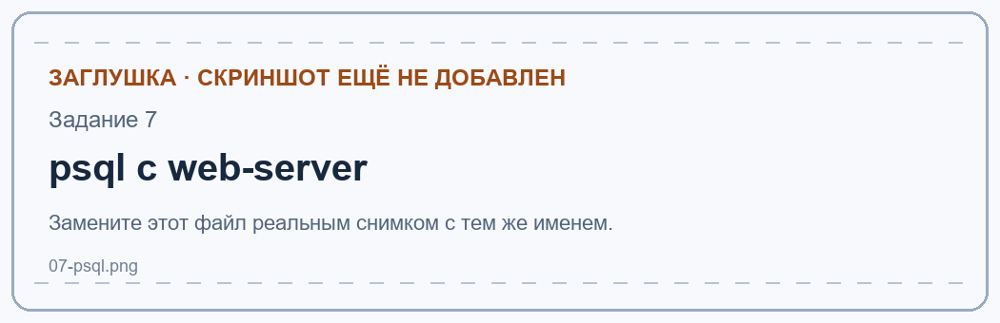

Команда `psql` с web-server выводит версию PostgreSQL на db-server.

Проверка TCP/5432 с web-server показывает `open`.

Проверка TCP/5432 с bastion показывает `closed`.

Правило Network ACL №90 блокирует домашний IP; с мобильного интернета сайт остаётся доступным.

В Tag Editor перечислены ресурсы с тегом `Project=timecapsule`.

### Контрольный вопрос

**Почему с web-server порт открыт, а с bastion — нет?**

Ответ: Локальный маршрут VPC есть у обоих, но `db-sg` разрешает порт 5432 только источнику `web-sg`. У bastion группа `bastion-sg`, поэтому его новое TCP-соединение к базе отбрасывается.

### Контрольный вопрос

**Почему после удаления NAT нет выхода из db-server и можно ли войти в БД из интернета?**

Ответ: В `private-rt` остался только локальный маршрут, поэтому внешнее назначение не достижимо. У db-server нет публичного IP, нет интернет-маршрута и `db-sg` не разрешает внешний источник на 5432; знание приватного IP само по себе не помогает.

### Контрольный вопрос

**Почему NACL блокирует SSH и сайт, но не телефон; зачем номер 90?**

Ответ: NACL действует на границе подсетей до правил SG; правило `Deny` для моего внешнего IP блокирует трафик с него к bastion и web-server. Телефон с мобильным интернетом имеет другой исходный IP и проходит через разрешающее правило №100. ACL проверяет правила по возрастанию номера и останавливается на первом совпадении; поэтому №90 должен быть раньше №100.

### Контрольный вопрос

**Как найти ресурсы проекта и зачем `Owner`?**

Ответ: В Tag Editor отфильтровать `Project=timecapsule` (при необходимости также `Environment=dev` и `Lab=lab3`), затем проверить дочерние диски, снимки и EIP. `Owner` показывает ответственного даже в общем аккаунте и помогает разбирать расходы, изменения и безопасное удаление.

# Часть 2. Продвинутый уровень

## Задание 8. Перенос сервера ЛР2

Запустить сервер ЛР2, создать AMI `timecapsule-dev-app-lab2` с тегами образа и снимка, запустить из него `timecapsule-dev-app` в `public-a` с `web-sg` и прежним ключом, добавить `Host app` с `ProxyJump bastion`. После проверки завершить временный `timecapsule-dev-web` из задания 5.

### Контрольный вопрос

**Что попало в образ и где база до переноса?**

Ответ: AMI содержит снимок корневого диска: ОС, установленные nginx/PHP/PostgreSQL, код, локальную `.env`, данные PostgreSQL и файлы `storage/uploads`, если всё лежало на этом диске. Сразу после запуска app-server приложение ещё подключается к локальной БД через `localhost`; перенос данных выполняется в задании 12.

## Задание 9. Elastic IP

Elastic IP `18.153.77.84` (`timecapsule-dev-app-eip`) привязан к app-server. В серверном `.env` задан `APP_URL=http://18.153.77.84`, PHP-FPM перезагружен. Приложение открывается по этому адресу; вход под исходной учётной записью ЛР2 успешен, на странице видна капсула ЛР2.

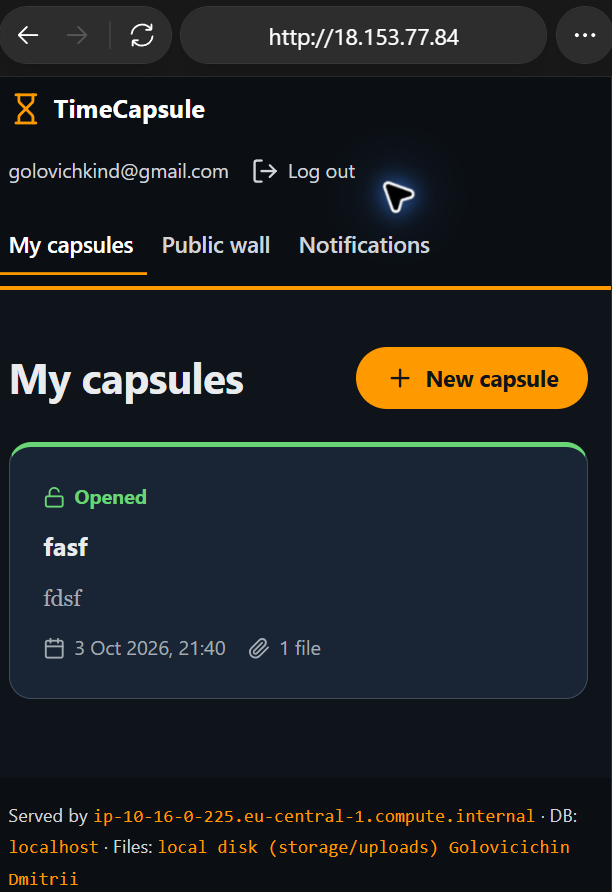

На снимке приложение открыто по Elastic IP `18.153.77.84`; после входа под исходной учётной записью ЛР2 видна капсула с вложением.

### Контрольный вопрос

**Зачем EIP приложению, сколько стоит и нужен ли он bastion/при ALB?**

Ответ: Постоянный IP сохраняет адрес приложения после остановки и запуска; bastion нужен только на время администрирования, а его изменившийся IP можно обновить в SSH config. По текущей цене AWS публичный IPv4 стоит `$0.005/час` как привязанный, так и свободный, поэтому EIP app-server продолжает стоить денег при остановке. После размещения приложения за публичным балансировщиком пользователи будут обращаться к DNS имени балансировщика, а app-server сможет работать без собственного EIP. [Тариф AWS](https://aws.amazon.com/vpc/pricing/).

## Задание 10. База приложения на db-server

На db-server созданы пользователь и база `timecapsule` с новым случайным паролем. Правило в `/var/lib/pgsql/data/pg_hba.conf` заменено на `host timecapsule timecapsule 10.16.0.0/24 scram-sha-256`; после перезапуска PostgreSQL работает. С app-server подключение `timecapsule` к новой базе успешно (`timecapsule|timecapsule`), а `student` к `lab3` получает `no pg_hba.conf entry`.

### Контрольный вопрос

**Зачем пароль, если SG закрывает порт?**

Ответ: SG ограничивает сетевой путь, но не удостоверяет пользователя БД. Пароль остаётся необходимым при ошибке правил SG, компрометации app-server или доступа другого разрешённого клиента; новый пароль также отделяет ЛР3 от старых учётных данных ЛР2.

## Задание 11. Приватная зона Route 53

Создана приватная зона `timecapsule.internal` (`Z06341272W3XX7KEJLXSJ`), связанная с VPC `timecapsule-dev-vpc` (`vpc-09b9beee88ce9816c`) в `eu-central-1`. Запись `db.timecapsule.internal` типа A указывает на приватный адрес базы `10.16.10.208`, TTL — 60 секунд.

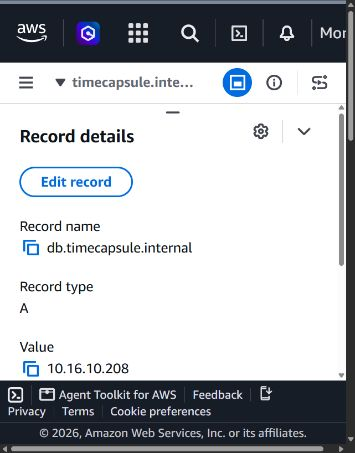

В Route 53 видны приватная зона и A-запись `db.timecapsule.internal` со значением `10.16.10.208`.

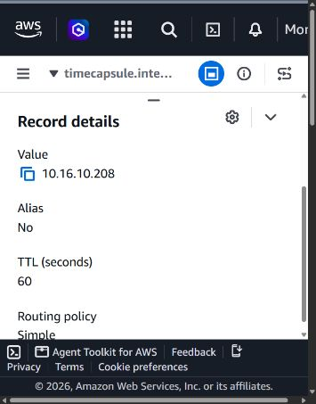

Для записи `db.timecapsule.internal` задан TTL 60 секунд.

Проверка из VPC: `ssh app 'dig +short db.timecapsule.internal'` вернула `10.16.10.208`. Проверка с моего компьютера: `nslookup db.timecapsule.internal` ответила `Non-existent domain` через домашний DNS `router.lan` (`192.168.88.1`).

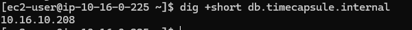

Команда `dig` на app-server возвращает приватный IP db-server.

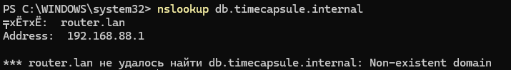

Команда `nslookup` на домашнем компьютере не получает приватную запись VPC.

### Контрольный вопрос

**Почему имя видно только приложению и что делать при замене db-server?**

Ответ: Route 53 Resolver отдаёт записи приватной зоны только из связанных VPC, а домашний DNS не видит эту зону. При пересоздании db-server нужно изменить A-запись на новый приватный IP и дождаться истечения TTL.

## Задание 12. Перенос данных

На app-server выгрузить локальную БД командой `pg_dump -h localhost -U timecapsule -d timecapsule -f timecapsule.sql`, затем загрузить её `psql -h db.timecapsule.internal -U timecapsule -d timecapsule -f timecapsule.sql`. В серверной `.env` задать `DB_HOST=db.timecapsule.internal` и новый `DB_PASSWORD`, выполнить `sudo systemctl reload php-fpm`, остановить локальный PostgreSQL. Проверить `/health` и капсулы ЛР2; только после успеха удалить AMI и связанный снимок.

Вывод `psql -f timecapsule.sql` подтверждает перенос таблиц и данных в db-server.

Endpoint `/health` возвращает состояние `db: ok` после переключения приложения.

На странице TimeCapsule видны капсулы, созданные в ЛР2.

### Контрольный вопрос

**Где вложения и что будет при удалении app-server?**

Ответ: В этом приложении загруженные файлы находятся на локальном диске в `/var/www/timecapsule/storage/uploads` при настройке `UPLOAD_DIR=storage/uploads`; `pg_dump` переносит только записи БД, а вложения попали на новый сервер через AMI. Если удалить app-server вместе с его EBS-томом без отдельной копии, файлы исчезнут. Снимок AMI тоже не заменяет регулярное резервное копирование.

## Задание 13. Деплой и обслуживание

Добавить видимую метку `LR3`, отправить изменение в GitHub и запустить существующий вариант B из ЛР2 командой `ssh app ./deploy.sh` через bastion. Затем остановить db-server, проверить `/health` и главную страницу, снова запустить БД. Для обновления `sudo dnf -y update` на db-server по специальности Informatică aplicată использовать вариант A: временно создать NAT в консоли, обновить пакеты и полностью удалить NAT, маршрут и его EIP.

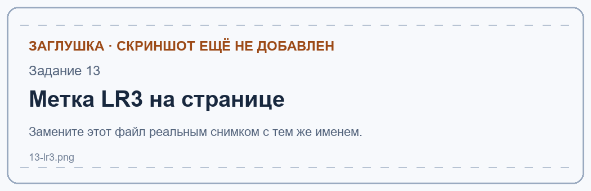

На странице приложения показана метка `LR3` после деплоя.

Endpoint `/health` сообщает об ошибке базы при остановленном db-server.

На db-server показан результат `sudo dnf -y update`.

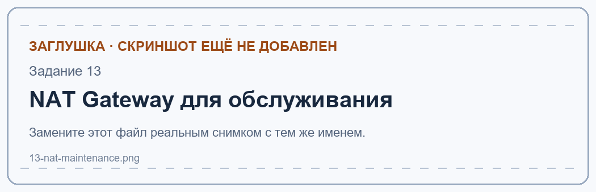

Во время обновления в списке NAT gateways виден временный шлюз варианта A.

### Контрольный вопрос

**Почему `deploy.sh` менять не пришлось?**

Ответ: Скрипт запускается на app-server и работает с тем же каталогом приложения и публичным GitHub. Изменился путь администратора к серверу (через bastion) и адрес БД в `.env`, но последовательность `git pull`, Composer, `init-db` и reload PHP-FPM осталась прежней.

### Контрольный вопрос

**Что покажет `/health`, изменится ли приватный IP БД?**

Ответ: Реализация TimeCapsule выполняет запрос к таблице `users`; при недоступной БД возвращает HTTP 500 с `"status":"error","db":"error"`. После повторного запуска того же EC2 с той же сетевой картой его основной приватный IP сохраняется, поэтому DNS-запись менять не нужно.

## Задание 14. Архитектура и ADR

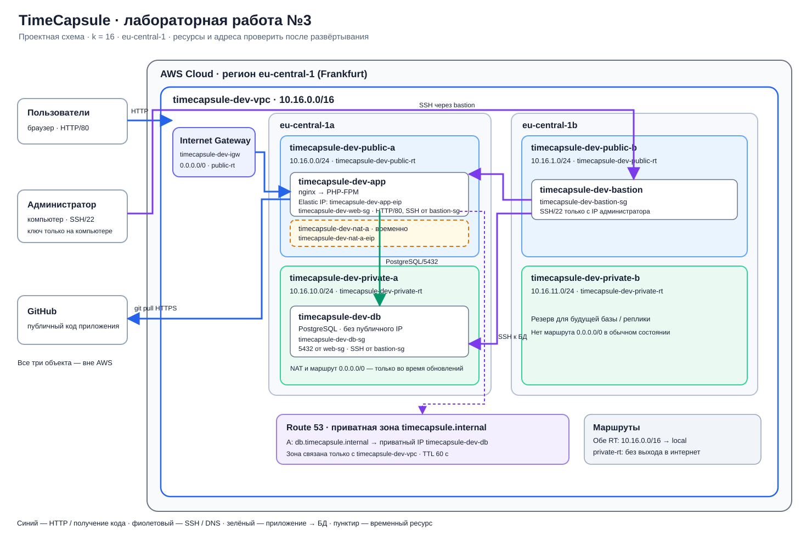

[Версия схемы в PNG](architecture.png).

Схема показывает пользователей, компьютер администратора и GitHub вне AWS; внутри региона eu-central-1 — VPC `10.16.0.0/16`, две зоны, четыре подсети, Internet Gateway, bastion, app-server, db-server, три Security Group, приватный DNS и временный NAT. Решение о размещении базы описано в [ADR-0002](../adr/0002-database-placement.md).

## Итоговое состояние ресурсов

После проверки остановить bastion, app-server и db-server; завершить старый сервер ЛР2. В NAT gateways не должно остаться шлюзов в состоянии `Available`, а в Elastic IPs — только `timecapsule-dev-app-eip`.

В списке Elastic IPs после работы остался только адрес app-server.

В списке NAT gateways нет шлюзов в состоянии `Available`.

## Вопросы для защиты

**Путь запроса.** Браузер идёт по HTTP/80 к публичному EIP app-server через Internet Gateway; `public-rt` направляет внешний трафик к IGW, `web-sg` разрешает HTTP. nginx передаёт PHP-запрос PHP-FPM; приложение разрешает `db.timecapsule.internal` в приватный IP и по локальному маршруту `10.16.0.0/16` соединяется с PostgreSQL на 5432, который принимает вход только от `web-sg`. Ответ возвращается по установленным соединениям; Security Group учитывают состояние соединения.

**Злоумышленник знает приватный IP БД.** Одного адреса мало: нужен сетевой путь внутрь VPC и возможность отправлять трафик от интерфейса с разрешённой `web-sg` (например, при компрометации app-server), а затем действительные учётные данные PostgreSQL, разрешённые `pg_hba.conf`. Прямого маршрута из интернета к приватному IP нет.

**Временный NAT.** Он оплачивается только в период установки и обновлений, а в остальное время база остаётся без общего исходящего пути в интернет. Недостаток — перед каждым обновлением приходится создавать шлюз и маршрут, ждать готовности и аккуратно удалять их вместе с EIP; забытый ресурс создаёт расходы.

**Отказ зоны `eu-central-1a`.** Сейчас и приложение, и база находятся в этой зоне, поэтому одна авария останавливает сервис. Для устойчивости потребуются экземпляр приложения в `public-b`, балансировщик перед приложениями, синхронная/реплицируемая БД или управляемая Multi-AZ БД в `private-b`, общее хранилище вложений и механизм автоматического переключения. Один лишь bastion в зоне b работу приложения не восстановит.
