# Лабораторная работа №2

## Облачные вычислительные сервисы. Amazon EC2

**ФИО:** Дмитрий Головичихин  
**Группа:** IA2403  
**Уровень:** Продвинутый  
**Приложение:** TimeCapsule
**Вариант деплоя:** B — скрипт `deploy.sh` 
**Репозиторий:** [dumkaguv-cloud/timecapsule](https://github.com/dumkaguv-cloud/timecapsule)

---

## Задание 1. Подготовка аккаунта

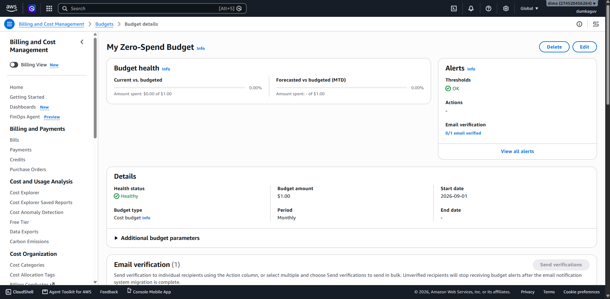

В списке AWS Budgets показан созданный бюджет `ZeroSpend`.

### Контрольный вопрос

**Что разрешает AdministratorAccess? Почему для повседневной работы нельзя использовать root?**

Ответ: `AdministratorAccess` предоставляет полный доступ к ресурсам AWS. Root имеет максимальные права на весь аккаунт, поэтому для обычной работы безопаснее использовать IAM-пользователя.

---

## Задание 2. Запуск EC2

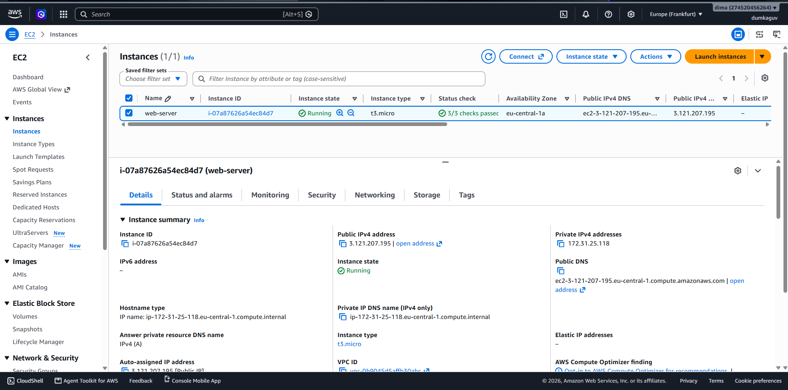

Экземпляр `web-server` находится в состоянии `Running` и успешно прошёл Status checks.

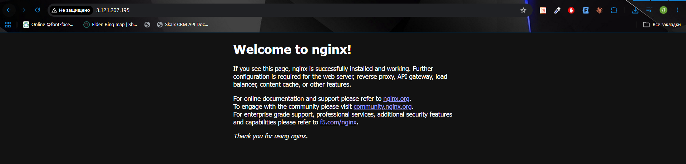

Стандартная страница nginx доступна в браузере по публичному IP экземпляра.

### Контрольный вопрос

**Что такое User data и когда выполняется этот скрипт? Выполнится ли он повторно после перезагрузки экземпляра?**

Ответ: User data — это скрипт первоначальной настройки EC2, который автоматически выполняется при первом запуске экземпляра. При обычной перезагрузке он повторно не выполняется.

---

## Задание 3. Мониторинг

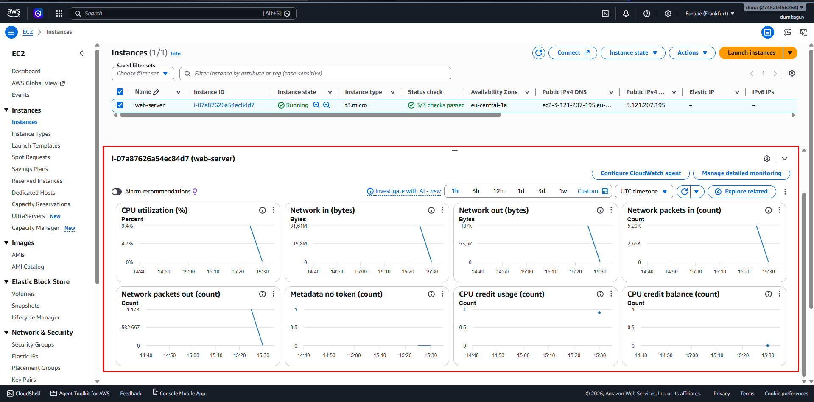

На скриншоте показаны метрики экземпляра во вкладке `Monitoring`.

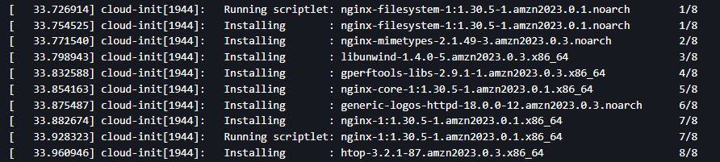

В `System log` показаны строки установки nginx через User data.

### Контрольный вопрос

**Какая из проверок укажет на проблему, которую можете исправить вы, а какая — на проблему на стороне AWS?**

Ответ: `Instance status check` показывает проблемы внутри виртуальной машины, которые обычно может исправить пользователь. `System status check` показывает проблемы инфраструктуры AWS.

### Контрольный вопрос

**В каких случаях стоит включать Detailed monitoring?**

Ответ: Detailed monitoring стоит использовать, когда необходимо получать метрики каждую минуту и быстрее замечать изменения нагрузки. Для обычных задач достаточно базового мониторинга раз в 5 минут.

---

## Задание 4. SSH

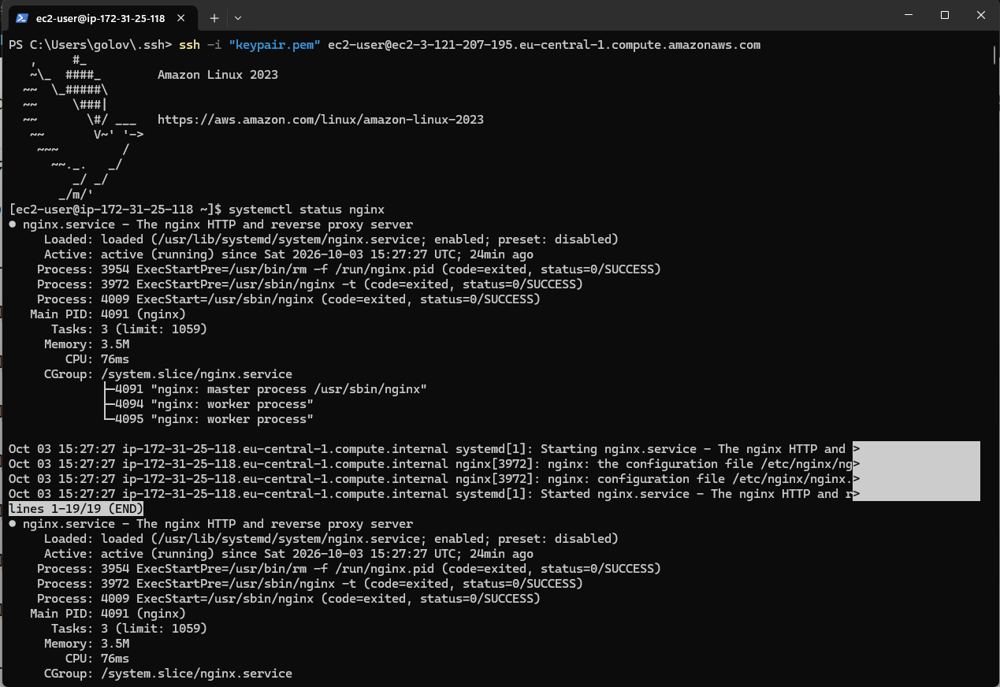

Показано успешное подключение к EC2 по SSH и вывод `systemctl status nginx`.

### Контрольный вопрос

**Почему для входа на экземпляр EC2 используется ключ, а не пароль?**

Ответ: SSH-ключ безопаснее обычного пароля и намного сложнее подобрать. Приватный ключ хранится только у пользователя.

---

## Задание 5. Статический сайт

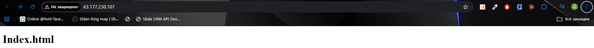

На скриншоте показан созданный статический сайт в браузере.

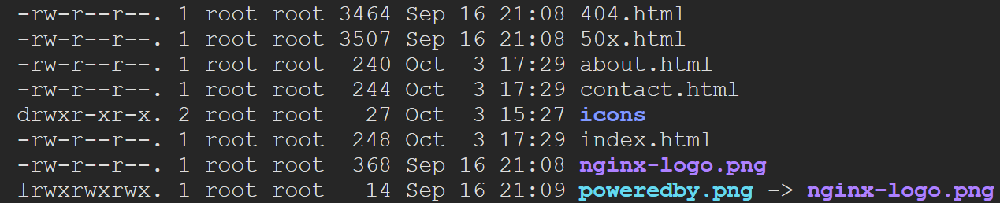

Показан вывод `ls -l /usr/share/nginx/html` с HTML-файлами сайта.

### Контрольный вопрос

**Что делает команда scp и чем она похожа на ssh?**

Ответ: `scp` используется для безопасного копирования файлов между компьютером и сервером. Как и `ssh`, она работает через защищённое SSH-соединение.

---

## Задание 6. AWS CLI

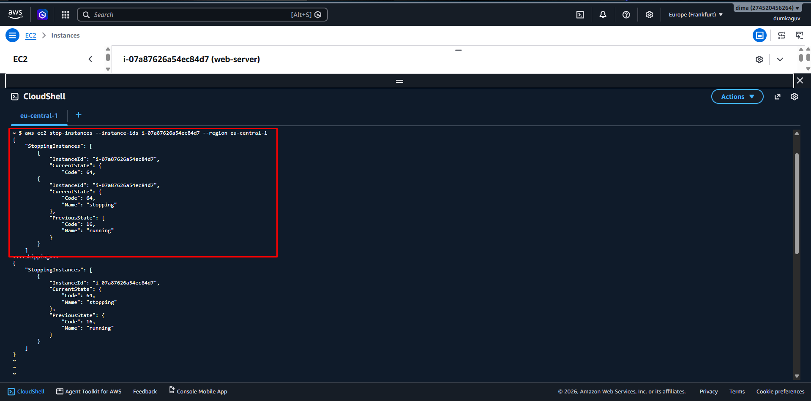

Показана команда `aws ec2 stop-instances` и результат остановки экземпляра.

### Контрольный вопрос

**Чем Stop отличается от Terminate? За что вы продолжаете платить, пока экземпляр остановлен?**

Ответ: `Stop` выключает экземпляр, но позволяет снова его запустить. `Terminate` удаляет экземпляр. После Stop может продолжаться оплата за EBS-диски и другие сохранённые ресурсы.

---

# Продвинутая часть

## Задание 7. GitHub

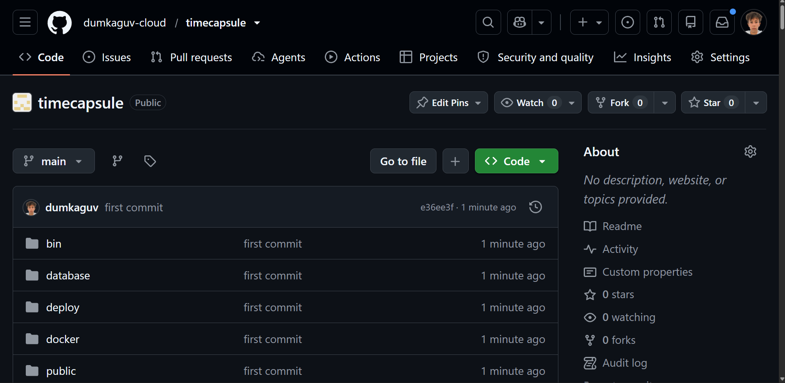

На скриншоте показан публичный репозиторий TimeCapsule в GitHub.

### Контрольный вопрос

**Почему папка vendor/ и файл .env не попали в репозиторий?**

Ответ: Они указаны в `.gitignore`, поэтому Git их не отслеживает. `vendor` можно восстановить через Composer, а `.env` содержит секретные настройки и пароли.

---

## Задание 8. Подготовка сервера

На сервер были установлены Git, Composer, PostgreSQL, PHP-FPM и необходимые расширения PHP.

### Контрольный вопрос

**Почему мы устанавливаем эти пакеты вручную, а не добавляем их в User data?**

Ответ: User data использовался для первоначальной настройки экземпляра. Установка пакетов вручную позволяет выполнять настройку приложения поэтапно и проще находить возможные ошибки.

---

## Задание 9. PostgreSQL

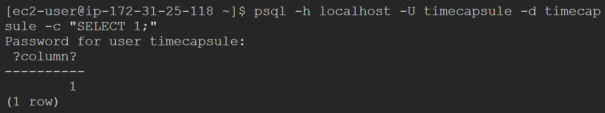

Показан успешный результат команды `psql -h localhost -U timecapsule -d timecapsule -c "SELECT 1;"`.

---

## Задание 10. Развёртывание приложения

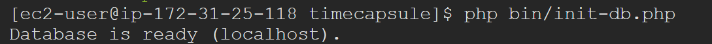

Показан успешный вывод команды `php bin/init-db.php`.

### Контрольный вопрос

**Почему пароль к базе данных хранится в файле .env на сервере, а не в коде в репозитории? Почему публичный репозиторий безопасен для этого приложения?**

Ответ: Пароль нельзя хранить в исходном коде, потому что он может попасть в публичный доступ. `.env` не добавляется в Git и хранится только на сервере, поэтому секретные данные не публикуются.

---

## Задание 11. nginx и PHP-FPM

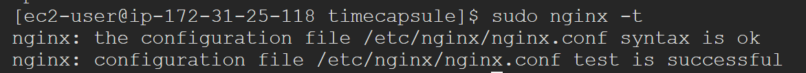

Показана успешная проверка конфигурации командой `sudo nginx -t`.

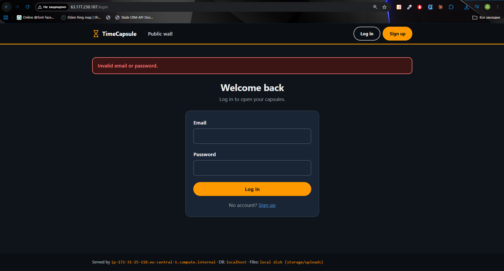

В браузере показано работающее приложение TimeCapsule.

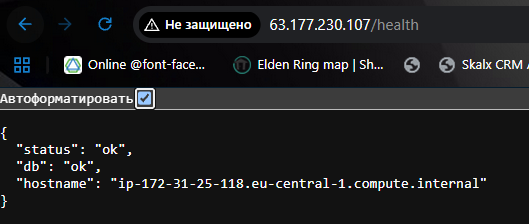

Показан успешный ответ endpoint `/health`.

---

## Задание 12. Deployment

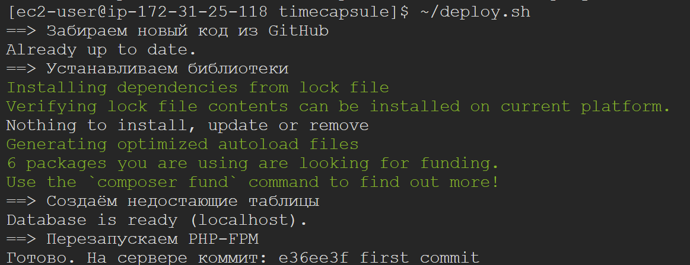

На скриншоте показан процесс развёртывания новой версии приложения.

### Контрольный вопрос

**Что может увидеть посетитель, который откроет сайт в момент выполнения git pull?**

Ответ: Во время `git pull` часть файлов может уже обновиться, а часть ещё оставаться старой. Поэтому пользователь может временно увидеть ошибку или некорректную страницу.

### Контрольный вопрос

**Что случится с сайтом, если после git pull не выполнится composer install?**

Ответ: Если новая версия использует новые зависимости, они не будут установлены. Из-за этого приложение может перестать работать.

---

## Задание 13. Обновление и rollback

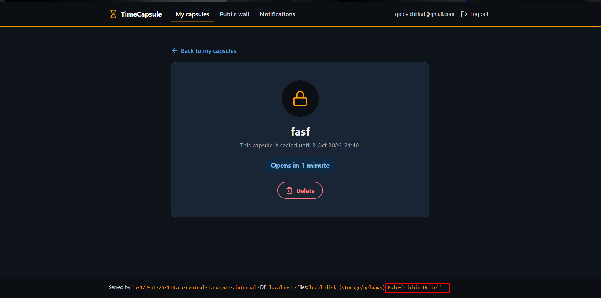

Показана новая версия приложения с внесённым изменением.

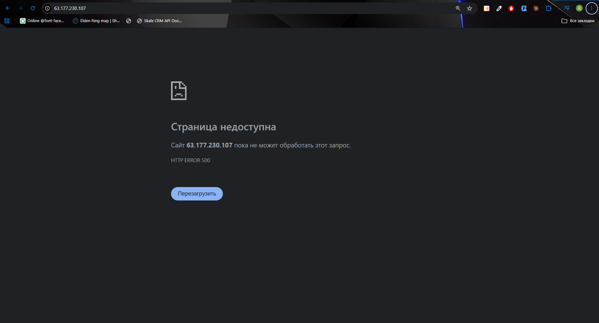

Показана ошибка `500` после намеренно сломанного деплоя.

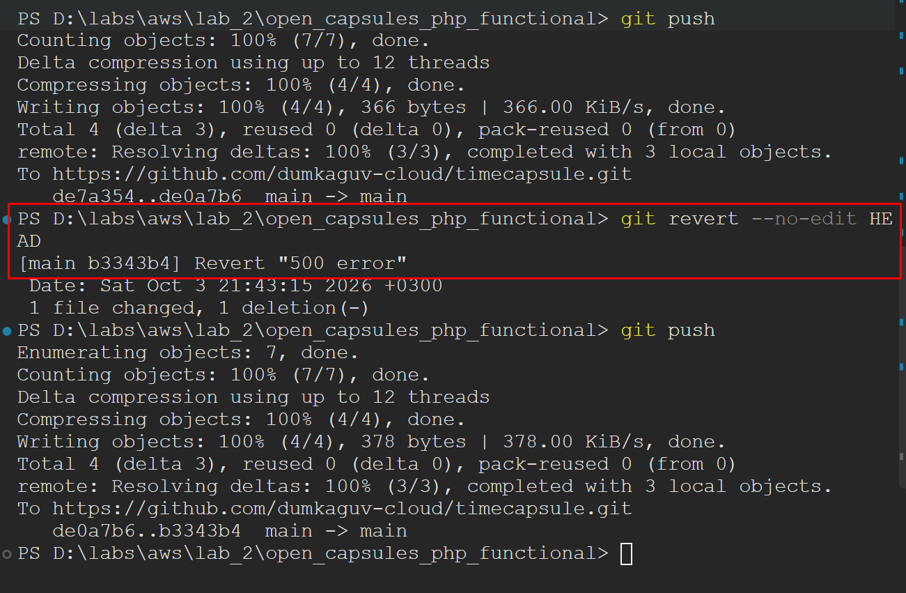

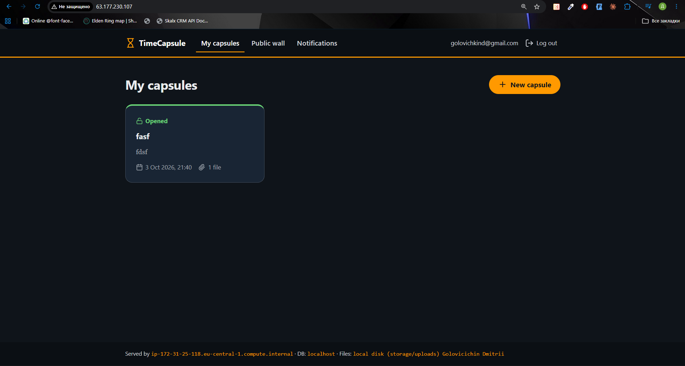

Показано работающее приложение после `git revert` и повторного деплоя.

### Контрольный вопрос

**Почему /health отвечает ok, хотя главная страница не работает? Что на самом деле проверяет этот адрес? Чего не хватает такой проверке?**

Ответ: `/health` проверяет только работу своего endpoint и доступность базы данных. Он не проверяет все страницы приложения, поэтому такой проверки недостаточно для полной проверки системы.

### Контрольный вопрос

**Сколько времени сайт был сломан? Из каких шагов сложилось это время? Как можно было бы сократить его?**

Ответ: Время простоя считается от появления сломанной версии до успешного восстановления сайта. Оно состоит из обнаружения ошибки, `git revert`, `git push` и повторного деплоя. Сократить его можно с помощью автоматических тестов и CI/CD.

---

## Архитектура

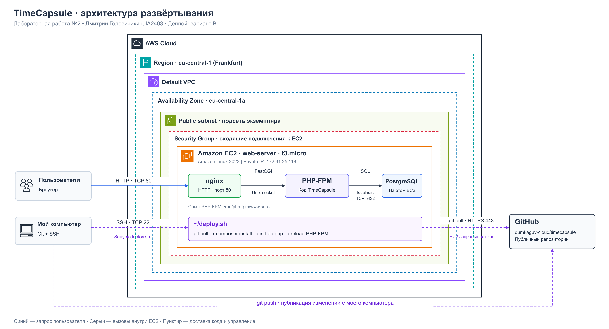

На схеме показан экземпляр `web-server` в регионе `eu-central-1`, зоне доступности `eu-central-1a`, default VPC и публичной подсети. Внутри EC2 работают nginx, PHP-FPM и PostgreSQL. Пользователи обращаются к nginx по HTTP, а PHP-приложение подключается к базе данных через `localhost:5432`.

Изменения отправляются с компьютера разработчика в GitHub командой `git push`. Скрипт `deploy.sh` запускается на EC2 через SSH; сервер сам получает код из GitHub по HTTPS. Стрелка от EC2 к GitHub обозначает инициатора запроса на получение кода.

[Редактируемая схема draw.io](open_capsules_php_functional/docs/architecture.drawio) · [Векторная версия SVG](open_capsules_php_functional/docs/architecture.svg)

Использованы официальные [AWS Architecture Icons](https://aws.amazon.com/architecture/icons/). Имя экземпляра, тип, зона доступности и частный IP взяты со скриншота задания 2. Default VPC и публичная подсеть показаны в соответствии с выполненной последовательностью лабораторной; их идентификаторы и имя Security Group на имеющихся скриншотах не указаны. Security Group изображена как граница доступа к экземпляру.

---

## ADR

[ADR-0001 — развёртывание с помощью deploy.sh](open_capsules_php_functional/docs/adr/0001-deploy-method.md)

---

## Контрольные вопросы

### 1. Как проходит запрос от браузера до базы данных в вашем развёртывании? Какую роль играет каждая программа?

Ответ: Браузер отправляет HTTP-запрос в nginx. nginx отдаёт статические файлы сам, а PHP-запросы передаёт PHP-FPM. Приложение при необходимости обращается к PostgreSQL и возвращает результат пользователю.

### 2. Почему сервер может скачивать код из репозитория, но не может отправлять в него изменения? Почему для сервера это правильно?

Ответ: Репозиторий публичный, поэтому сервер может скачивать код без авторизации. Для отправки изменений нужны права записи, которых серверу не предоставляют. Это безопаснее в случае взлома сервера.

### 3. Что произойдёт с загруженными пользователями файлами, если удалить экземпляр EC2? Как это связано с EBS?

Ответ: Если EBS-том удаляется вместе с экземпляром EC2, находящиеся на нём файлы будут потеряны. Если EBS-том сохранить, данные можно оставить после удаления экземпляра.

### 4. Что общего у deploy.sh или последовательности команд варианта A с тем, что делают системы CI/CD? Чего в вашем процессе ещё не хватает?

Ответ: Как и CI/CD, процесс деплоя забирает код из репозитория, устанавливает зависимости и запускает новую версию приложения. В нём пока не хватает автоматического запуска после `git push`, автоматических тестов и автоматического отката.

---

## Вывод

В ходе лабораторной работы был создан и настроен экземпляр Amazon EC2, установлен nginx и настроено подключение по SSH. Также было развёрнуто приложение TimeCapsule с PostgreSQL, настроено обновление приложения через GitHub и выполнен откат после неудачного деплоя.
