# Лабораторная работа №4

## Облачные хранилища. Amazon S3

| Данные | Значение |
| --- | --- |
| ФИО | Дмитрий Головичихин |
| Группа | IA2403 |
| Специальность | Informatică aplicată |
| Уровень | Продвинутый, задания 1–14 |
| Приложение | TimeCapsule |
| Репозиторий | [dumkaguv-cloud/timecapsule](https://github.com/dumkaguv-cloud/timecapsule) |
| Регион | eu-central-1 (Frankfurt) |
| Бакет | `timecapsule-dev-uploads-dumkaguv` |

> Шаблон отчёта. Результаты, снимки экрана и ответы добавлять по мере выполнения заданий. Для продвинутого уровня итоговый отчёт должен находиться в `docs/lab4/README.md` репозитория приложения.

## Цель и исходное состояние

**Цель:** хранить вложения TimeCapsule в закрытом бакете S3, управлять версиями, жизненным циклом и доступом; для продвинутого уровня перенести файлы с диска app-server в S3.

**Исходное состояние из ЛР3:** [кратко описать приложение, серверы и место хранения вложений]

**Именование и теги:** `Project=timecapsule`, `Environment=dev`, `Lab=lab4`, `Owner=<nickname>`, `Name=<полное имя ресурса>`.

# Часть 1. Базовый уровень

## Задание 1. Бакет и объекты в консоли

**Выполнение:** В бакете `timecapsule-dev-uploads-dumkaguv` под префиксом `uploads/` находятся `image.webp` и `aml-837865.pdf`. Вывод CLI также показывает `backups/asd.txt` размером 0 байт.

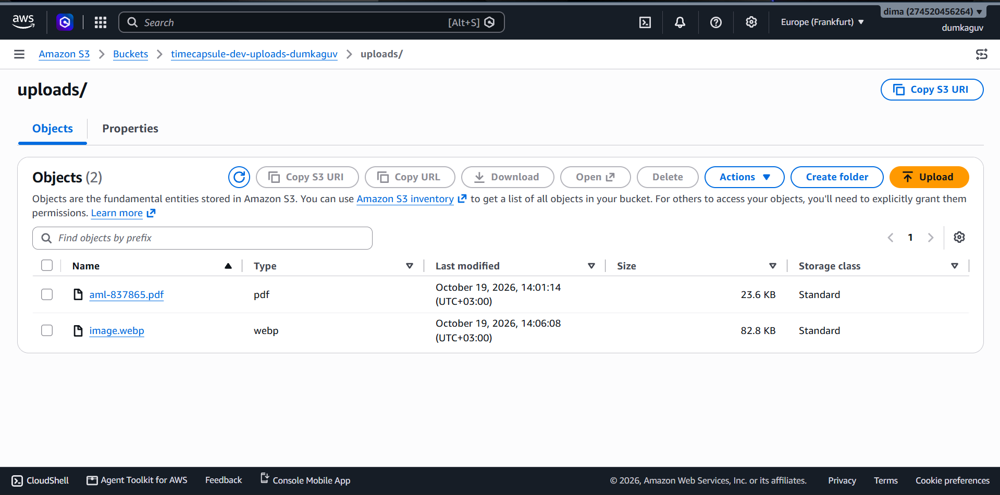

**Свойства картинки:**

| Параметр | Значение |
| --- | --- |
| Ключ | `uploads/image.webp` |
| ETag | `6d3fce6adbaa95081a9a6ecae0267add` |
| Object URL | `https://timecapsule-dev-uploads-dumkaguv.s3.eu-central-1.amazonaws.com/uploads/image.webp` |
| Content-Type | `image/webp` (подтверждено `head-object` в задании 2) |
| Шифрование объекта | `AES256` (SSE-S3, подтверждено `head-object`) |

**Проверка доступа:** в консоли подтверждены `Block all public access: On` и `Object Ownership: Bucket owner enforced` (ACLs disabled). Наличие префиксов `uploads/` и `backups/` видно в выводе CLI задания 2.

**Ещё нужно добавить:** настройки шифрования бакета SSE-S3 и первоначальное состояние версионирования.

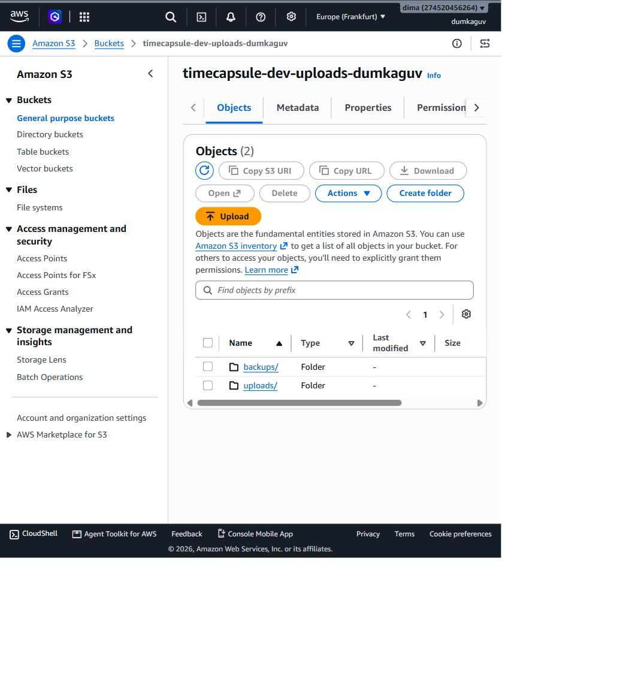

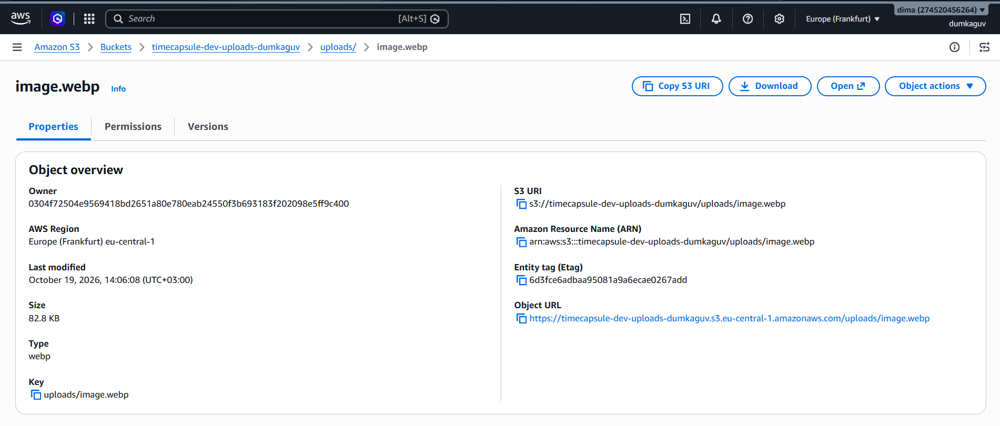

При открытии прямого Object URL браузер получил `AccessDenied`.

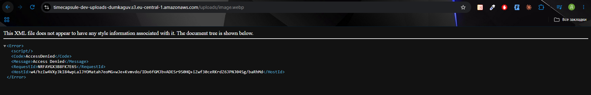

**Контрольные вопросы:**

1. **Какой ключ у картинки?** `uploads/image.webp`.
2. **Почему Object URL не открывается, хотя вы владелец бакета?** Прямой URL отправляет запрос к S3 без подписи. Авторизация в консоли AWS не даёт этому запросу права на чтение закрытого объекта, поэтому S3 возвращает `AccessDenied`.
3. **Что на самом деле создала кнопка Create folder?** В S3 нет настоящих каталогов: консоль создаёт объект нулевого размера с ключом, оканчивающимся на `/`, например `uploads/`. Остальные объекты группируются в интерфейсе по общему префиксу ключа.

## Задание 2. Объекты из командной строки

**Выполнение:** Вывод CLI показывает `uploads/photo.txt`, `uploads/2026/10/report.txt`, `uploads/2026/10/report-2.txt` и созданные ранее файлы. Скачивание `photo.txt` и удаление `report-2.txt` ещё нужно показать; в текущем выводе `report-2.txt` присутствует.

**Вывод `aws s3 ls s3://$BUCKET`:**

```text
                           PRE backups/
                           PRE uploads/
```

**Вывод `aws s3 ls s3://$BUCKET/uploads/`:**

```text
                           PRE 2026/
2026-10-19 10:59:20          0
2026-10-19 11:01:14      24183 aml-837865.pdf
2026-10-19 11:06:08      84772 image.webp
2026-10-19 11:16:37         18 photo.txt
```

**Вывод `aws s3 ls s3://$BUCKET --recursive`:**

```text
2026-10-19 11:02:22          0 backups/
2026-10-19 11:02:51          0 backups/asd.txt
2026-10-19 10:59:20          0 uploads/
2026-10-19 11:16:46         17 uploads/2026/10/report-2.txt
2026-10-19 11:16:46         15 uploads/2026/10/report.txt
2026-10-19 11:01:14      24183 uploads/aml-837865.pdf
2026-10-19 11:06:08      84772 uploads/image.webp
2026-10-19 11:16:37         18 uploads/photo.txt
```

**`head-object` для `uploads/image.webp`:** `ContentLength=84772`, `ContentType=image/webp`, `ETag=6d3fce6adbaa95081a9a6ecae0267add`, `ServerSideEncryption=AES256`. Метаданные `uploads/2026/10/report.txt` ещё нужно добавить.

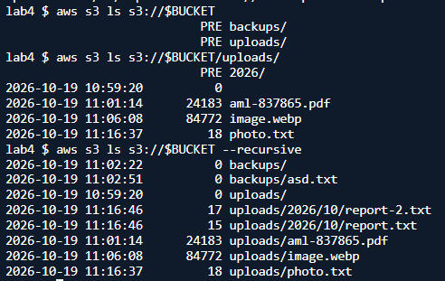

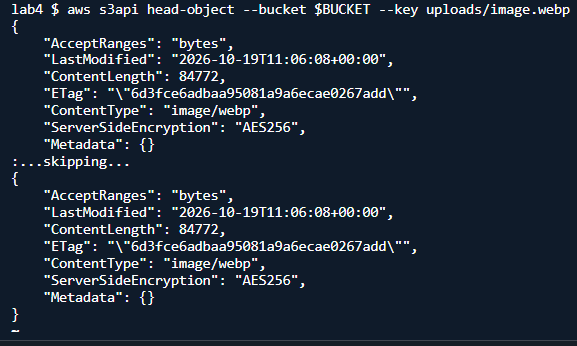

**Контрольные вопросы:**

1. **Почему первая команда `ls` показывает `PRE uploads/` и `PRE backups/`, а третья — полные ключи?** Обычный `ls` группирует объекты по общим префиксам, изображая их как папки. Параметр `--recursive` отключает такое представление и показывает полные ключи всех объектов, включая нулевые объекты-маркеры `uploads/` и `backups/`.
2. **Какой Content-Type получил `report.txt` без явного указания?** [проверить через `head-object` для `uploads/2026/10/report.txt`]

## Задание 3. Политика бакета: только HTTPS

**Политика бакета:** в разделе Permissions сохранён явный запрет всех действий с бакетом и его объектами для запросов без HTTPS. `Block all public access` остался включённым.

```json
{
  "Version": "2012-10-17",
  "Statement": [
    {
      "Sid": "DenyInsecureTransport",
      "Effect": "Deny",
      "Principal": "*",
      "Action": "s3:*",
      "Resource": [
        "arn:aws:s3:::timecapsule-dev-uploads-dumkaguv",
        "arn:aws:s3:::timecapsule-dev-uploads-dumkaguv/*"
      ],
      "Condition": {
        "Bool": {
          "aws:SecureTransport": "false"
        }
      }
    }
  ]
}
```

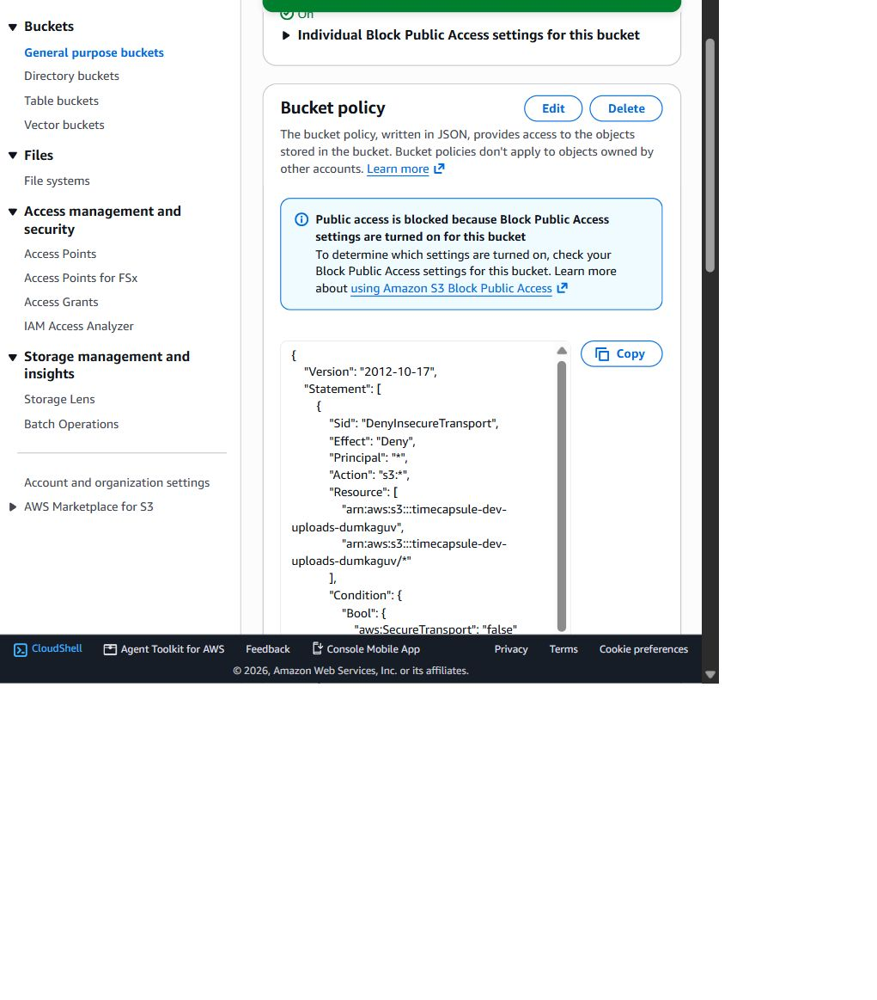

**Проверка по HTTPS:**

```text
                           PRE 2026/
2026-10-19 10:59:20          0
2026-10-19 11:01:14      24183 aml-837865.pdf
2026-10-19 11:06:08      84772 image.webp
2026-10-19 11:16:37         18 photo.txt
```

**Проверка по HTTP:**

```text
aws: [ERROR]: An error occurred (AccessDenied) when calling the ListObjectsV2 operation:
User: arn:aws:iam::274520456264:user/dumkaguv is not authorized to perform:
s3:ListBucket on resource: "arn:aws:s3:::timecapsule-dev-uploads-dumkaguv"
with an explicit deny in a resource-based policy
```

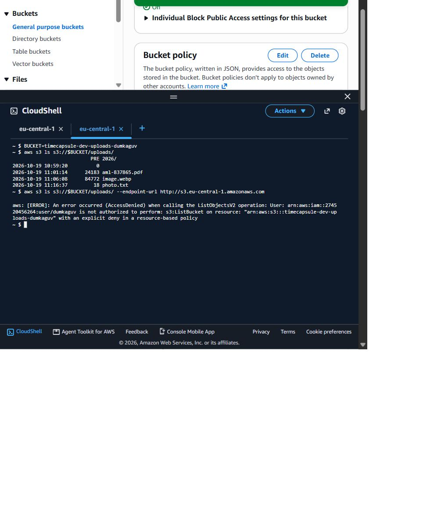

**Контрольные вопросы:**

1. **Почему запрос по HTTP получает AccessDenied при правах администратора?** Политика бакета содержит явный `Deny` для запросов с `aws:SecureTransport=false`. Явный запрет в политике ресурса имеет приоритет над разрешениями IAM-пользователя, включая административные.
2. **Почему Block Public Access позволил сохранить политику с `"Principal": "*"`?** Звёздочка в этом правиле обозначает всех участников, но правило запрещает доступ, а не предоставляет его. Block Public Access блокирует политики, открывающие публичный доступ; эта политика только ограничивает запросы по HTTP.

## Задание 4. Версионирование и защита от удаления

**Выполнение:** в свойствах бакета подтверждено `Bucket Versioning: Enabled`. У объектов, загруженных до включения версионирования, Version ID равен `null`. На раннем снимке `notes.txt` видны две версии размером 2 байта: от 20.10.2026 17:38:23 и 17:38:41. Поздняя версия впоследствии была удалена, ранняя стала текущей.

Чтобы проверить обычное удаление при включённом версионировании, `uploads/notes.txt` удалён из списка без показа версий. Объект исчез из обычного списка, а при включении Show versions появился новый Delete marker от 20.10.2026 17:53:07 с собственным Version ID `OJoUQIp44jZLH0BTYWh9yD6RIQWoQ2NY`; версия файла осталась под ним. Затем удалён только этот маркер, и ранняя версия `notes.txt` снова стала текущей.

На раннем снимке был ещё один маркер с Version ID `null`. [AWS описывает такой маркер](https://docs.aws.amazon.com/AmazonS3/latest/userguide/DeletingObjectsfromVersioningSuspendedBuckets.html) для удаления при приостановленном версионировании. Состояние бакета во время того удаления не проверялось; повторная проверка выше выполнена при статусе `Enabled`.

**Доказательства:**

- [x] Bucket Versioning имеет статус `Enabled`.
- [x] У ранее загруженных объектов Version ID равен `null`.
- [x] На раннем снимке видны две версии `uploads/notes.txt`.
- [x] Новое обычное удаление создало маркер с отдельным Version ID; версия файла сохранилась.
- [x] После удаления маркера ранняя версия `notes.txt` снова текущая.
- [ ] Фактический текст `v1` и `v2` проверен открытием или скачиванием файлов.

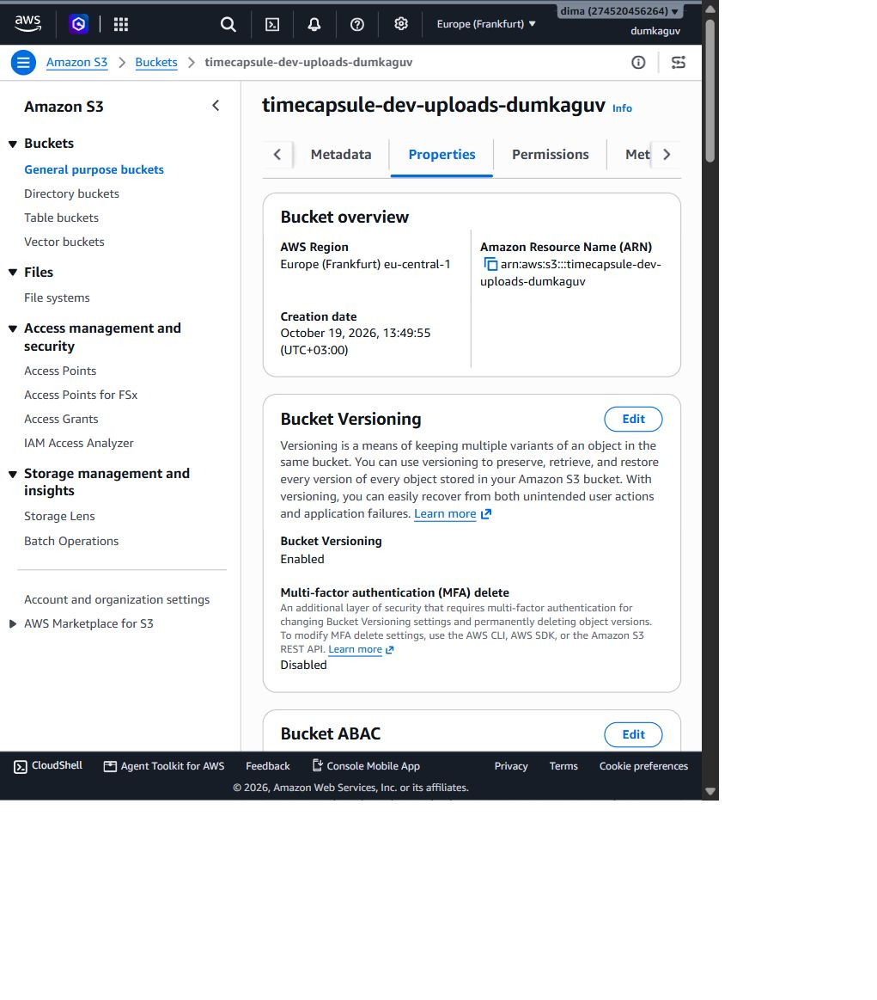

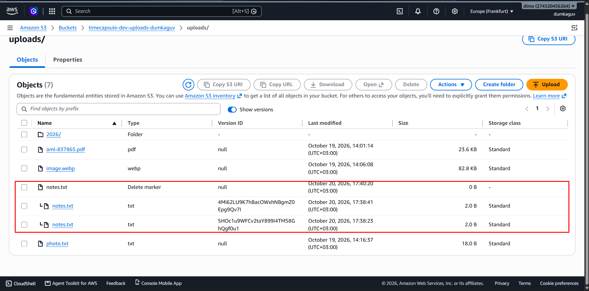

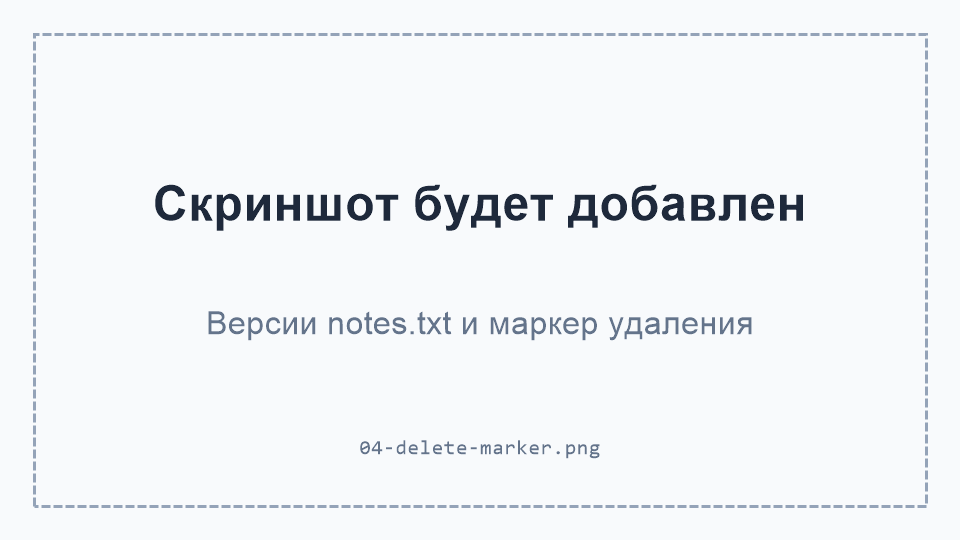

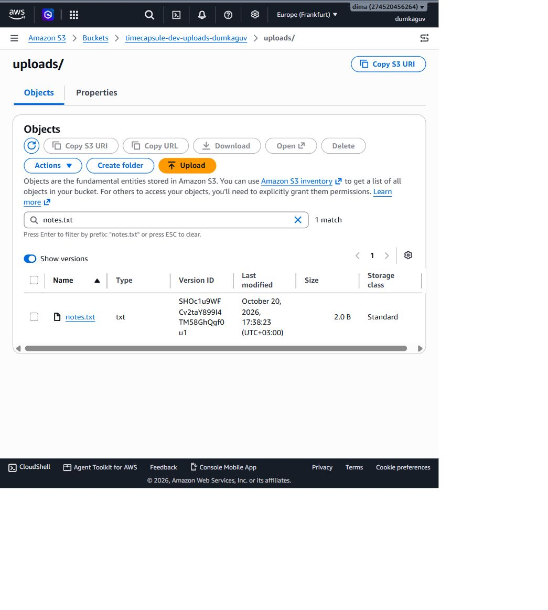

**Контрольные вопросы:**

1. **Чем обычное удаление объекта отличается от удаления конкретной версии?** При включённом версионировании удаление без Version ID добавляет маркер: объект перестаёт открываться по обычному ключу, но его версии сохраняются. Удаление с Version ID безвозвратно убирает именно указанную версию.
2. **Какое удаление можно отменить?** Удаление без Version ID можно отменить, удалив маркер. Удаление конкретной версии отменить средствами S3 нельзя.
3. **Что защищает от случайного удаления и какое действие нужно запрещать приложению?** Включённое версионирование сохраняет прежние версии при обычном удалении. Приложению не следует предоставлять `s3:DeleteObjectVersion`; для обычного удаления ему достаточно `s3:DeleteObject`.

## Задание 5. Правило жизненного цикла

**Выполнение:** правило `timecapsule-dev-noncurrent` включено. Фильтр исправлен на точный префикс `uploads/`, поэтому объекты `backups/` не затрагиваются. Неактуальные версии переходят в Standard-IA через 30 дней; через 90 дней удаляются все, кроме двух самых новых неактуальных версий. Незавершённые multipart uploads под тем же префиксом удаляются через 7 дней. Для переходов действует стандартный порог размера 128 КБ.

**Доказательство:** на снимке видны статус `Enabled`, префикс `uploads/`, схема перехода и удаления версий, а также очистка незавершённых загрузок через 7 дней.

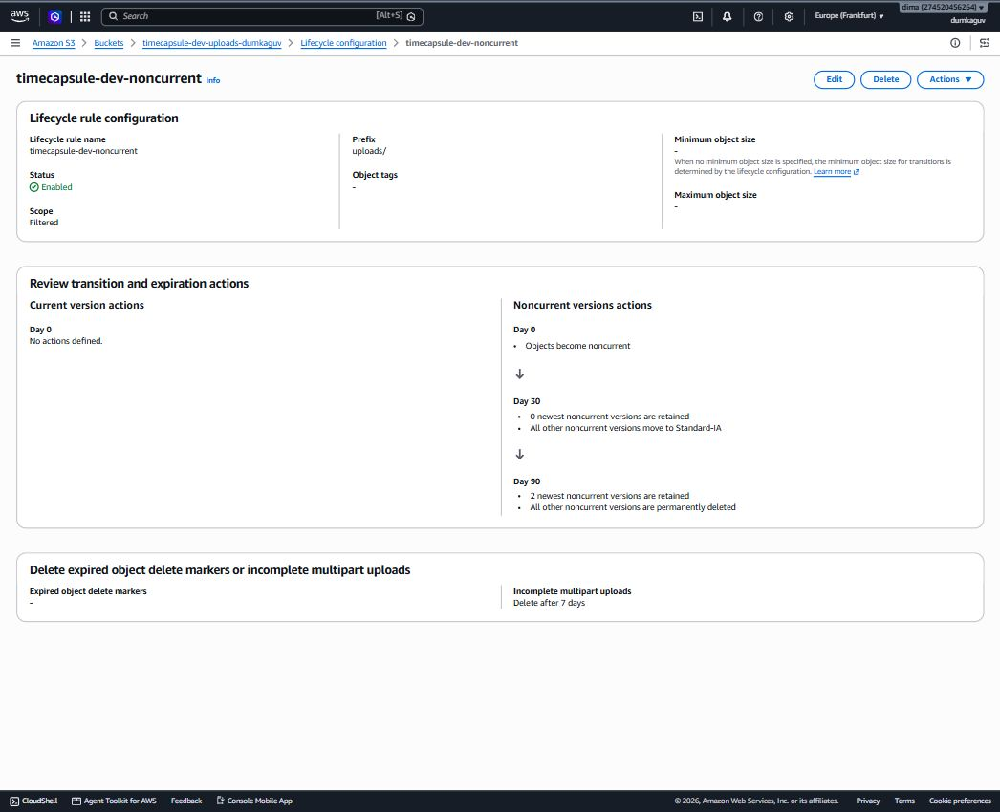

**Контрольные вопросы:**

1. **Что произойдёт после десяти перезаписей за неделю?** Останется одна текущая и десять неактуальных версий. Версии размером от 128 КБ перейдут в Standard-IA после 30 дней в неактуальном состоянии. После 90 дней неактуального состояния восемь старейших версий будут удалены, а две самые новые сохранятся; поскольку перезаписи сделаны в разные дни, сроки для отдельных версий тоже различаются.
2. **Почему маленькие тестовые файлы не попадут в Standard-IA?** По умолчанию [S3 не переводит объекты меньше 128 КБ](https://docs.aws.amazon.com/AmazonS3/latest/userguide/lifecycle-transition-general-considerations.html) в другой класс хранения. Это не отменяет удаления старых версий по отдельному действию правила.
3. **Что такое незавершённая загрузка частями и почему за неё платят?** Multipart upload передаёт объект отдельными частями. Если загрузку не завершить и не отменить, S3 [сохраняет уже переданные части](https://docs.aws.amazon.com/AmazonS3/latest/userguide/mpuoverview.html), и они занимают оплачиваемое место. Правило отменяет такие загрузки через 7 дней.

## Задание 6. Подписанные URL

**Проверки:** для `uploads/image.webp` через **Object actions → Share with a presigned URL** создана ссылка на 5 минут (`X-Amz-Expires=300`). Прямой адрес S3 открыл изображение в отдельной вкладке браузера. В CloudShell команда `aws s3 presign s3://timecapsule-dev-uploads-dumkaguv/uploads/photo.txt --expires-in 120 --region eu-central-1` создала ссылку на 2 минуты. Прямой запрос по ней без заголовка авторизации вернул HTTP 200 и содержимое `photo placeholder`; полная ссылка также открыта во вкладке браузера. Отдельного приватного окна в доступном браузере не было; проверка прямым запросом `curl` не использовала авторизацию AWS Console.

| Проверка | Ответ S3 |
| --- | --- |
| Подмена `photo.txt` на существующий `notes.txt` в URL | HTTP 403, `SignatureDoesNotMatch` — подпись не соответствует изменённому запросу. |
| Исходный URL после истечения 120 секунд | HTTP 403, `AccessDenied`, сообщение `Request has expired`. |

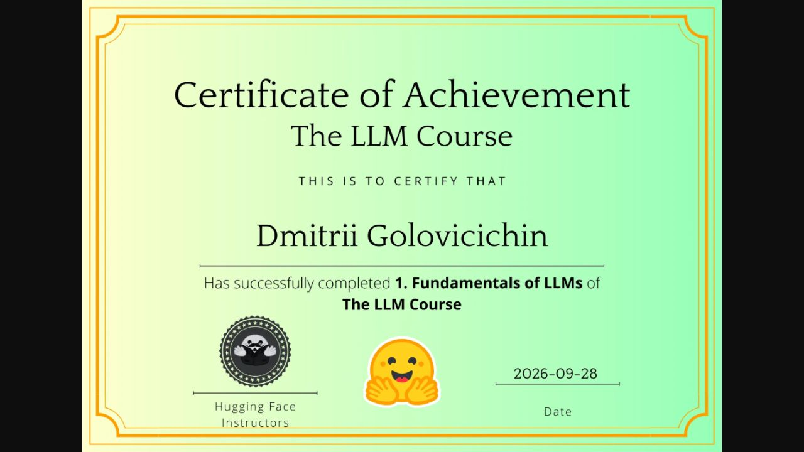

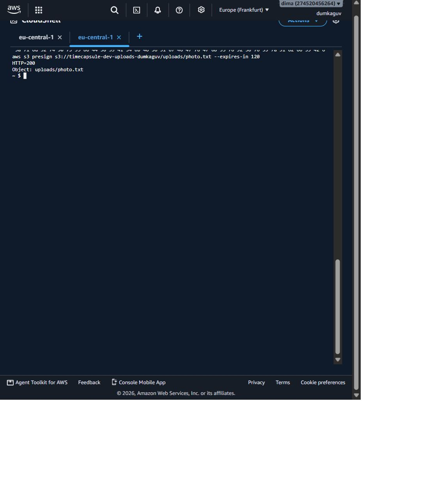

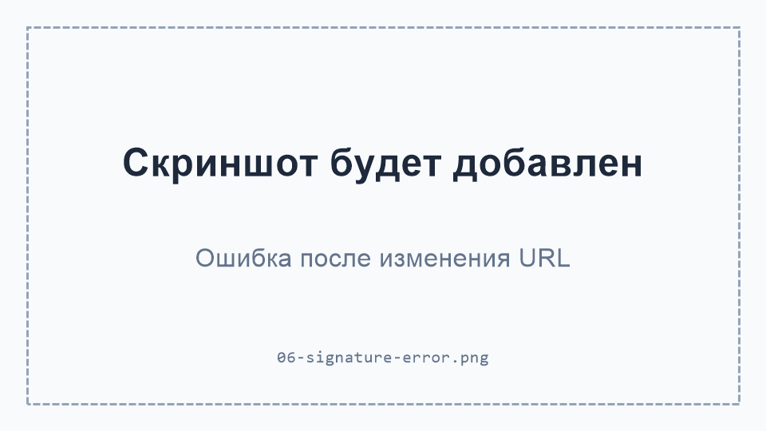

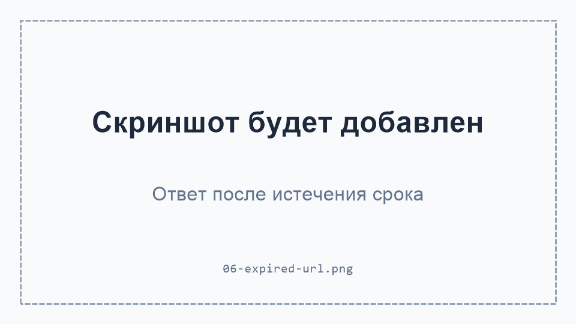

**Контрольные вопросы:**

1. **Почему нельзя получить другой объект, изменив ключ в подписанной ссылке?** Путь к объекту входит в [канонический запрос SigV4](https://docs.aws.amazon.com/AmazonS3/latest/API/sig-v4-header-based-auth.html). Изменение `photo.txt` на `notes.txt` меняет этот запрос, а прежняя подпись уже не подходит.
2. **Обращалась ли команда `aws s3 presign` к S3 при создании ссылки?** Нет. Она формирует и подписывает URL локально, используя доступные учётные данные. [Запрос к S3 происходит при открытии URL](https://docs.aws.amazon.com/AmazonS3/latest/developerguide/sigv4-query-string-auth.html): тогда проверяются подпись, срок и доступ к объекту. Получение временных учётных данных само по себе может требовать отдельного обращения к сервису выдачи учётных данных, но это не запрос к S3 за объектом.

**Очистка после Части 1:** в CloudShell удалена временная папка `~/lab4` и файлы ответов, созданные для этой проверки. Бакет сохранён для Части 2.

# Часть 2. Продвинутый уровень

## Задание 7. Политика приложения

**Политика `timecapsule-dev-app-s3`:** [вставить JSON: `ListBucket` только с префиксом `uploads/`; `GetObject`, `PutObject`, `DeleteObject` только для `uploads/*`; без доступа к `backups/` и удаления конкретных версий]

**Доказательство:** [добавить созданную политику и обязательные теги]

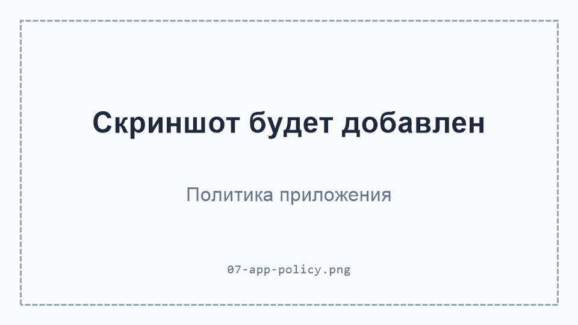

**Контрольные вопросы:**

1. Почему `s3:ListBucket` относится к ARN бакета, а `s3:GetObject` — к ARN объекта? — [ответ]
2. Что произойдёт, если перепутать ARN в двух правилах? — [ответ]

## Задание 8. Проверка прав через тестовую роль

**Роль:** `timecapsule-dev-s3-tester` (`arn:aws:iam::274520456264:role/timecapsule-dev-s3-tester`). Политика доверия разрешает `sts:AssumeRole` участникам этого AWS-аккаунта; прикреплена ровно одна политика прав — `timecapsule-dev-app-s3`. Теги: `Project=timecapsule`, `Environment=dev`, `Lab=lab4`, `Owner=dumkaguv`, `Name=timecapsule-dev-s3-tester`.

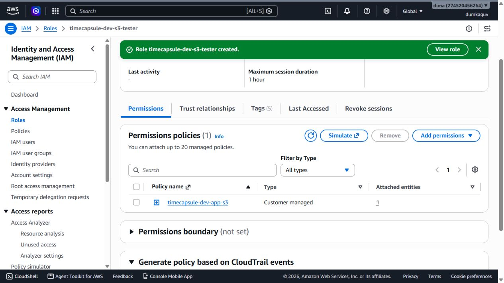

**`aws sts get-caller-identity --query '{Account:Account,Arn:Arn}' --output json` после `assume-role`:**

```text
{
    "Account": "274520456264",
    "Arn": "arn:aws:sts::274520456264:assumed-role/timecapsule-dev-s3-tester/lab4"
}
```

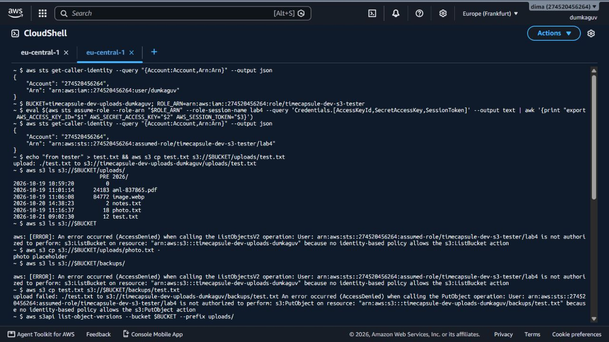

Колонка «Ожидаю» была заполнена до проверок. Для команды 8 идентификатор версии `XknGXjFFDMa3_AOzpEiUkt3GYouXg93p` получен через `head-object` после команды 1.

| № | Команда | Ожидаю | Получил | Какое правило сработало |
| ---: | --- | --- | --- | --- |
| 1 | `aws s3 cp test.txt s3://$BUCKET/uploads/test.txt` | Разрешено | `upload: ./test.txt to s3://.../uploads/test.txt` | Разрешение в политике приложения: `s3:PutObject` |
| 2 | `aws s3 ls s3://$BUCKET/uploads/` | Разрешено | Список объектов, включая `test.txt` | Разрешение в политике приложения: `s3:ListBucket` при `s3:prefix=uploads/` |
| 3 | `aws s3 ls s3://$BUCKET` | AccessDenied | AccessDenied на `s3:ListBucket` | Неявный запрет: пустой префикс не соответствует `uploads/*` |
| 4 | `aws s3 cp s3://$BUCKET/uploads/photo.txt -` | Разрешено | `photo placeholder` | Разрешение в политике приложения: `s3:GetObject` |
| 5 | `aws s3 ls s3://$BUCKET/backups/` | AccessDenied | AccessDenied на `s3:ListBucket` | Неявный запрет: `backups/` не соответствует `uploads/*` |
| 6 | `aws s3 cp test.txt s3://$BUCKET/backups/test.txt` | AccessDenied | AccessDenied на `s3:PutObject` | Неявный запрет: ARN объекта вне `uploads/*` |
| 7 | `aws s3api list-object-versions --bucket $BUCKET --prefix uploads/` | AccessDenied | AccessDenied на `s3:ListBucketVersions` | Неявный запрет: действие не разрешено |
| 8 | `aws s3api delete-object --bucket $BUCKET --key uploads/test.txt --version-id XknGXjFFDMa3_AOzpEiUkt3GYouXg93p` | AccessDenied | AccessDenied на `s3:DeleteObjectVersion` | Неявный запрет: действие не разрешено |
| 9 | `aws s3 rm s3://$BUCKET/uploads/test.txt` | Разрешено | `delete: s3://.../uploads/test.txt` | Разрешение в политике приложения: `s3:DeleteObject` |
| 10 | `aws s3 ls s3://$BUCKET/uploads/ --endpoint-url http://s3.eu-central-1.amazonaws.com` | AccessDenied | AccessDenied с `explicit deny in a resource-based policy` | Явный запрет в политике бакета: `aws:SecureTransport=false` |

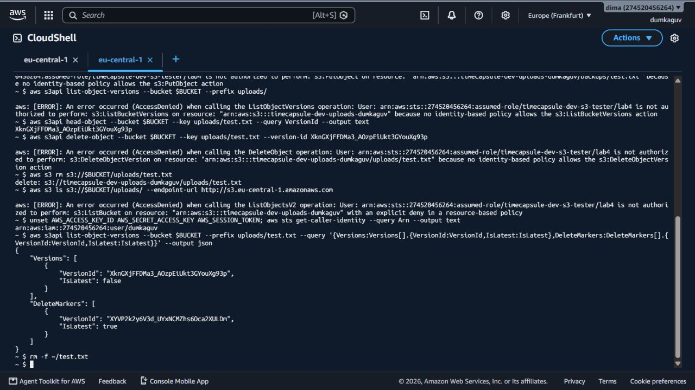

**Несовпадения ожидания и результата:** нет. После команды 9 под своим IAM-пользователем я проверил историю: версия `XknGXjFFDMa3_AOzpEiUkt3GYouXg93p` сохранилась, а новой текущей записью стал маркер удаления `XYVP2k2y6V3d_UYxNCMZhs6Oca2XULDm`. В конце выполнил `unset AWS_ACCESS_KEY_ID AWS_SECRET_ACCESS_KEY AWS_SESSION_TOKEN`; CloudShell снова показал `arn:aws:iam::274520456264:user/dumkaguv`. Локальный `~/test.txt` удалён.

**Контрольные вопросы:**

1. **Чем политика доверия роли отличается от политики прав?** Политика доверия определяет, кто может вызвать `sts:AssumeRole` для этой роли: в тесте это участники аккаунта `274520456264`, которым разрешено принимать роль. Политика прав определяет, какие действия доступны после принятия роли: здесь только четыре действия S3 в пределах `uploads/`.
2. **Что произошло с `test.txt` после команды 9, можно ли его восстановить?** S3 создал маркер удаления, поэтому объект исчез из обычного списка. Предыдущая версия сохранилась. Администратор с правом `s3:DeleteObjectVersion` может удалить маркер и вернуть файл; тестовая роль не может удалить конкретную версию или этот маркер.
3. **Может ли обладатель учётных данных приложения безвозвратно уничтожить файлы? Что изменилось бы при `"s3:*"`?** С текущими правами он может скрыть файлы маркерами удаления или перезаписать их, но не может сразу удалить прежние версии навсегда: `s3:DeleteObjectVersion` отсутствует. Старые версии всё же могут позже удаляться правилом жизненного цикла. При `s3:*` злоумышленник получил бы и право окончательно удалять версии объектов.

## Задание 9. Роль сервера

**Роль:** `timecapsule-dev-app-role`; доверие — EC2; прикреплена политика `timecapsule-dev-app-s3`; роль привязана к app-server.

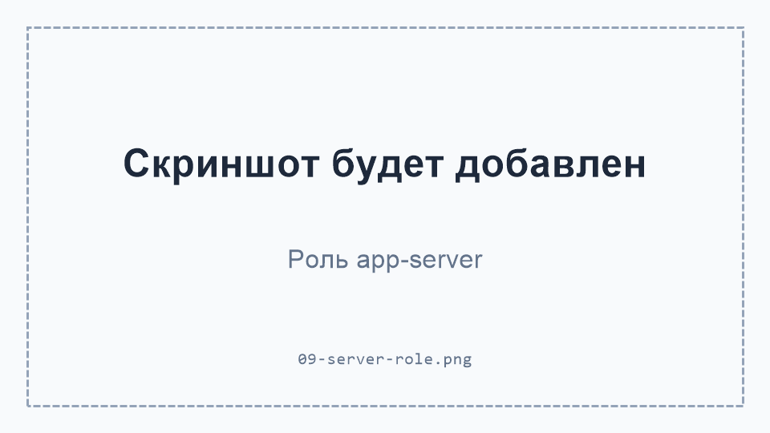

**`aws sts get-caller-identity` на app-server:**

```text
[вставить вывод]
```

**`aws s3 ls s3://$BUCKET/uploads/` на app-server:**

```text
[вставить вывод]
```

**`aws s3 ls s3://$BUCKET/backups/` на app-server:**

```text
[вставить вывод]
```

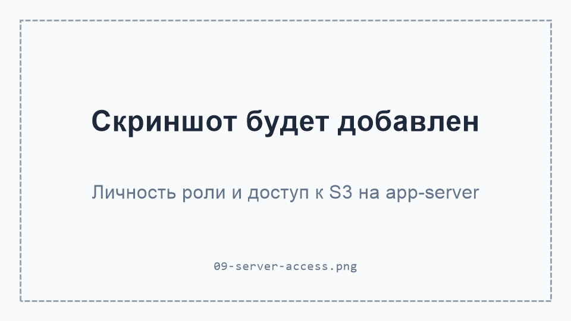

**Контрольные вопросы:**

1. Откуда AWS CLI получил учётные данные без `aws configure` и `assume-role`? — [ответ]
2. Чем политика доверия роли сервера отличается от тестовой? — [ответ]
3. Почему временные данные роли безопаснее ключа в `.env`? — [ответ]

## Задание 10. Перенос существующих файлов

**Путь исходных вложений:** [указать фактический путь на app-server]

**Первый `aws s3 sync ... --dryrun`:**

```text
[вставить вывод]
```

**Перенос `aws s3 sync ...`:**

```text
[вставить вывод]
```

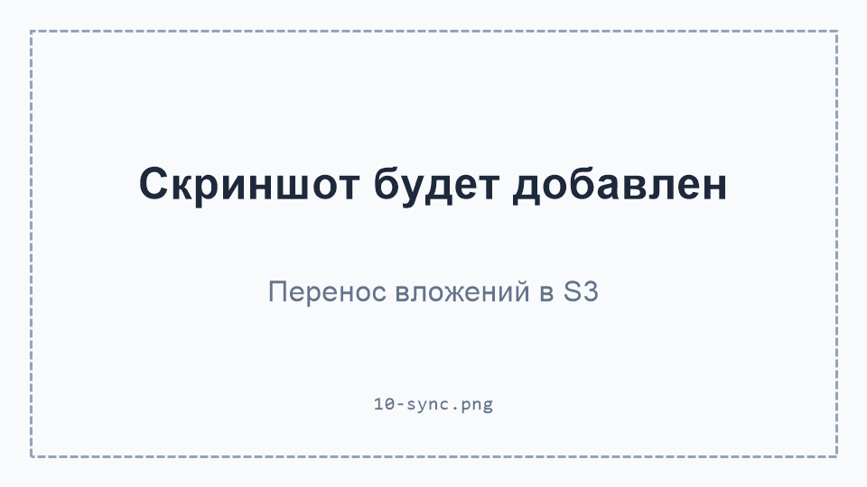

**Повторный `aws s3 sync ... --dryrun` и Content-Type перенесённого объекта:**

```text
[вставить вывод]
```

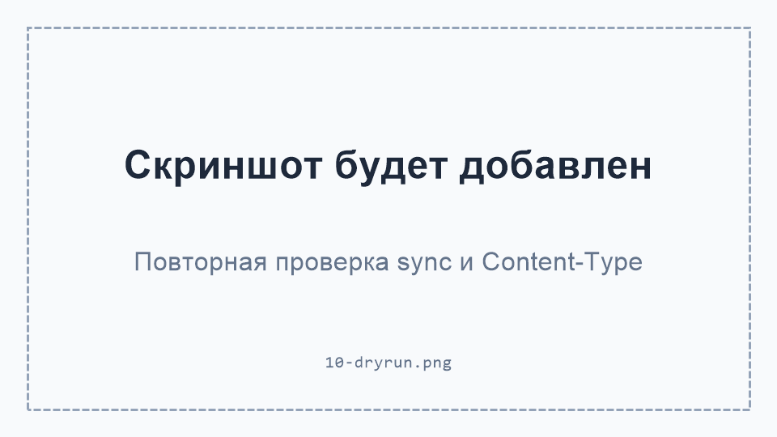

**Контрольные вопросы:**

1. Хватило ли политике приложения прав для `aws s3 sync`? — [ответ]
2. Какие разрешённые действия использовала команда? — [ответ]

## Задание 11. Модуль хранения на S3

**Изменения в репозитории:** [ссылка на коммит или файлы модуля хранения, `.env.example` и подвала страницы]

**Проверка требований:**

- [ ] `storage_save()` загружает объект в `uploads/` с верным Content-Type.
- [ ] `storage_delete()` удаляет объект без указания VersionId.
- [ ] `storage_stream()` после проверки прав пользователя возвращает HTTP 302 на подписанный URL на 5 минут; заданы тип, способ показа и исходное имя файла.
- [ ] SDK использует роль EC2 и настройки `S3_BUCKET`, `AWS_REGION`; постоянных ключей доступа в `.env` нет.
- [ ] Подвал показывает имя бакета.

**Результат:** [описать реализацию и проверку без вставки секретов]

## Задание 12. Деплой и проверка

**Деплой:** [версия/коммит, команда выпуска, установка зависимостей, перезапуск приложения]

**Доказательства:**

- [ ] Новые объекты картинки и PDF под `uploads/` с Content-Type.
- [ ] Адресная строка при открытии картинки: адрес S3 и параметры `X-Amz-*` (без полной действующей подписи).
- [ ] PDF скачивается под исходным именем.
- [ ] Старое вложение из ЛР2 открывается через S3.
- [ ] Ответ S3 на ссылку после 5 минут.
- [ ] Версии объекта после удаления капсулы.

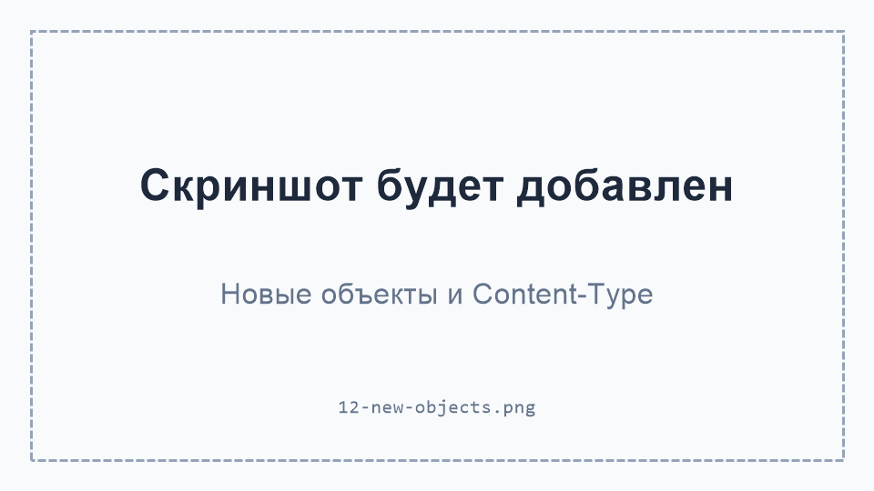

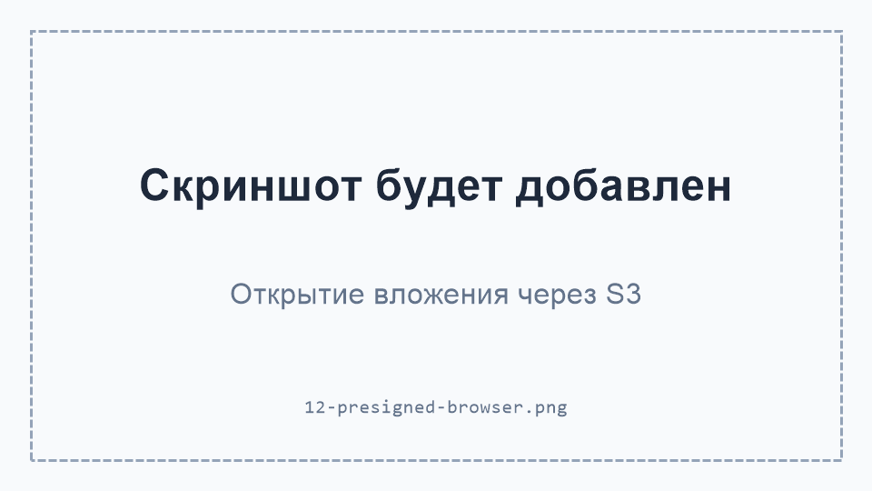

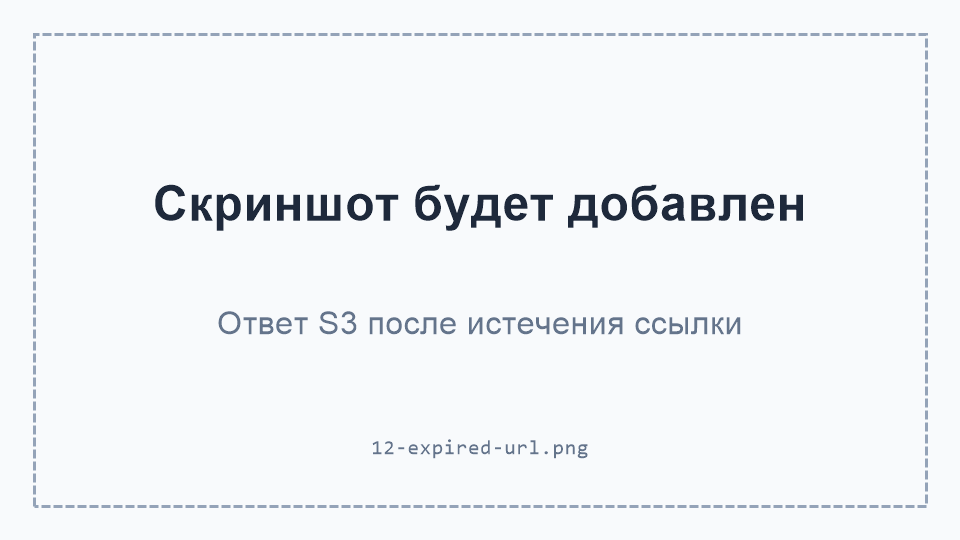

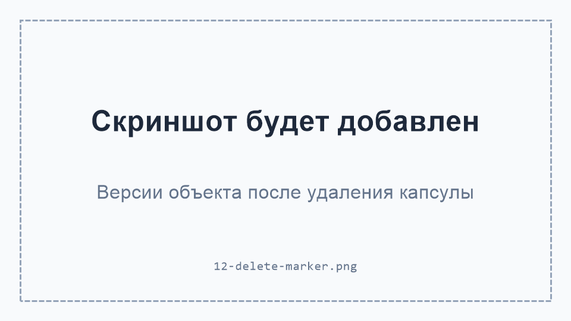

**Контрольные вопросы:**

1. Почему пересланную пользователем ссылку не нужно специально отзывать? — [ответ]
2. Что осталось в бакете после удаления капсулы и когда исчезнет окончательно? — [ответ]

## Задание 13. Сервер без состояния

**Проверка после перемещения `storage/uploads`:** [описать открытие старых и новых вложений, создание капсулы и удаление временной копии после успешной проверки]

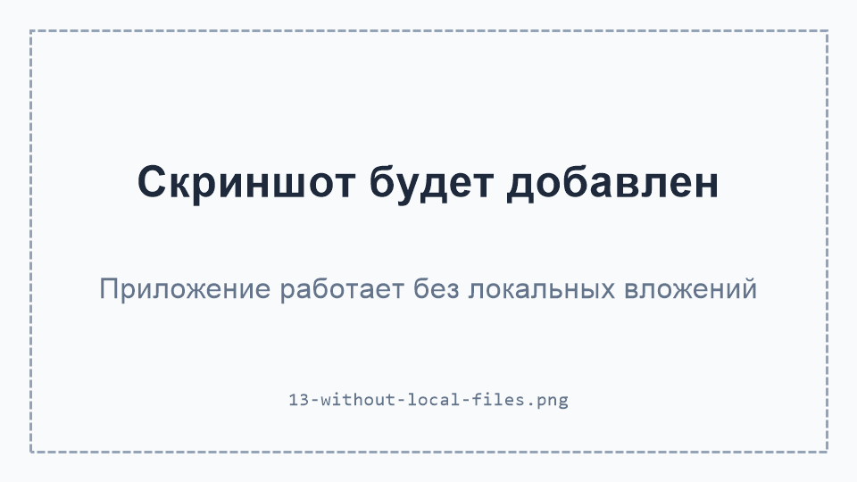

**Политика после удаления `s3:ListBucket`:** [вставить ссылку/версию политики и результат работы приложения]

**`aws s3 ls s3://$BUCKET/uploads/` на app-server:**

```text
[вставить вывод]
```

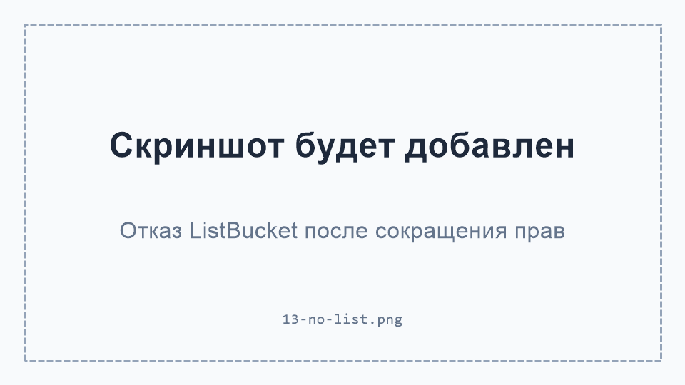

**Запрос отсутствующего объекта на app-server:**

```text
[вставить ответ]
```

**Тот же запрос в CloudShell:**

```text
[вставить ответ]
```

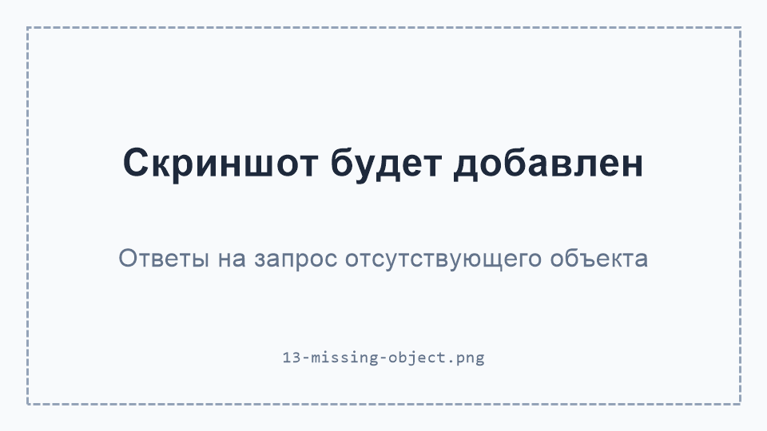

**Контрольные вопросы:**

1. Почему S3 отвечает по-разному на один отсутствующий объект и зачем? — [ответ]
2. Что потребуется для замены app-server новым сервером без потери вложений? — [ответ]

## Задание 14. Архитектура и решение

**Схема:** [вставить обновлённую схему из ЛР3: S3 вне VPC, роль app-server, запись/удаление объектов сервером и прямое скачивание браузером по подписанному URL]

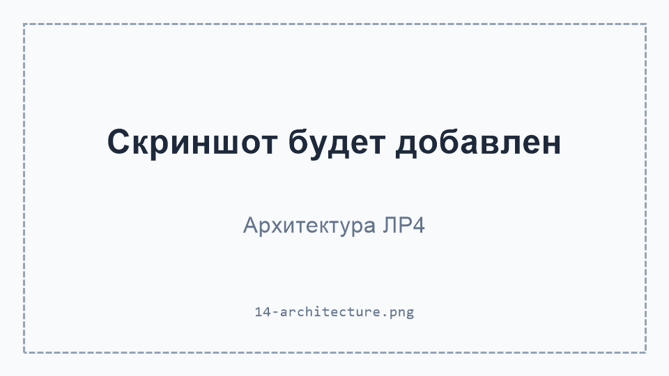

**ADR-0003:** [ссылка на `docs/adr/0003-attachment-storage.md` в репозитории приложения; сравнить EBS, EFS и S3]

**Последствия решения:** [описать путь скачивания и срок ссылки, защиту от случайного удаления и роста стоимости, работу с несколькими app-server за балансировщиком]

## Завершение работы

**Состояние ресурсов:** [подтвердить остановку bastion, app-server и db-server; отметить сохранённые бакет, политику и роли]

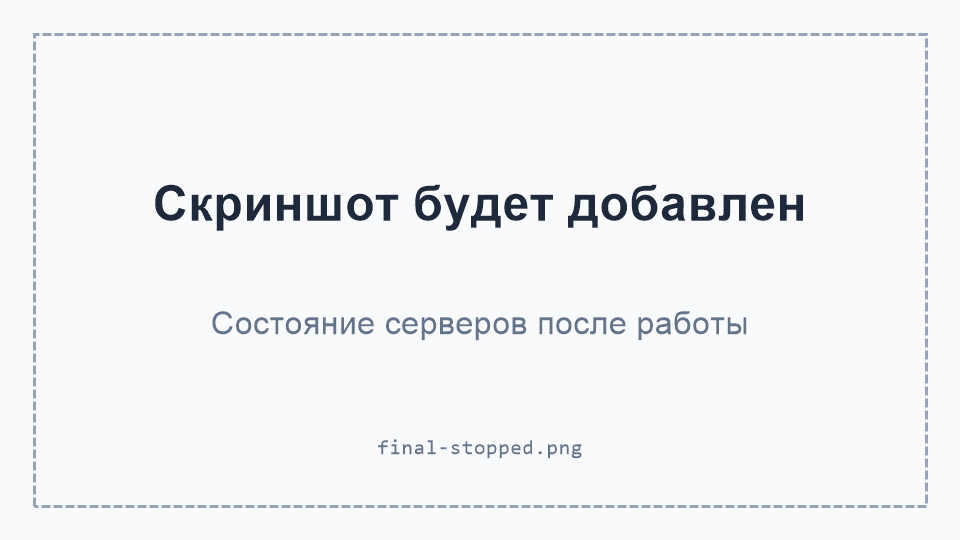

## Вопросы для защиты

1. Как проходит скачивание вложения от клика до получения файла? Где проверяются права пользователя, а где — права роли? — [ответ]
2. Какие настройки бакета и свойства подписанного URL защищают прямой адрес объекта? — [ответ]
3. Почему приложение выдаёт подписанный URL вместо публичного чтения бакета? — [ответ]
4. Что изменить, чтобы вложения пережили отказ всего региона `eu-central-1`? — [ответ]

> В опубликованный отчёт не вставлять действующие подписанные URL целиком: удалить `X-Amz-Signature` или дождаться истечения срока ссылки.
