# Лабораторная работа №4

## Облачные хранилища. Amazon S3

| Данные | Значение |
| --- | --- |
| ФИО | Дмитрий Головичихин |
| Группа | IA2403 |
| Специальность | Informatică aplicată |
| Уровень | Продвинутый, задания 1–14 |
| Приложение | TimeCapsule |
| Репозиторий | [dumkaguv-cloud/timecapsule](https://github.com/dumkaguv-cloud/timecapsule) |
| Регион | eu-central-1 (Frankfurt) |
| Бакет | `timecapsule-dev-uploads-dumkaguv` |

> Ссылки на PNG с надписью «Скриншот будет добавлен» обозначают отсутствующий снимок, а не подтверждённый результат. Дополнительные результаты фактических проверок 31.10.2026 сохранены в [журнале проверок](evidence/2026-10-31-aws-checks.md). Файлы приложения находятся в `lab_2/open_capsules_php_functional`.

## Цель и исходное состояние

**Цель:** хранить вложения TimeCapsule в закрытом бакете S3, управлять версиями, жизненным циклом и доступом; для продвинутого уровня перенести файлы с диска app-server в S3.

**Исходное состояние из ЛР3:** TimeCapsule — PHP приложение на app-server в публичной подсети VPC `10.16.0.0/16`; PostgreSQL вынесен на db-server в приватной подсети, доступ к серверам идёт через bastion. До перехода на S3 вложения лежали на диске app-server в `/var/www/timecapsule/storage/uploads` (см. [отчёт ЛР3](../lab_3/readme.md) и [ADR о размещении БД](../lab_2/open_capsules_php_functional/docs/adr/0002-database-placement.md)).

**Именование и теги:** `Project=timecapsule`, `Environment=dev`, `Lab=lab4`, `Owner=dumkaguv`, `Name=<полное имя ресурса>`. Наличие тегов на каждом AWS ресурсе требует отдельного снимка или вывода CLI.

# Часть 1. Базовый уровень

## Задание 1. Бакет и объекты в консоли

**Выполнение:** В бакете `timecapsule-dev-uploads-dumkaguv` под префиксом `uploads/` находятся `image.webp` и `aml-837865.pdf`. Вывод CLI также показывает `backups/asd.txt` размером 0 байт.

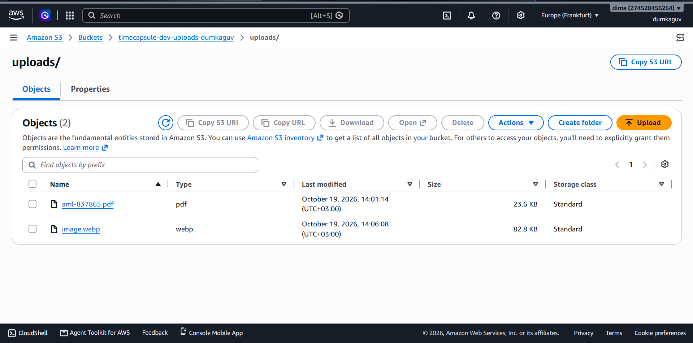

**Свойства картинки:**

| Параметр | Значение |
| --- | --- |
| Ключ | `uploads/image.webp` |
| ETag | `6d3fce6adbaa95081a9a6ecae0267add` |
| Object URL | `https://timecapsule-dev-uploads-dumkaguv.s3.eu-central-1.amazonaws.com/uploads/image.webp` |
| Content-Type | `image/webp` (подтверждено `head-object` в задании 2) |
| Шифрование объекта | `AES256` (SSE-S3, подтверждено `head-object`) |

**Проверка доступа:** в консоли подтверждены `Block all public access: On` и `Object Ownership: Bucket owner enforced` (ACLs disabled). Наличие префиксов `uploads/` и `backups/` видно в выводе CLI задания 2.

**Текущие настройки бакета (проверка CLI 31.10):** шифрование по умолчанию `AES256` (SSE-S3), `BucketKeyEnabled=true`, SSE-C заблокировано; версионирование `Enabled`. Снимок настроек и первоначальное состояние до включения версионирования не сохранены. `head-object` подтверждает SSE-S3 у `uploads/image.webp`, а [свойства другого объекта](screenshots/10-object-full.png) показывают SSE-S3 на 25.10.2026.

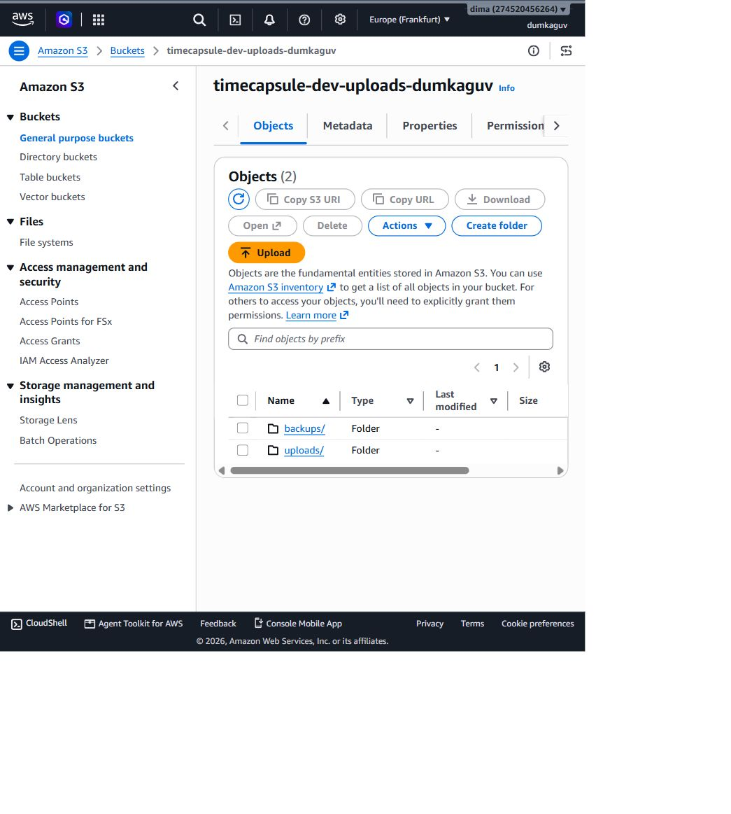

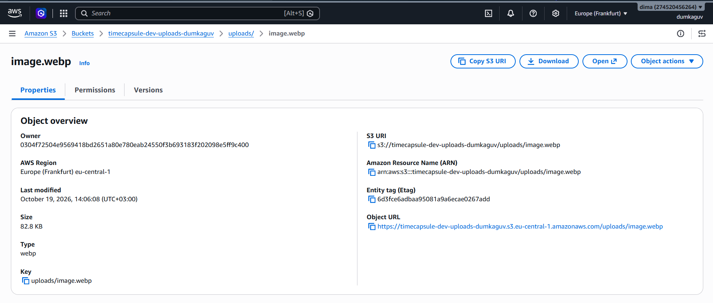

При открытии прямого Object URL браузер получил `AccessDenied`.

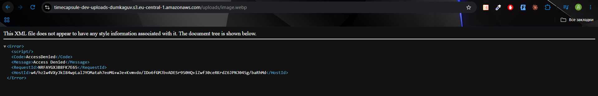

**Контрольные вопросы:**

1. **Какой ключ у картинки?** `uploads/image.webp`.
2. **Почему Object URL не открывается, хотя вы владелец бакета?** Прямой URL отправляет запрос к S3 без подписи. Авторизация в консоли AWS не даёт этому запросу права на чтение закрытого объекта, поэтому S3 возвращает `AccessDenied`.
3. **Что на самом деле создала кнопка Create folder?** В S3 нет настоящих каталогов: консоль создаёт объект нулевого размера с ключом, оканчивающимся на `/`, например `uploads/`. Остальные объекты группируются в интерфейсе по общему префиксу ключа.

## Задание 2. Объекты из командной строки

**Выполнение:** Вывод CLI показывает `uploads/photo.txt`, `uploads/2026/10/report.txt`, `uploads/2026/10/report-2.txt` и созданные ранее файлы. Скачивание `photo.txt` и удаление `report-2.txt` ещё нужно показать; в текущем выводе `report-2.txt` присутствует.

**Вывод `aws s3 ls s3://$BUCKET`:**

```text
                           PRE backups/
                           PRE uploads/
```

**Вывод `aws s3 ls s3://$BUCKET/uploads/`:**

```text
                           PRE 2026/
2026-10-19 10:59:20          0
2026-10-19 11:01:14      24183 aml-837865.pdf
2026-10-19 11:06:08      84772 image.webp
2026-10-19 11:16:37         18 photo.txt
```

**Вывод `aws s3 ls s3://$BUCKET --recursive`:**

```text
2026-10-19 11:02:22          0 backups/
2026-10-19 11:02:51          0 backups/asd.txt
2026-10-19 10:59:20          0 uploads/
2026-10-19 11:16:46         17 uploads/2026/10/report-2.txt
2026-10-19 11:16:46         15 uploads/2026/10/report.txt
2026-10-19 11:01:14      24183 uploads/aml-837865.pdf
2026-10-19 11:06:08      84772 uploads/image.webp
2026-10-19 11:16:37         18 uploads/photo.txt
```

**`head-object` для `uploads/image.webp`:** `ContentLength=84772`, `ContentType=image/webp`, `ETag=6d3fce6adbaa95081a9a6ecae0267add`, `ServerSideEncryption=AES256`. Повторная проверка `uploads/2026/10/report.txt` 31.10: 15 байт, `ContentType=text/plain`, `ServerSideEncryption=AES256`.

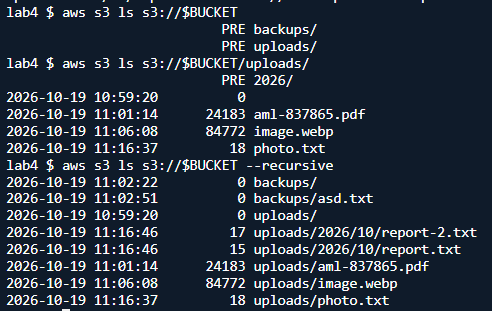

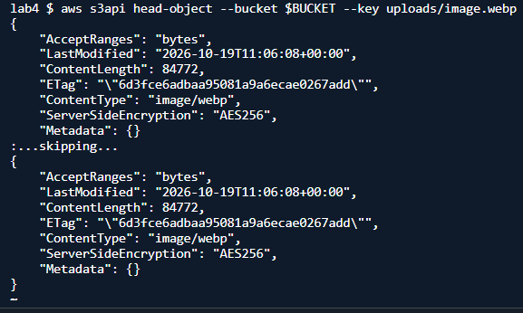

**Контрольные вопросы:**

1. **Почему первая команда `ls` показывает `PRE uploads/` и `PRE backups/`, а третья — полные ключи?** Обычный `ls` группирует объекты по общим префиксам, изображая их как папки. Параметр `--recursive` отключает такое представление и показывает полные ключи всех объектов, включая нулевые объекты-маркеры `uploads/` и `backups/`.
2. **Какой Content-Type получил `report.txt` без явного указания?** `text/plain` по `head-object` от 31.10.2026.

## Задание 3. Политика бакета: только HTTPS

**Политика бакета:** в разделе Permissions сохранён явный запрет всех действий с бакетом и его объектами для запросов без HTTPS. `Block all public access` остался включённым.

```json
{
  "Version": "2012-10-17",
  "Statement": [
    {
      "Sid": "DenyInsecureTransport",
      "Effect": "Deny",
      "Principal": "*",
      "Action": "s3:*",
      "Resource": [
        "arn:aws:s3:::timecapsule-dev-uploads-dumkaguv",
        "arn:aws:s3:::timecapsule-dev-uploads-dumkaguv/*"
      ],
      "Condition": {
        "Bool": {
          "aws:SecureTransport": "false"
        }
      }
    }
  ]
}
```

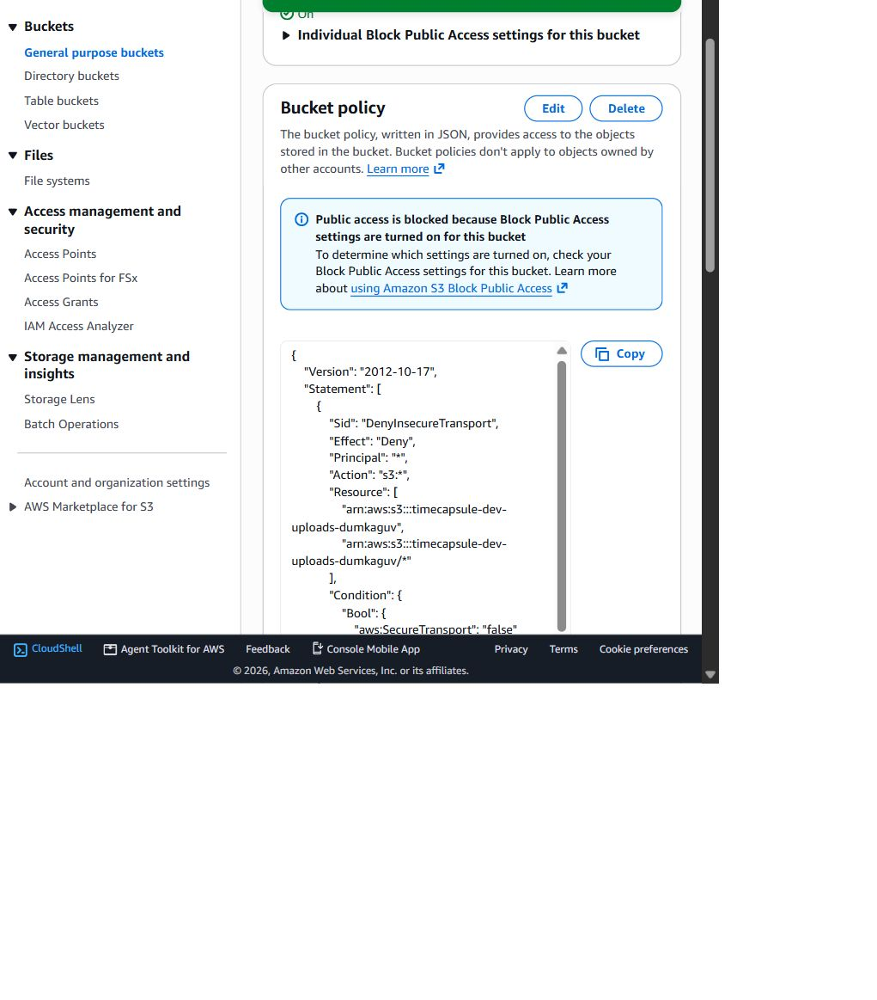

**Проверка по HTTPS:**

```text
                           PRE 2026/
2026-10-19 10:59:20          0
2026-10-19 11:01:14      24183 aml-837865.pdf
2026-10-19 11:06:08      84772 image.webp
2026-10-19 11:16:37         18 photo.txt
```

**Проверка по HTTP:**

```text
aws: [ERROR]: An error occurred (AccessDenied) when calling the ListObjectsV2 operation:
User: arn:aws:iam::274520456264:user/dumkaguv is not authorized to perform:
s3:ListBucket on resource: "arn:aws:s3:::timecapsule-dev-uploads-dumkaguv"
with an explicit deny in a resource-based policy
```

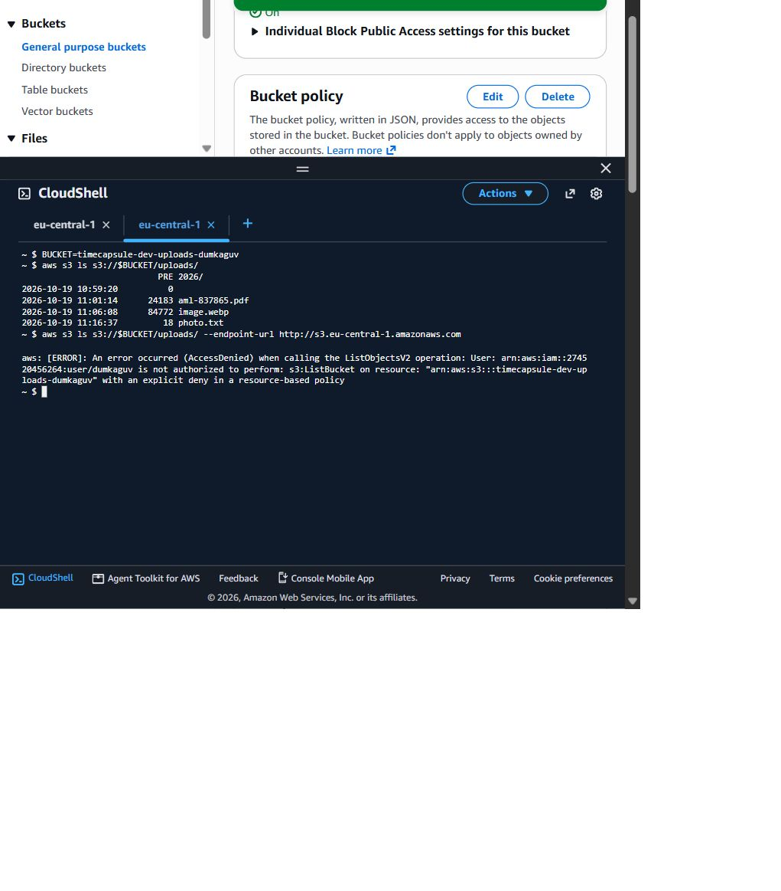

**Контрольные вопросы:**

1. **Почему запрос по HTTP получает AccessDenied при правах администратора?** Политика бакета содержит явный `Deny` для запросов с `aws:SecureTransport=false`. Явный запрет в политике ресурса имеет приоритет над разрешениями IAM-пользователя, включая административные.
2. **Почему Block Public Access позволил сохранить политику с `"Principal": "*"`?** Звёздочка в этом правиле обозначает всех участников, но правило запрещает доступ, а не предоставляет его. Block Public Access блокирует политики, открывающие публичный доступ; эта политика только ограничивает запросы по HTTP.

## Задание 4. Версионирование и защита от удаления

**Выполнение:** в свойствах бакета подтверждено `Bucket Versioning: Enabled`. У объектов, загруженных до включения версионирования, Version ID равен `null`. На раннем снимке `notes.txt` видны две версии размером 2 байта: от 20.10.2026 17:38:23 и 17:38:41. Поздняя версия впоследствии была удалена, ранняя стала текущей.

Чтобы проверить обычное удаление при включённом версионировании, `uploads/notes.txt` удалён из списка без показа версий. Объект исчез из обычного списка, а при включении Show versions появился новый Delete marker от 20.10.2026 17:53:07 с собственным Version ID `OJoUQIp44jZLH0BTYWh9yD6RIQWoQ2NY`; версия файла осталась под ним. Затем удалён только этот маркер, и ранняя версия `notes.txt` снова стала текущей.

На раннем снимке был ещё один маркер с Version ID `null`. [AWS описывает такой маркер](https://docs.aws.amazon.com/AmazonS3/latest/userguide/DeletingObjectsfromVersioningSuspendedBuckets.html) для удаления при приостановленном версионировании. Состояние бакета во время того удаления не проверялось; повторная проверка выше выполнена при статусе `Enabled`.

**Доказательства:**

- [x] Bucket Versioning имеет статус `Enabled`.
- [x] У ранее загруженных объектов Version ID равен `null`.
- [x] На раннем снимке видны две версии `uploads/notes.txt`.
- [x] Новое обычное удаление создало маркер с отдельным Version ID; версия файла сохранилась.
- [x] После удаления маркера ранняя версия `notes.txt` снова текущая.
- [ ] Фактический текст `v1` и `v2` проверен открытием или скачиванием файлов.

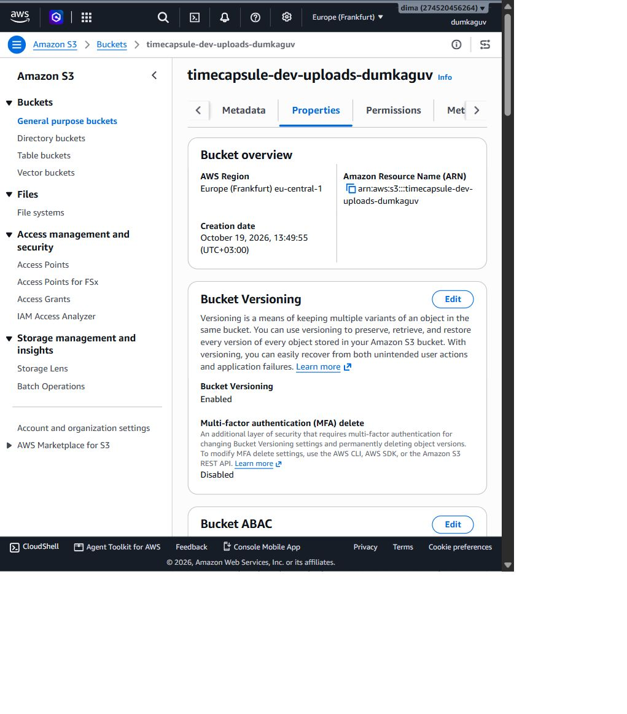

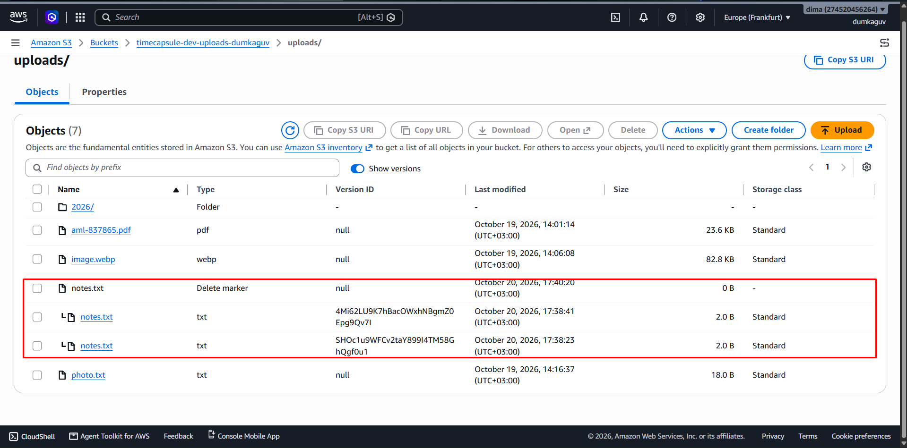

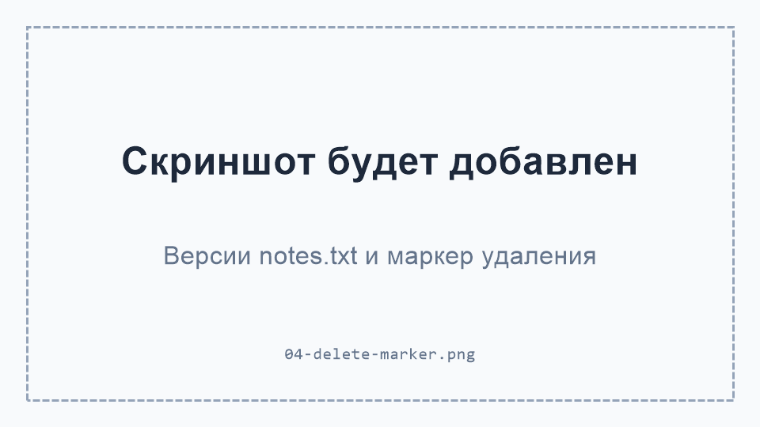

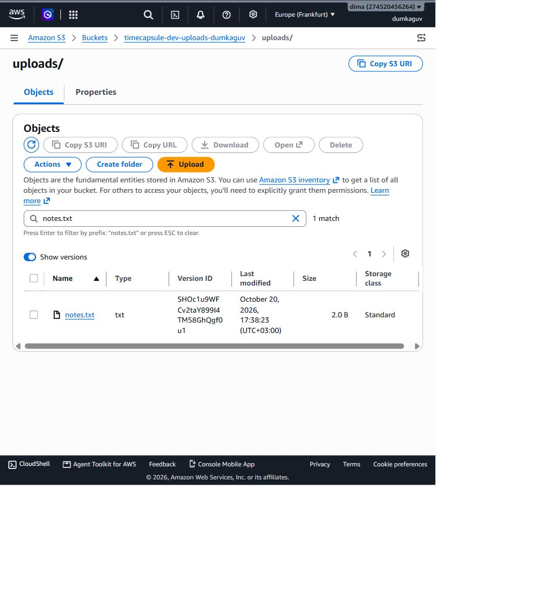

**Контрольные вопросы:**

1. **Чем обычное удаление объекта отличается от удаления конкретной версии?** При включённом версионировании удаление без Version ID добавляет маркер: объект перестаёт открываться по обычному ключу, но его версии сохраняются. Удаление с Version ID безвозвратно убирает именно указанную версию.
2. **Какое удаление можно отменить?** Удаление без Version ID можно отменить, удалив маркер. Удаление конкретной версии отменить средствами S3 нельзя.
3. **Что защищает от случайного удаления и какое действие нужно запрещать приложению?** Включённое версионирование сохраняет прежние версии при обычном удалении. Приложению не следует предоставлять `s3:DeleteObjectVersion`; для обычного удаления ему достаточно `s3:DeleteObject`.

## Задание 5. Правило жизненного цикла

**Выполнение:** правило `timecapsule-dev-noncurrent` включено. Фильтр исправлен на точный префикс `uploads/`, поэтому объекты `backups/` не затрагиваются. Неактуальные версии переходят в Standard-IA через 30 дней; через 90 дней удаляются все, кроме двух самых новых неактуальных версий. Незавершённые multipart uploads под тем же префиксом удаляются через 7 дней. Для переходов действует стандартный порог размера 128 КБ.

**Доказательство:** на снимке видны статус `Enabled`, префикс `uploads/`, схема перехода и удаления версий, а также очистка незавершённых загрузок через 7 дней.

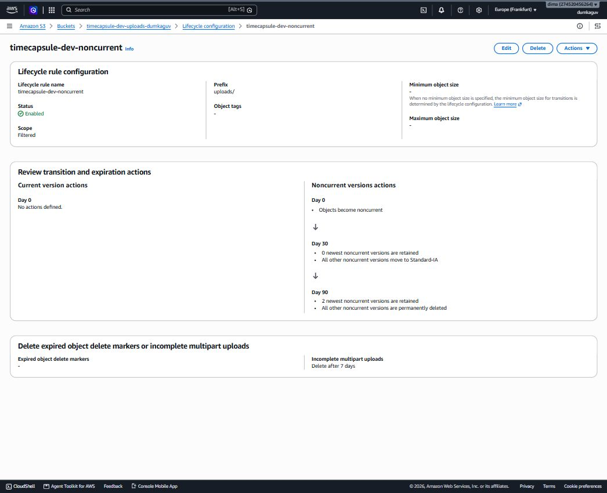

**Контрольные вопросы:**

1. **Что произойдёт после десяти перезаписей за неделю?** Останется одна текущая и десять неактуальных версий. Версии размером от 128 КБ перейдут в Standard-IA после 30 дней в неактуальном состоянии. После 90 дней неактуального состояния восемь старейших версий будут удалены, а две самые новые сохранятся; поскольку перезаписи сделаны в разные дни, сроки для отдельных версий тоже различаются.
2. **Почему маленькие тестовые файлы не попадут в Standard-IA?** По умолчанию [S3 не переводит объекты меньше 128 КБ](https://docs.aws.amazon.com/AmazonS3/latest/userguide/lifecycle-transition-general-considerations.html) в другой класс хранения. Это не отменяет удаления старых версий по отдельному действию правила.
3. **Что такое незавершённая загрузка частями и почему за неё платят?** Multipart upload передаёт объект отдельными частями. Если загрузку не завершить и не отменить, S3 [сохраняет уже переданные части](https://docs.aws.amazon.com/AmazonS3/latest/userguide/mpuoverview.html), и они занимают оплачиваемое место. Правило отменяет такие загрузки через 7 дней.

## Задание 6. Подписанные URL

**Проверки:** для `uploads/image.webp` через **Object actions → Share with a presigned URL** создана ссылка на 5 минут (`X-Amz-Expires=300`). Прямой адрес S3 открыл изображение в отдельной вкладке браузера. В CloudShell команда `aws s3 presign s3://timecapsule-dev-uploads-dumkaguv/uploads/photo.txt --expires-in 120 --region eu-central-1` создала ссылку на 2 минуты. Прямой запрос по ней без заголовка авторизации вернул HTTP 200 и содержимое `photo placeholder`; полная ссылка также открыта во вкладке браузера. Отдельного приватного окна в доступном браузере не было; проверка прямым запросом `curl` не использовала авторизацию AWS Console.

| Проверка | Ответ S3 |
| --- | --- |
| Подмена `photo.txt` на существующий `notes.txt` в URL | HTTP 403, `SignatureDoesNotMatch` — подпись не соответствует изменённому запросу. |
| Исходный URL после истечения 120 секунд | HTTP 403, `AccessDenied`, сообщение `Request has expired`. |

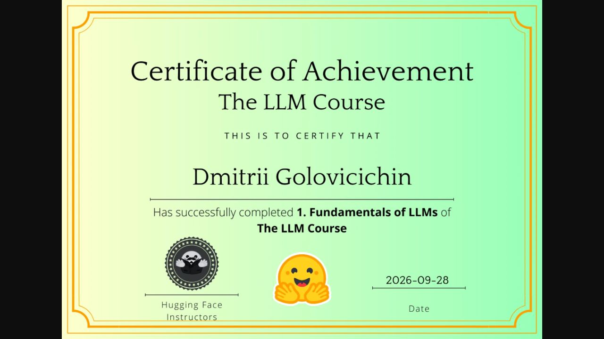

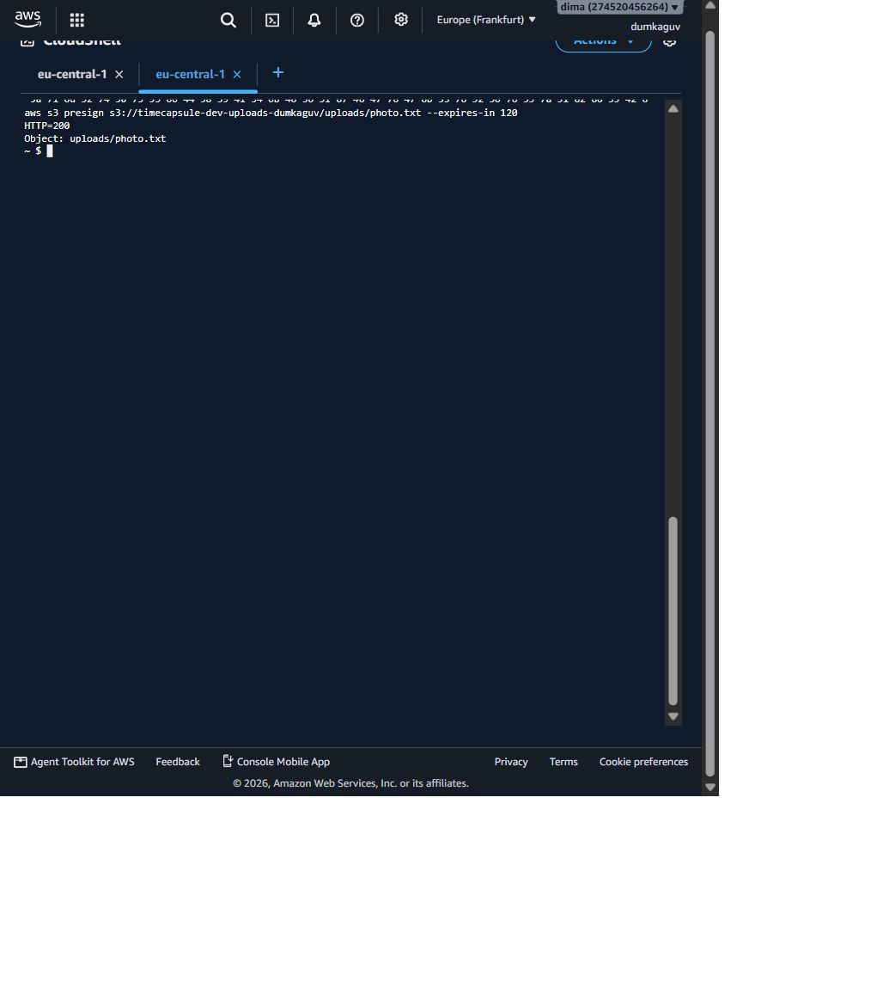

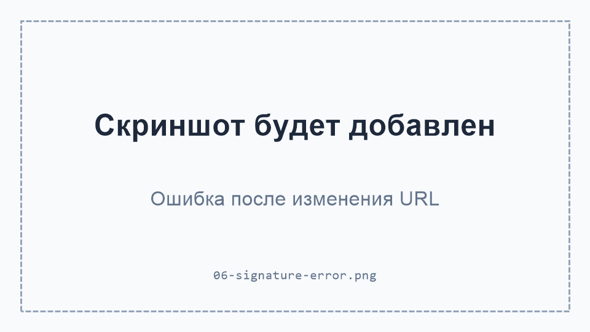

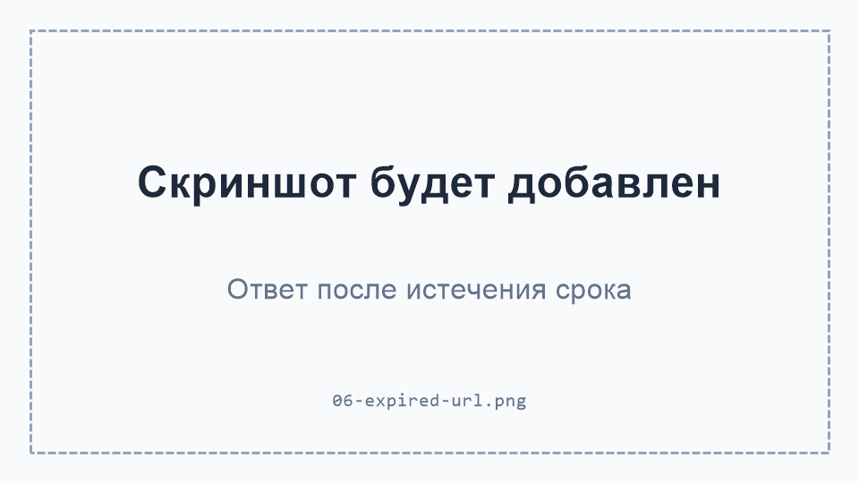

**Контрольные вопросы:**

1. **Почему нельзя получить другой объект, изменив ключ в подписанной ссылке?** Путь к объекту входит в [канонический запрос SigV4](https://docs.aws.amazon.com/AmazonS3/latest/API/sig-v4-header-based-auth.html). Изменение `photo.txt` на `notes.txt` меняет этот запрос, а прежняя подпись уже не подходит.
2. **Обращалась ли команда `aws s3 presign` к S3 при создании ссылки?** Нет. Она формирует и подписывает URL локально, используя доступные учётные данные. [Запрос к S3 происходит при открытии URL](https://docs.aws.amazon.com/AmazonS3/latest/developerguide/sigv4-query-string-auth.html): тогда проверяются подпись, срок и доступ к объекту. Получение временных учётных данных само по себе может требовать отдельного обращения к сервису выдачи учётных данных, но это не запрос к S3 за объектом.

**Очистка после Части 1:** в CloudShell удалена временная папка `~/lab4` и файлы ответов, созданные для этой проверки. Бакет сохранён для Части 2.

# Часть 2. Продвинутый уровень

## Задание 7. Политика приложения

**Политика `timecapsule-dev-app-s3`:** [исходный JSON](../lab_2/open_capsules_php_functional/docs/lab4/iam-policy-initial.json). `ListBucket` разрешён только с `s3:prefix = uploads/*` для ARN бакета; `GetObject`, `PutObject`, `DeleteObject` разрешены только для ARN `uploads/*`. Прав на `backups/`, `ListBucketVersions` и `DeleteObjectVersion` нет.

**Проверка IAM 31.10:** политика существует по ARN `arn:aws:iam::274520456264:policy/timecapsule-dev-app-s3`; исходная версия `v1` соответствовала локальному JSON. Теги политики: `Project=timecapsule`, `Environment=dev`, `Owner=dumkaguv`, `Lab=lab4`, `Name=timecapsule-dev-app-s3`. Политика прикреплена к тестовой и серверной ролям. Позже в задании 13 версия по умолчанию изменена на `v2`. Скриншот `07-app-policy.png` остаётся заглушкой; текстовые результаты приведены в [журнале](evidence/2026-10-31-aws-checks.md).

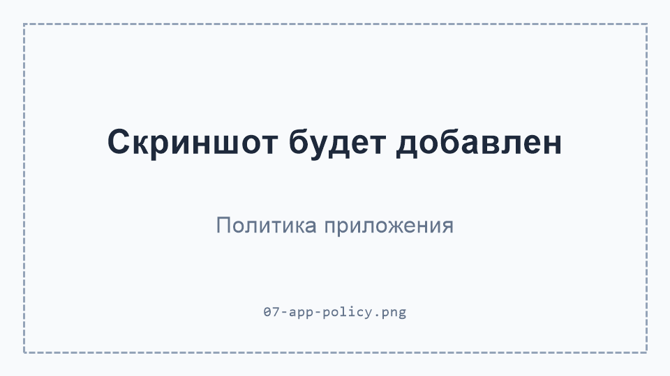

**Контрольные вопросы:**

1. `ListBucket` перечисляет ключи внутри бакета, поэтому его ресурс — `arn:aws:s3:::timecapsule-dev-uploads-dumkaguv`. `GetObject` читает конкретный объект, поэтому ресурс содержит путь `arn:aws:s3:::timecapsule-dev-uploads-dumkaguv/uploads/*`.
2. Если указать объектный ARN для `ListBucket` или ARN бакета для `GetObject`, разрешение не совпадёт с ресурсом запроса. IAM не применит это `Allow`, и действие завершится `AccessDenied`, если нет другого разрешающего правила.

## Задание 8. Проверка прав через тестовую роль

**Тестовая роль:** `timecapsule-dev-s3-tester` (`arn:aws:iam::274520456264:role/timecapsule-dev-s3-tester`) доверяет аккаунту `274520456264`; к ней прикреплена `timecapsule-dev-app-s3`, дополнительных inline-политик нет. Проверки выполнены до сокращения политики, с исходной версией `v1`. [Снимок карточки роли](screenshots/08-tester-role.png) показывает прикреплённую политику.

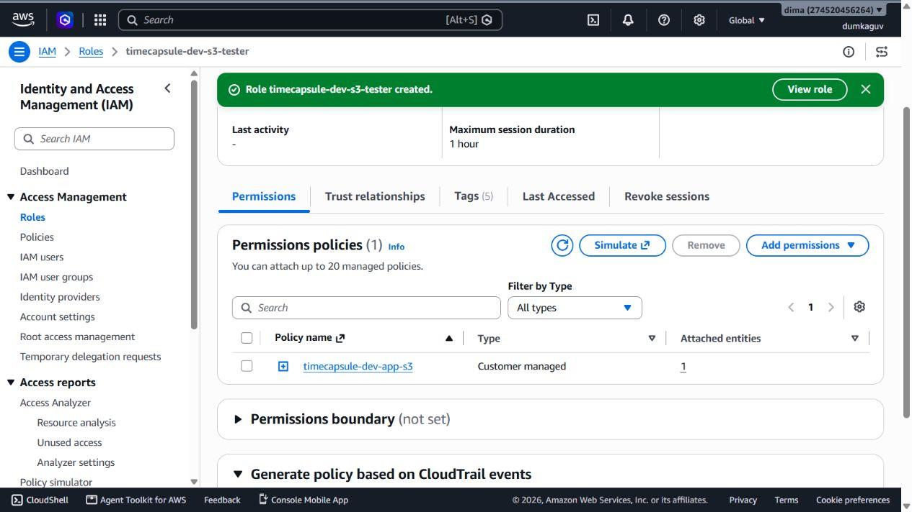

**`aws sts get-caller-identity` после `assume-role`:**

```text
arn:aws:sts::274520456264:assumed-role/timecapsule-dev-s3-tester/lab4-verify
```

На [снимке раннего прогона](screenshots/08-tester-identity.png) видна другая сессия той же роли с именем `lab4`; таблица ниже относится к повторной проверке 31.10 с именем `lab4-verify`.

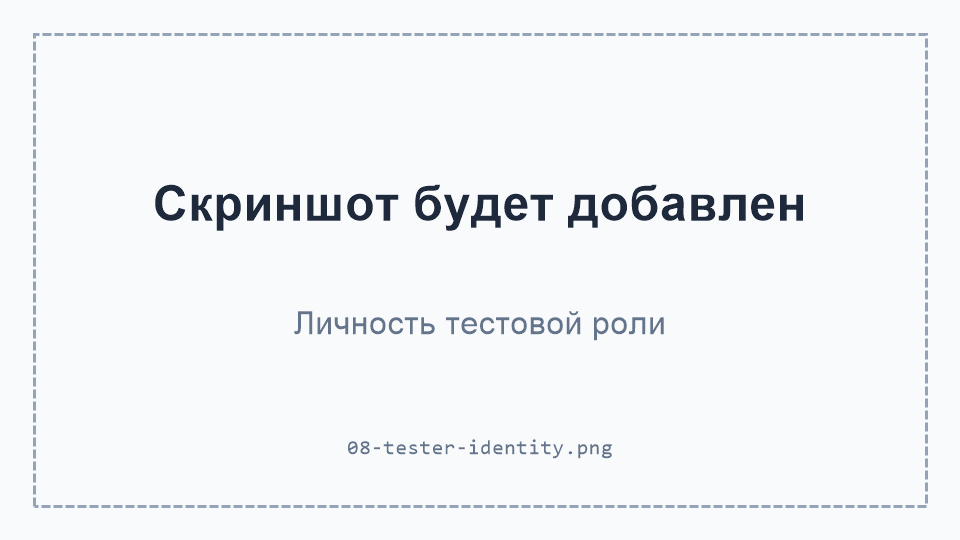

Проверка проведена с тестовым ключом `uploads/lab4-role-test-20261031.txt`. Его версия `y.Yh0sl5rISlnT.D43lZsz.NHFI0BADM` и маркер обычного удаления `76WnE2Oqp.fF3FPNwfH10ftKhOYphL7c` подтверждены `list-object-versions` от IAM-пользователя после выхода из роли. Временные переменные STS удалены из CloudShell.

| № | Команда | Ожидаю | Получил | Какое правило сработало |
| ---: | --- | --- | --- | --- |
| 1 | `PutObject uploads/lab4-role-test-20261031.txt` | Разрешено | Успех: 26 байт, `text/plain`, VersionId получен | `s3:PutObject` для `uploads/*` |
| 2 | `aws s3 ls s3://$BUCKET/uploads/` | Разрешено | Успех, тестовый объект виден | `s3:ListBucket` с `s3:prefix=uploads/` |
| 3 | `aws s3 ls s3://$BUCKET` | AccessDenied | `AccessDenied` | Нет разрешения `ListBucket` для пустого префикса |
| 4 | `aws s3 cp s3://$BUCKET/uploads/photo.txt -` | Разрешено | `photo placeholder` | `s3:GetObject` для `uploads/*` |
| 5 | `aws s3 ls s3://$BUCKET/backups/` | AccessDenied | `AccessDenied` | Префикс `backups/` не разрешён |
| 6 | `PutObject backups/lab4-role-test-20261031.txt` | AccessDenied | `AccessDenied`, объект не создан | Объект вне разрешённого ARN `uploads/*` |
| 7 | `list-object-versions --prefix uploads/` | AccessDenied | `AccessDenied` | Нет `s3:ListBucketVersions` |
| 8 | `delete-object --key uploads/lab4-role-test-20261031.txt --version-id y.Yh0sl5rISlnT.D43lZsz.NHFI0BADM` | AccessDenied | `AccessDenied` | Нет `s3:DeleteObjectVersion` |
| 9 | `delete-object --key uploads/lab4-role-test-20261031.txt` | Разрешено | Успех, создан маркер `76WnE2Oqp.fF3FPNwfH10ftKhOYphL7c` | `s3:DeleteObject` для `uploads/*` |
| 10 | `aws s3 ls s3://$BUCKET/uploads/ --endpoint-url http://s3.eu-central-1.amazonaws.com` | AccessDenied | `AccessDenied` с явным запретом политики бакета | Запрет HTTP в политике бакета |

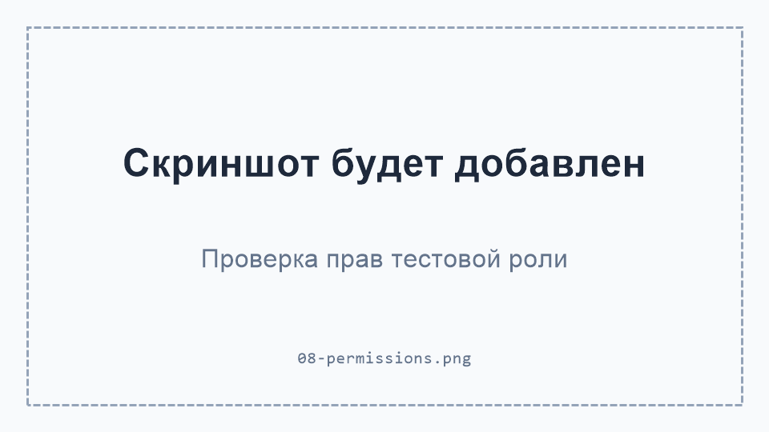

**Несовпадения ожидания и результата:** нет; повторная проверка использовала ключ с именем, отличным от образца задания. На раннем [снимке проверки](screenshots/08-permissions.png) также видны прежняя версия `uploads/test.txt` `XknGXjFFDMa3_AOzpEiUkt3GYouXg93p` и маркер `XYVP2k2y6V3d_UYxNCMZhs6Oca2XULDm`; это другой тестовый объект. [Журнал 31.10](evidence/2026-10-31-aws-checks.md) описывает повторный прогон без смешения идентификаторов.

**Контрольные вопросы:**

1. Политика доверия определяет, кто может вызвать `sts:AssumeRole` и получить временную сессию роли. Политика прав определяет, какие действия эта сессия может выполнить над ресурсами AWS.
2. При включённом версионировании обычный `DeleteObject` добавил маркер `76WnE2Oqp.fF3FPNwfH10ftKhOYphL7c`, а версия тестового объекта `y.Yh0sl5rISlnT.D43lZsz.NHFI0BADM` осталась. Это проверено повторным `list-object-versions` от IAM-пользователя.
3. У роли нет `s3:DeleteObjectVersion`, поэтому она не может удалить конкретную версию безвозвратно. `s3:*` включило бы и это действие, а также просмотр версий и другие операции, что сильно расширило бы последствия компрометации приложения.

## Задание 9. Роль сервера

**Роль:** `timecapsule-dev-app-role` показана в карточке EC2 `i-012cb83b9091855bb`. Проверка IAM 31.10 подтвердила доверие к `ec2.amazonaws.com` и прикрепление `timecapsule-dev-app-s3`.

Вкладка **Security** карточки экземпляра показывает `IAM role: timecapsule-dev-app-role` и `IMDSv2: Required`.

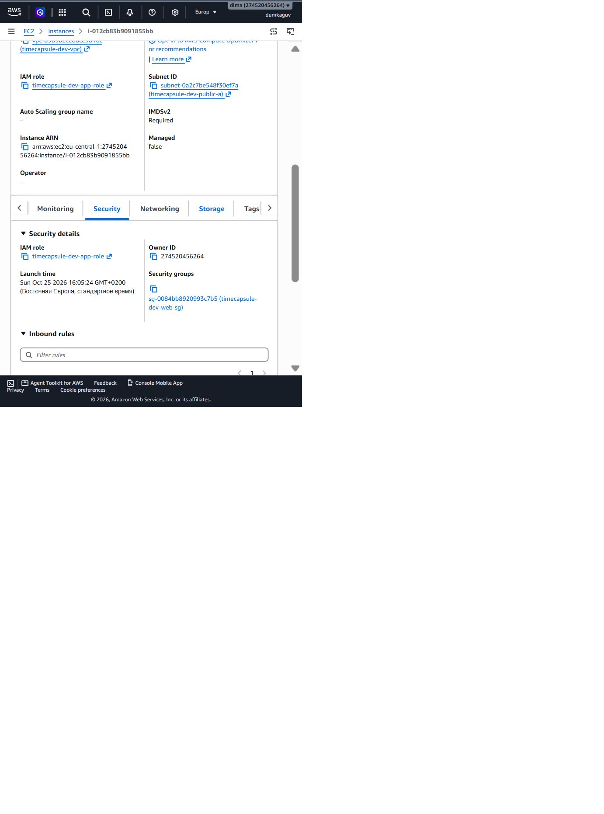

**`aws sts get-caller-identity` на app-server:**

```text
arn:aws:sts::274520456264:assumed-role/timecapsule-dev-app-role/i-012cb83b9091855bb
```

**`aws s3 ls s3://$BUCKET/uploads/` на app-server:**

```text
Список доступен до перехода на версию политики v2; видны, среди прочего, uploads/3e0a94bdae459ce76bc942fd6fc12a62.webp и новые тестовые файлы.
```

**`aws s3 ls s3://$BUCKET/backups/` на app-server:**

```text
AccessDenied: для роли не разрешён префикс backups/.
```

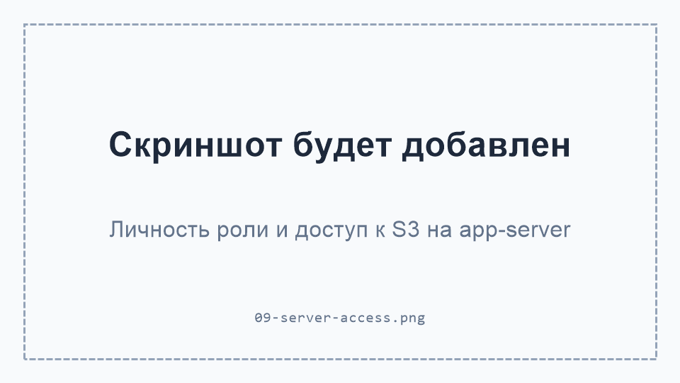

**Контрольные вопросы:**

1. При работе с ролью EC2 AWS CLI получает временные данные через Instance Metadata Service. `get-caller-identity` на сервере подтвердил сессию роли, привязанную к экземпляру `i-012cb83b9091855bb`; отдельный сетевой трассировки IMDS нет.
2. Тестовую роль может принять доверенная IAM-учётная запись через STS. Серверная роль доверяет сервису `ec2.amazonaws.com`; EC2 выдаёт её сессию конкретному экземпляру через instance profile.
3. Временные данные роли обновляются автоматически. В [.env.example](../lab_2/open_capsules_php_functional/.env.example) нет постоянных AWS ключей; в рабочей `.env` на сервере проверено наличие `S3_BUCKET` и `AWS_REGION` и отсутствие имён `AWS_ACCESS_KEY_ID`/`AWS_SECRET_ACCESS_KEY` без вывода значений остальных переменных.

## Задание 10. Перенос существующих файлов

**Путь исходных вложений:** `/var/www/timecapsule/storage/uploads` на app-server. В этом развёртывании приложение находится непосредственно в `/var/www/timecapsule`, без каталога `current`.

**Первый `aws s3 sync ... --dryrun`:** исторический вывод не сохранён; файл `10-dryrun.png` пока заглушка.

```text
Нет сохранённого вывода.
```

**Перенос `aws s3 sync ...`:** исторический вывод не сохранён; файл `10-sync.png` пока заглушка. Сравнение от 31.10 подтвердило наличие в S3 объекта, соответствующего локальному файлу по имени и размеру, но не устанавливает команду, которой его загрузили.

```text
Нет сохранённого вывода.
```

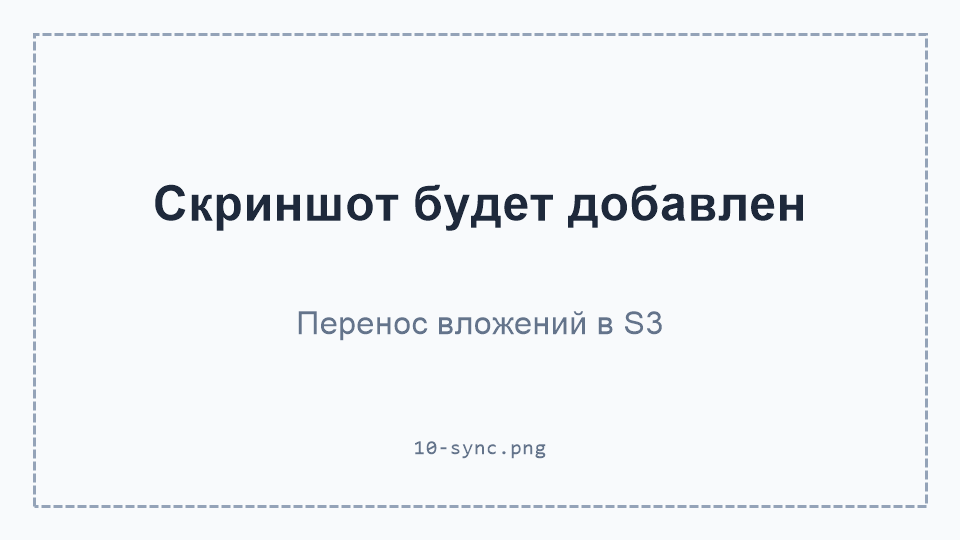

**Объект в S3 и его Content-Type:**

```text
На [снимке свойств объекта](screenshots/10-object-full.png) виден ключ `uploads/3e0a94bdae459ce76bc942fd6fc12a62.webp`, размер 13,4 КБ, SSE-S3 и `Content-Type: image/webp` на 25.10.2026. [Отдельный снимок метаданных](screenshots/10-content-type.png) подтверждает тот же Content-Type. Эти снимки не доказывают способ загрузки, первоначальный MIME тип или результат повторного `sync --dryrun`.
```

**Повторный `sync --dryrun` 31.10:** команда с `--exclude .gitkeep` завершилась с кодом 0 и не вывела ни одной операции; локальный файл и соответствующий объект S3 имеют размер 13 702 байта. Проверка выполнена до временного перемещения локального каталога.

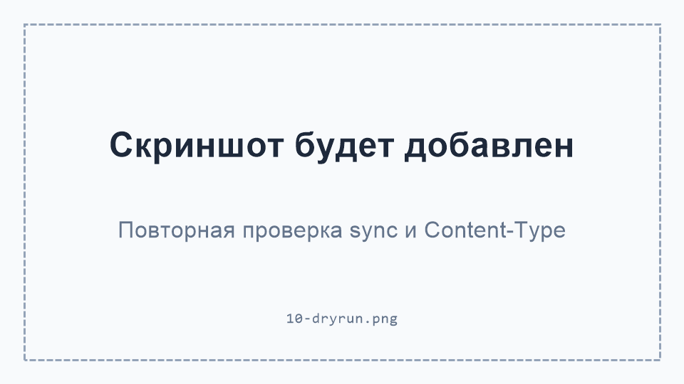

**Контрольные вопросы:**

1. Повторный `--dryrun` показал отсутствие операций на 31.10. Первоначальный перенос и его вывод не задокументированы.
2. Для сравнения объектов CLI нужна возможность `s3:ListBucket`, для записи — `s3:PutObject`. Чтение исходного файла выполняется с локального диска и не требует `s3:GetObject`. После снятия `ListBucket` роль приложения больше не предназначена для запуска `sync`.

## Задание 11. Модуль хранения на S3

**Изменения в проекте приложения:** [модуль хранения](../lab_2/open_capsules_php_functional/src/storage.php), [контроллер капсул](../lab_2/open_capsules_php_functional/src/controllers/capsules.php), [.env.example](../lab_2/open_capsules_php_functional/.env.example), [подвал страницы](../lab_2/open_capsules_php_functional/views/layout.php) и [зависимость AWS SDK](../lab_2/open_capsules_php_functional/composer.json). Изменения S3 и копия отчёта зафиксированы в репозитории приложения отдельным коммитом.

**Проверка требований:**

- [x] `storage_save()` записывает объект в `uploads/` и задаёт Content-Type по `finfo`; новые PNG и PDF от 31.10 найдены в S3 с `image/png` и `application/pdf`.
- [x] `storage_delete()` вызывает `DeleteObject` без VersionId; после удаления тестовой капсулы №5 в S3 появился маркер, прежняя версия PDF осталась.
- [x] Контроллер проверяет доступ и время открытия до вызова `storage_stream()`; модуль создаёт подписанный `GetObject` URL на 5 минут и HTTP 302 с типом, способом показа и исходным именем файла. Реальный переход на S3 и истечение ссылки проверены для PNG.
- [x] SDK настроен на `AWS_REGION`, бакет берётся из `S3_BUCKET`, явные ключи в клиенте и `.env.example` отсутствуют. На EC2 подтверждены сессия роли, имена переменных в рабочей `.env` и запись новых файлов через приложение.
- [x] В шаблоне подвала выводится имя бакета; [снимок страницы](screenshots/12-image-sealed.png) показывает `Files: S3 timecapsule-dev-uploads-dumkaguv`.

**Результат:** код развёрнут на app-server; SHA256 серверных `src/storage.php` и `views/layout.php` совпадают с файлами проекта, AWS SDK установлен, `php -l` прошёл. Снимок страницы подтверждает подвал и запечатанную капсулу; отдельная проверка S3 подтвердила запись новых вложений.

## Задание 12. Деплой и проверка

**Деплой:** исторический вывод установки зависимостей, команды выпуска и перезапуска не сохранён. На момент проверки 31.10 серверный `git HEAD` был `f959fed9e6a9454ce7d261e07c630c5ef339f8df`; поверх него находились развёрнутые изменения `src/storage.php` и `views/layout.php`, совпадающие по SHA256 с локальными файлами. AWS SDK установлен, `nginx` и `php-fpm` активны. Позже эти изменения зафиксированы отдельным коммитом в репозитории приложения; обновление серверного `git HEAD` после остановки EC2 не выполнялось.

**Доказательства:**

- [x] Новые объекты через приложение: `uploads/51838cddcf4f5f45cdf00ef598ca9d67.png` — 210 309 байт, `image/png`; `uploads/40ed6bc7637b8001b326efc4c789d805.pdf` — 589 байт, `application/pdf`. Оба объекта имеют `AES256`; `12-new-objects.png` пока заглушка, данные из CLI в [журнале](evidence/2026-10-31-aws-checks.md).
- [x] Открытая капсула №7 показала изображение `architecture.png` размером 1820×990. Прямой переход по `/capsules/7/file` привёл в S3 к ключу `uploads/4e07678c3c46a9460b31882611f04bea.png`; URL содержал `X-Amz-Algorithm=AWS4-HMAC-SHA256`, `X-Amz-Date=20261031T134941Z`, `X-Amz-Expires=300` и параметры подписи. Полный действующий URL не сохранён. [Снимок полученного изображения](screenshots/12-presigned-browser.jpg) не показывает адресную строку; `12-presigned-browser.png` остаётся заглушкой.
- [ ] На открытой капсуле №5 есть ссылка `Download lab4-test.pdf`; браузерная проверка фактической загрузки заблокирована клиентом, имя скачанного файла не подтверждено.
- [x] Старый файл `3e0a94bdae459ce76bc942fd6fc12a62.webp` прочитан из S3 ролью app-server после переноса локального каталога; SHA256 совпал с временной копией (`56c0d131ae52b0f19dc2b18cc152e882a26a7b65302eeb32aea36f42f4fd04d3`). Для сквозной проверки тестовая открытая капсула №7 временно указывала на этот старый ключ: `/capsules/7/file` показал `old-lab2.webp` размером 310×301. Затем запись №7 восстановлена на исходный тестовый PNG (1820×990). Исходная непубличная капсула ЛР2 через её владельца не проверялась.
- [x] Повторное открытие той же ссылки после пяти минут вернуло XML `AccessDenied` с `Request has expired`: время истечения `2026-10-31T13:54:41Z`, время ответа S3 `2026-10-31T13:55:00Z`. [Снимок ответа](screenshots/12-expired-url.jpg).
- [x] Через приложение удалена только тестовая капсула №5. `list-object-versions` показал прежнюю версию PDF `My2fg.2bmgCjXKM4GJiKx9birLcdaUrd` (589 байт, `IsLatest=false`) и текущий маркер удаления `dUbycZCodxOlQsgBWYAOJSIpi8PicHTA`. [Снимок CloudShell](screenshots/12-delete-marker.jpg).

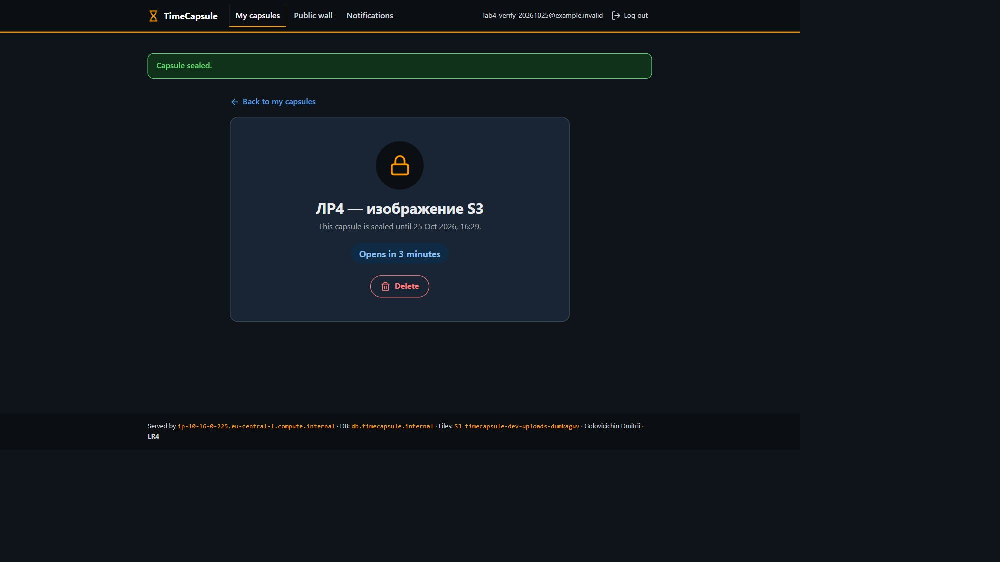

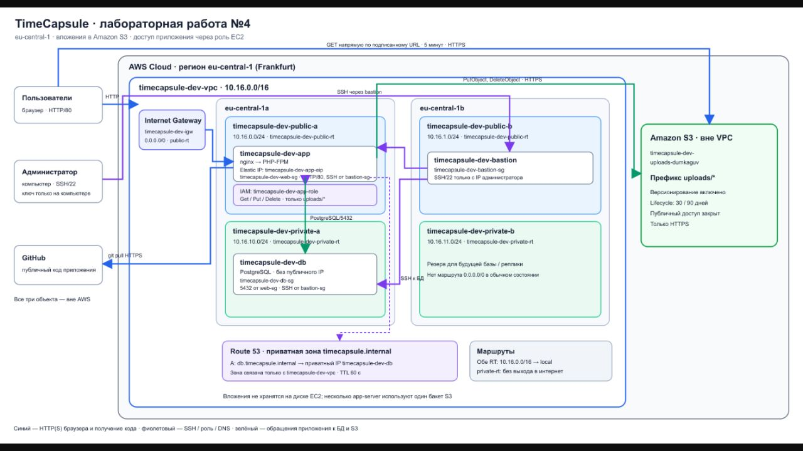

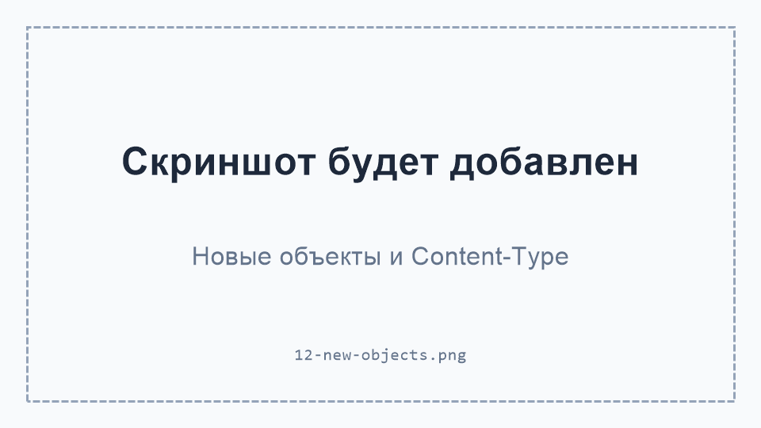

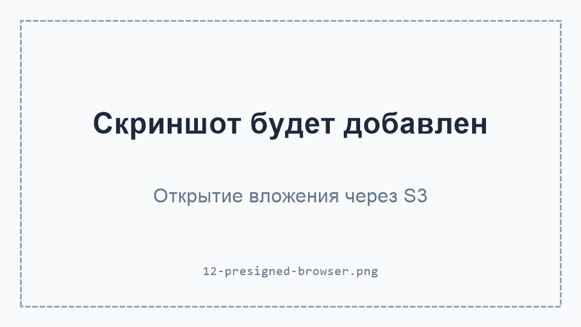

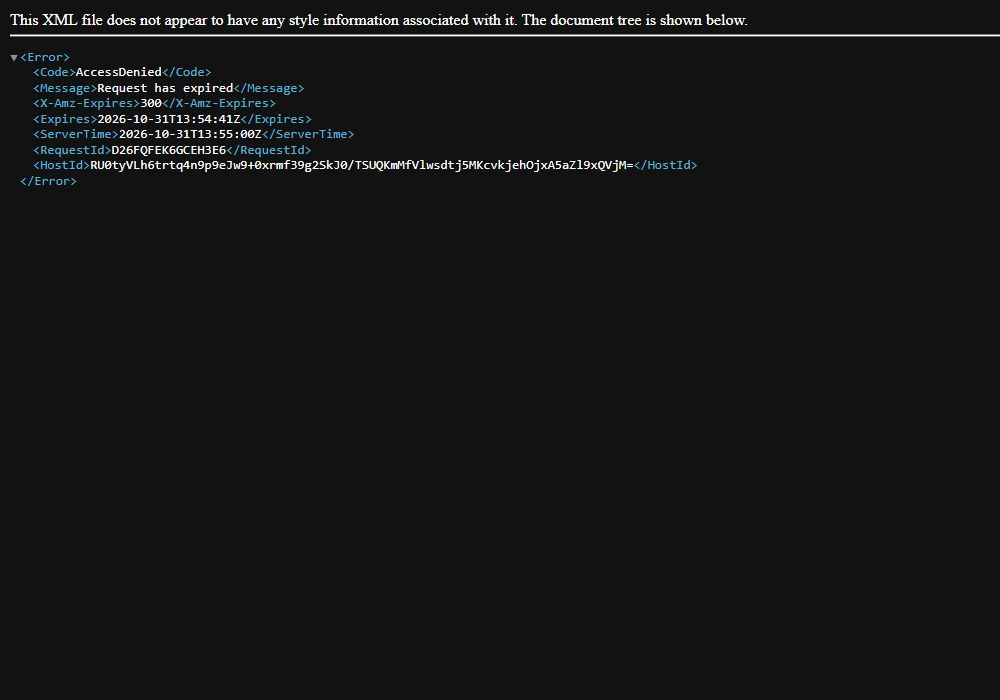

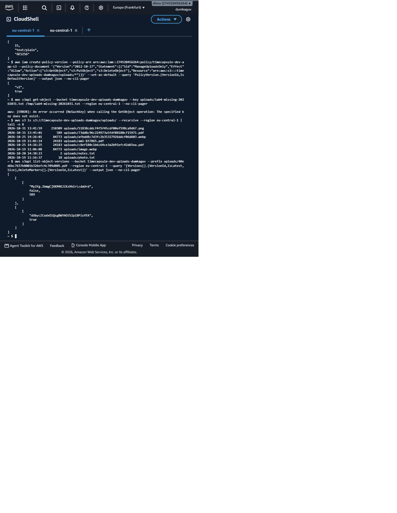

**Контрольные вопросы:**

1. Срок ссылки в коде ограничен пятью минутами. Пересланная ссылка действует до истечения этого срока (или более раннего прекращения действия учётных данных); досрочно отозвать отдельную ссылку без изменения доступа к объекту нельзя.
2. Обычный `DeleteObject` после удаления тестовой капсулы №5 создал маркер, прежняя версия PDF осталась. Правило жизненного цикла позже обработает неактуальную версию по условиям задания 5.

## Задание 13. Сервер без состояния

**Проверка после перемещения `storage/uploads`:** каталог на app-server был перенесён в `/var/www/timecapsule/storage/uploads.lab4-backup-20261031`; путь `/var/www/timecapsule/storage/uploads` отсутствовал. После перемещения и сокращения IAM-прав приложение создало капсулу №6 и записало новый PDF объект `uploads/73dd8c96c224973a5fdf08180cf15971.pdf` (589 байт, `application/pdf`, `AES256`). Старый файл прочитан из S3 ролью сервера, совпал по SHA256 с локальной копией и открылся через маршрут приложения из временно перенастроенной тестовой капсулы №7. Затем исходная запись №7 восстановлена, а временная локальная копия удалена. Оба пути локального хранения отсутствуют.

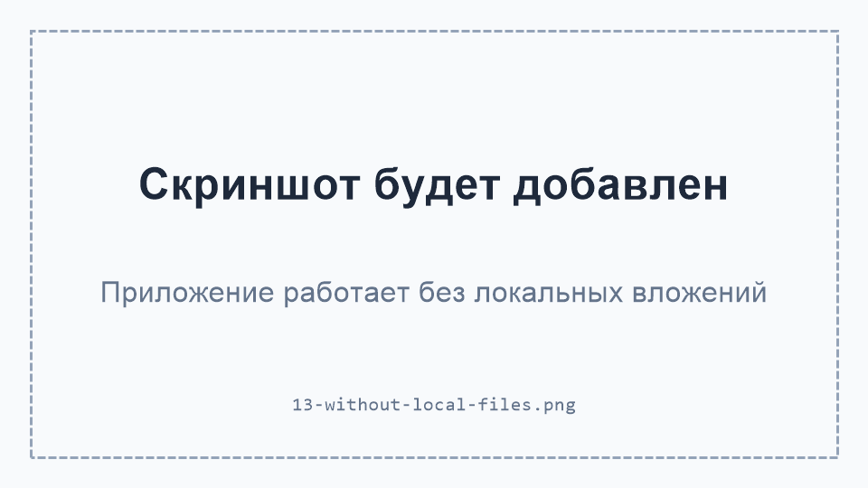

**Политика после удаления `s3:ListBucket`:** [итоговый JSON](../lab_2/open_capsules_php_functional/docs/lab4/iam-policy-final.json) оставляет `GetObject`, `PutObject`, `DeleteObject` для `uploads/*`. В IAM создана версия `v2` и назначена по умолчанию. После переключения роль не может перечислять объекты, но прочитала существующий объект и сохранила новый через приложение.

**`aws s3 ls s3://$BUCKET/uploads/` на app-server:**

```text
AccessDenied при ListObjectsV2: у роли нет разрешения s3:ListBucket.
```

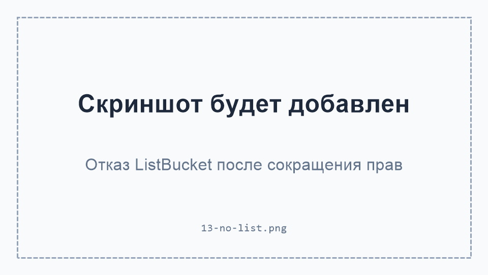

**Запрос отсутствующего объекта на app-server:**

```text
AccessDenied (403) при GetObject uploads/lab4-missing-20261031.txt.
```

**Тот же запрос в CloudShell:**

```text
NoSuchKey (404) при GetObject uploads/lab4-missing-20261031.txt.
```

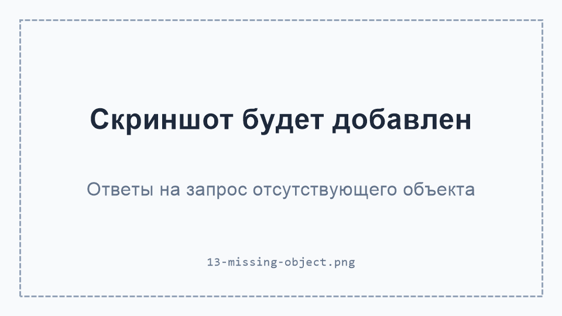

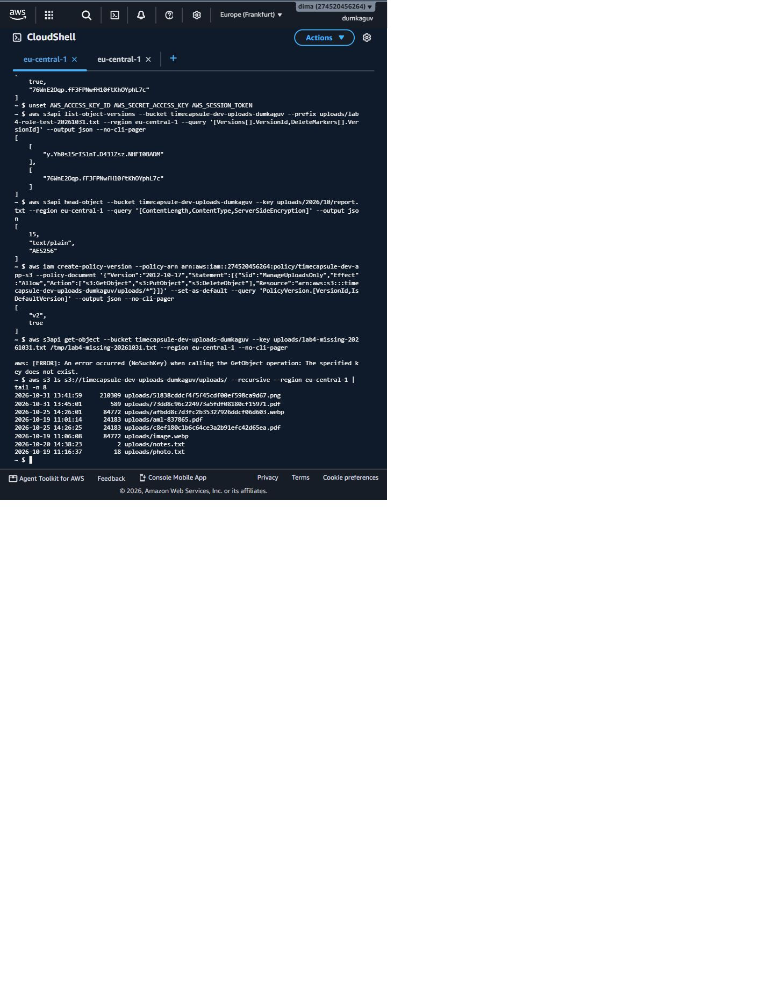

**Контрольные вопросы:**

1. Без права `s3:ListBucket` `GetObject` для отсутствующего ключа вернул `403 AccessDenied`, а CloudShell с правом списка получил `404 NoSuchKey`: вызывающий без доступа к списку не узнаёт, существует ли ключ.
2. Новый app-server должен получить тот же код и настройки `S3_BUCKET`/`AWS_REGION`, роль с правами на `uploads/*` и доступ к PostgreSQL. Сами вложения сохраняются в S3 отдельно от EC2; замена экземпляра в этой лабораторной не выполнялась.

## Задание 14. Архитектура и решение

**Схема:** [SVG](../lab_2/open_capsules_php_functional/docs/lab4/architecture.svg) и [PNG](../lab_2/open_capsules_php_functional/docs/lab4/architecture.png) подготовлены в проекте приложения: S3 показан вне VPC, app-server обращается к нему через роль EC2, браузер получает объект по подписанному URL. Путь приложения к S3 и путь браузера к подписанному объекту проверены в заданиях 12–13; второй app-server и репликация в другой регион на схеме не изображены как развёрнутые ресурсы.

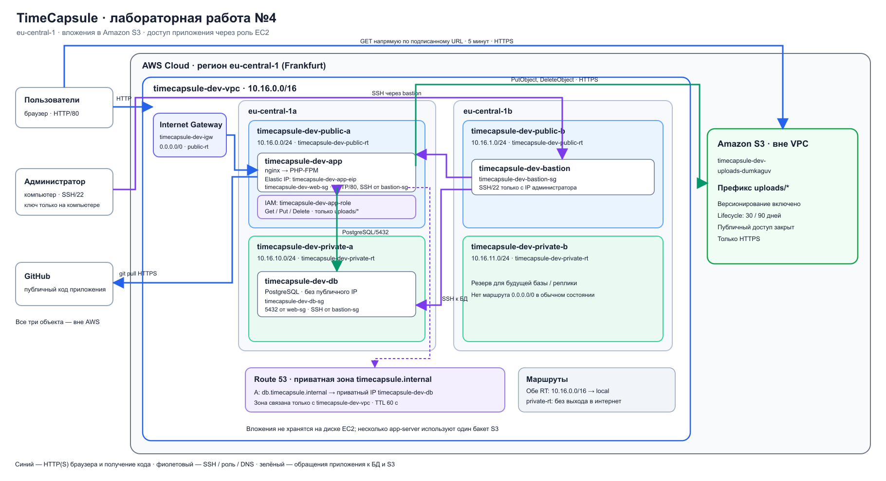

**ADR-0003:** [Решение о хранении вложений](../lab_2/open_capsules_php_functional/docs/adr/0003-attachment-storage.md) сравнивает EBS, EFS и S3, описывает выбор S3 и последствия.

**Последствия решения:** приложение проверяет доступ и время открытия, затем возвращает HTTP 302 на S3 URL сроком 5 минут. Версионирование сохраняет прежние версии при обычном удалении, lifecycle ограничивает число и срок хранения неактуальных версий. Несколько app-server смогут использовать один бакет при одинаковой роли и конфигурации; балансировщик и второй сервер в этой лабораторной не развёрнуты.

**Итоговая проверка перед остановкой:** `/health` ответил HTTP 200 с `status=ok` и `db=ok` 31.10.2026 в 13:58 UTC. На app-server отсутствуют исходный локальный каталог вложений и его временная резервная копия; сервер продолжает работать с ролью EC2.

## Завершение работы

**Состояние ресурсов:** после проверок вызван `stop-instances` для bastion `i-093ce4db16e26e44e`, app-server `i-012cb83b9091855bb` и db-server `i-0f55807403e5f9a96`. `aws ec2 wait instance-stopped` завершился успешно; повторный `describe-instances` показал `stopped` у всех трёх. Бакет, политика и роли сохранены. Снимок `final-stopped.png` остаётся заглушкой; CLI-результат записан в [журнале](evidence/2026-10-31-aws-checks.md).

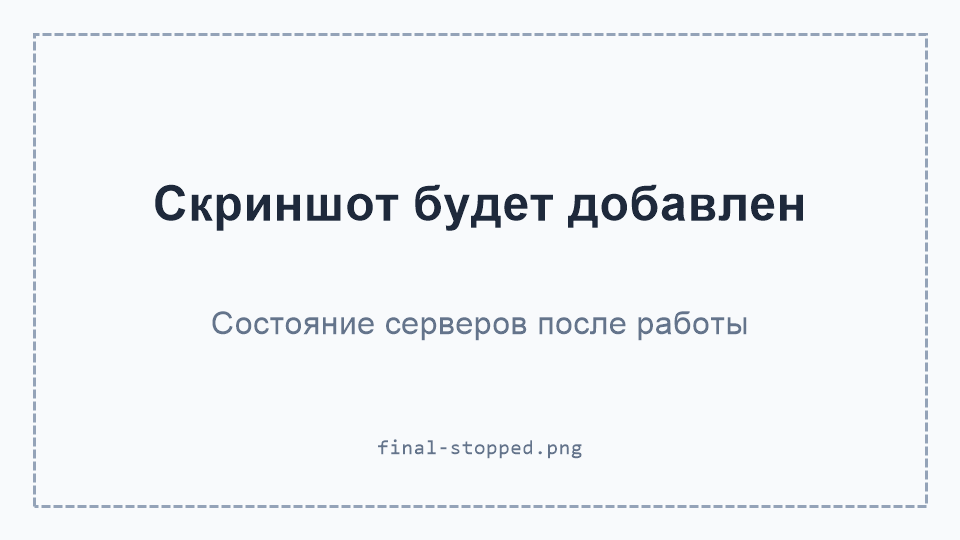

**Оставшиеся ограничения доказательств:** первоначальное состояние версионирования и исторический вывод первого `sync` не восстановить из текущих настроек; фактическое скачивание PDF с исходным именем блокируется доступным браузером; исходная приватная капсула ЛР2 не проверялась через аккаунт её владельца. Проверка старого ключа проведена через временно перенастроенную тестовую капсулу. Заглушки PNG без соответствующего результата обозначены в тексте; вывод CLI не выдаётся за снимок экрана.

## Вопросы для защиты

1. Браузер запрашивает `/capsules/{id}/file`. Контроллер проверяет видимость капсулы и время открытия, затем SDK с ролью EC2 подписывает запрос `GetObject`. После HTTP 302 браузер скачивает файл непосредственно из S3; права пользователя проверяет приложение, права роли — AWS при запросе объекта.
2. Block Public Access, запрет HTTP в политике бакета и короткий срок подписанного URL защищают доступ. Подпись включает ключ объекта и параметры запроса; изменение ключа приводит к ошибке подписи.
3. Бакет остаётся закрытым, а приложение может выдать ограниченный по времени доступ только после проверки пользователя. Публичное чтение обходило бы эту проверку.
4. Нужны репликация S3 в другой регион и план переключения приложения, DNS и PostgreSQL. Один бакет в `eu-central-1` не обеспечивает доступность при отказе всего региона.

> В опубликованный отчёт не вставлять действующие подписанные URL целиком: удалить `X-Amz-Signature` или дождаться истечения срока ссылки.
