# Лабораторная работа №5

## Облачные базы данных. Amazon RDS

| Данные | Значение |
| --- | --- |
| ФИО | Дмитрий Головичихин |
| Группа | IA2403 |
| Специальность | Informatică aplicată |
| Уровень | Базовый, часть 1: задания 1–5 |
| Репозиторий отчёта | [dumkaguv/cloud](https://github.com/dumkaguv/cloud) |
| Регион | eu-central-1 (Frankfurt) |

> **Статус:** документ описывает фактически проверенную базовую часть. Несовпадения с формулировкой задания перечислены ниже; они не объявлены выполненными. Пароль и дамп базы в отчёт не включены.

## Цель и исходное состояние

**Цель:** разместить учебную PostgreSQL в Amazon RDS, ограничить сетевой доступ, проверить реплику для чтения и восстановление на момент времени, затем удалить учебные ресурсы.

**Контекст:** серверы приложения ЛР3 находятся в `timecapsule-dev-vpc` (`vpc-09b9beee88ce9816c`). Учебная база создана в отдельной `lab5-db-subnets-vpc` (`vpc-092f097eb07ac5b5f`). Подключение с `web-server`/`app-server` поэтому не проверено; SQL выполнялся из VPC-среды CloudShell `lab-5-shell` с группой `lab-5-app-sg`. Это отступление от прямого требования Moodle не использовать CloudShell.

**Принцип доступа:** RDS не получает публичный адрес; единственное входящее правило SG базы разрешает TCP/5432 от `lab-5-app-sg`. На снимке группы подсетей тег `Lab=lab5` отсутствует.

## Краткая теория

Группа подсетей RDS задаёт подсети и зоны, где сервис может разместить экземпляр. Security Group фильтрует подключения; ссылка на группу клиента остаётся действительной при смене его IP. Реплика асинхронно получает изменения и обслуживает чтение. Автоматические резервные копии и журнал транзакций позволяют восстановить базу на выбранный момент в отдельный экземпляр.

# Часть 1. Учебная база

## Задание 1. Размещение и доступ

Группа `lab5-db-subnets` содержит две приватные подсети: `lab5-db-subnets-subnet-private1-eu-central-1a` в зоне `eu-central-1a` и `lab5-db-subnets-subnet-private2-eu-central-1b` в `eu-central-1b`. Они находятся в `lab5-db-subnets-vpc`, а не в VPC ЛР3. На предоставленном снимке группа подсетей имеет `Tags (0)`.

В EC2 проверена группа базы `lab-5-db-sg` (`sg-00f6a4a0f6293ced1`): у неё одно входящее правило PostgreSQL/TCP `5432` с источником `lab-5-app-sg` (`sg-0632b6d466c0d1071`). Назначение этой группы серверу `web-server`/`app-server` не подтверждено. Снимок правил RDS показывает источник, а точные протокол и порт были прочитаны на странице SG в EC2.

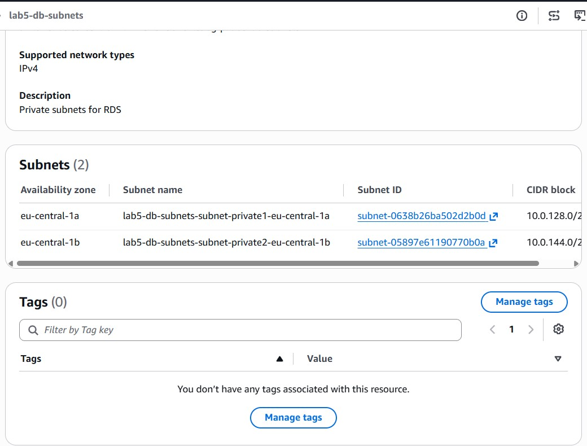

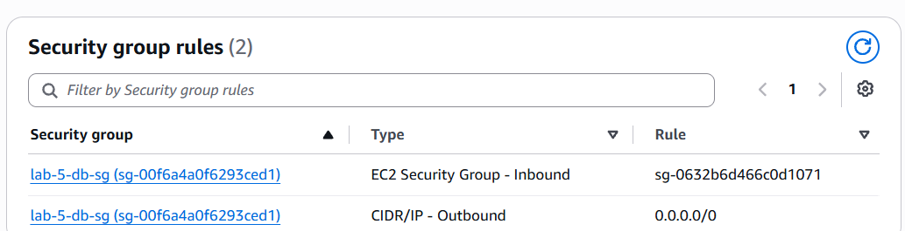

**Ответы:** ссылка на SG клиента не зависит от смены IP-адреса сервера. Две подсети в разных зонах дают RDS возможность разместить реплику или резервный экземпляр в другой зоне; одна учебная база при этом работает в одной зоне.

## Задание 2. Учебный экземпляр RDS

Основной экземпляр имеет идентификатор `lab-5-db`, PostgreSQL `18.3`, статус `Available`, класс `db.t4g.micro`, 20 ГиБ gp3 без автоподстройки, шифрование `Enabled`, Single-AZ в `eu-central-1a`. Endpoint: `lab-5-db.cdyoa62yi185.eu-central-1.rds.amazonaws.com:5432`; VPC `lab5-db-subnets-vpc`, группа подсетей `lab5-db-subnets`, SG `lab-5-db-sg`, `Publicly accessible: No`.

Фактические имя начальной БД и главный пользователь — `lab_5_db` и `postgres`. Автоматические резервные копии включены на **1 день**, защита от удаления **выключена**. Это отличается от условий задания (`lab5-db`, `lab5`, `dbadmin`, 7 дней, включённая защита). Шаблон Sandbox по текущим данным не подтверждён.

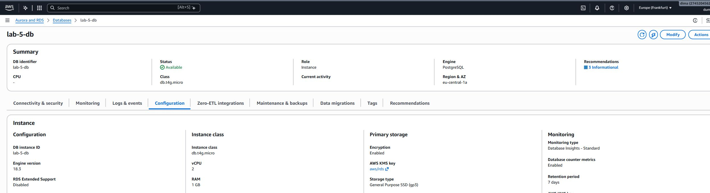

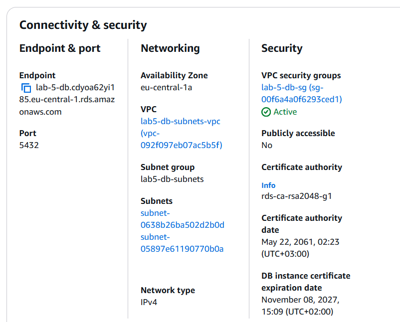

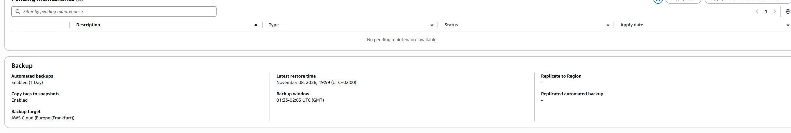

**Ответы:** ограничение доступа проверяется правилом SG, отсутствием публичного адреса и успешным подключением клиента с разрешённой SG; испытание с `web-server`/`app-server` здесь не выполнено. Зона `eu-central-1a` выбрана для основного экземпляра, вторая зона нужна реплике. Deletion protection блокирует удаление экземпляра через RDS, но не защищает строки от SQL-команды `DELETE`.

## Задание 3. Подключение и таблица

Из VPC-среды CloudShell `lab-5-shell` подключение к приватному endpoint прошло по TLS 1.3. `SELECT version();` вернул PostgreSQL `18.3`; `\conninfo` показал БД `lab_5_db`, пользователя `postgres`, адрес `10.0.131.43` и порт `5432`. Клиент `psql 16.15` предупредил о несовпадении основных версий клиента и сервера, но команды выполнились.

```sql
CREATE TABLE notes (
    id SERIAL PRIMARY KEY,
    body VARCHAR(100) NOT NULL,
    created_at TIMESTAMPTZ NOT NULL DEFAULT now()
);
INSERT INTO notes (body) VALUES ('first'), ('second'), ('third');
SELECT * FROM notes;
```

Создана таблица `notes`; команда `INSERT 0 3` добавила строки `first`, `second`, `third`, и `SELECT * FROM notes` вернул три строки.

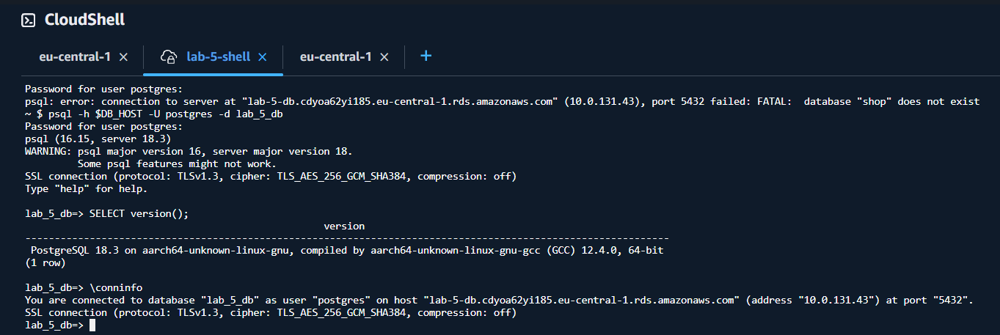

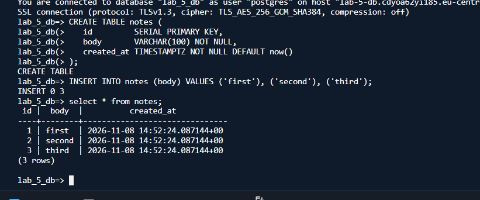

**Ограничение:** по заданию подключаться нужно с `web-server` или `app-server`, а CloudShell использовать нельзя. Требуемый путь доступа и сравнение DNS-разрешения endpoint на сервере и локальном компьютере не проверены. Это остаётся существенным несоответствием базовой части.

## Задание 4. Реплика для чтения

**План:** создать `lab5-db-replica` в `eu-central-1b`, без публичного доступа; проверить `pg_is_in_recovery()` на основной базе и реплике, чтение строк, отказ `INSERT` на реплике, появление `fourth` после записи на основной базе и метрику `ReplicaLag`.

**Результат (8 ноября 2026):** реплика `lab5-db-replica` имеет статус `Available`, класс `db.t4g.micro`, зону `eu-central-1b`, источник `lab-5-db`, группу безопасности `lab-5-db-sg` и `Publicly accessible: No`. Endpoint: `lab5-db-replica.cdyoa62yi185.eu-central-1.rds.amazonaws.com:5432`. В `lab-5-shell` из той же VPC с группой `lab-5-app-sg` подключение прошло по TLS 1.3. На реплике `pg_is_in_recovery()` вернул `t`, на основной базе — `f`. Реплика прочитала `first`, `second`, `third`; команда `INSERT INTO notes (body) VALUES ('from replica');` вернула `ERROR: cannot execute INSERT in a read-only transaction`. На основной базе добавлена строка `fourth` (`INSERT 0 1`); затем реплика показала её с `id=4`. В RDS статус репликации — `Replicating`, отставание — `3 Seconds`; график `ReplicaLag` на вкладке Monitoring показывает 3 секунды (время графика — UTC).

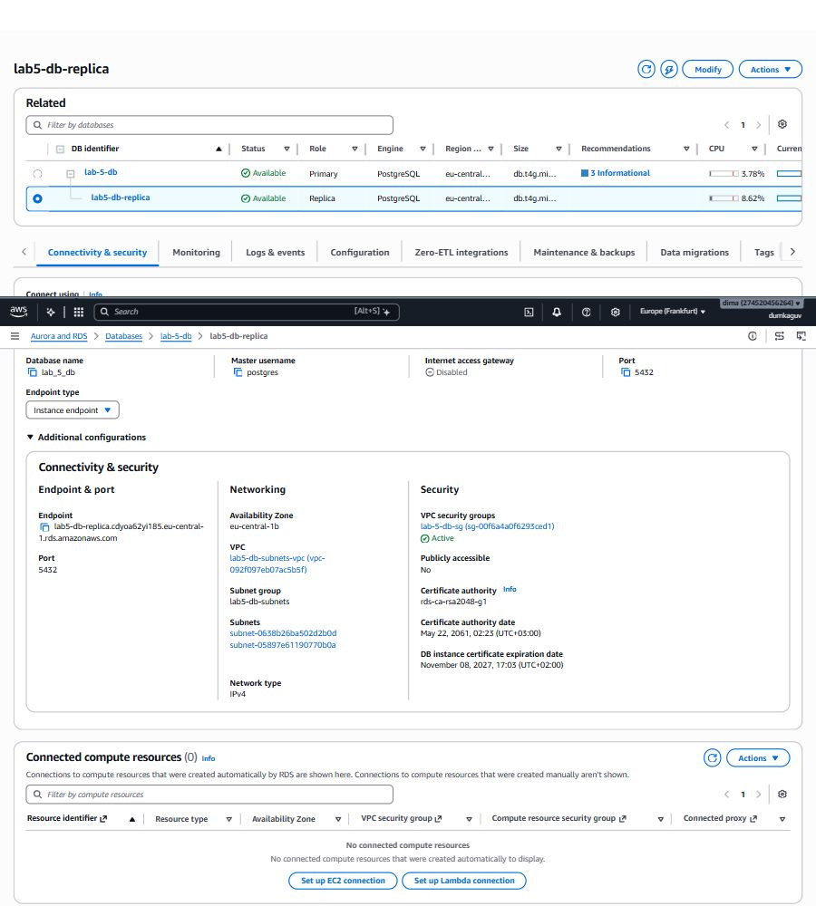

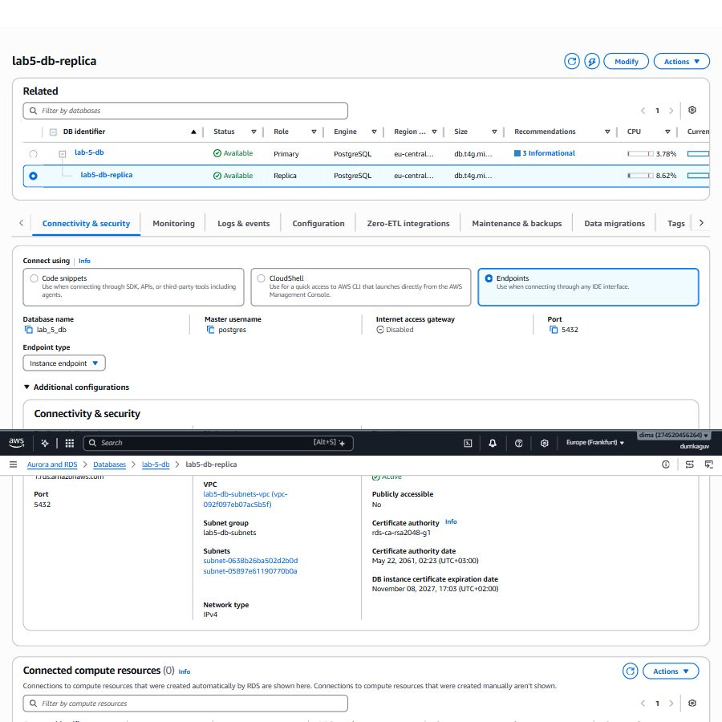

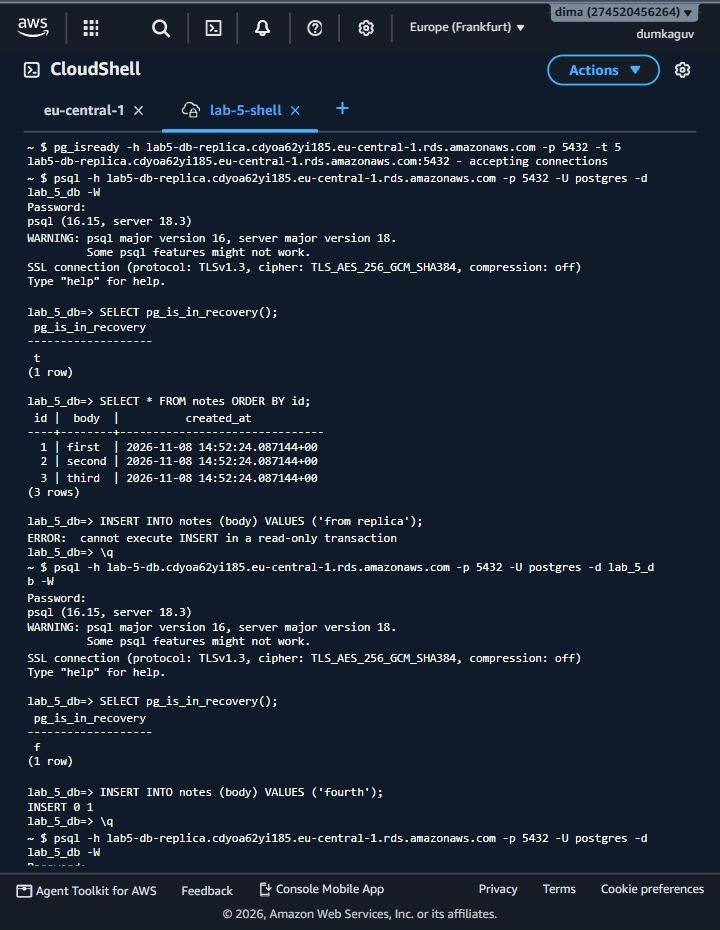

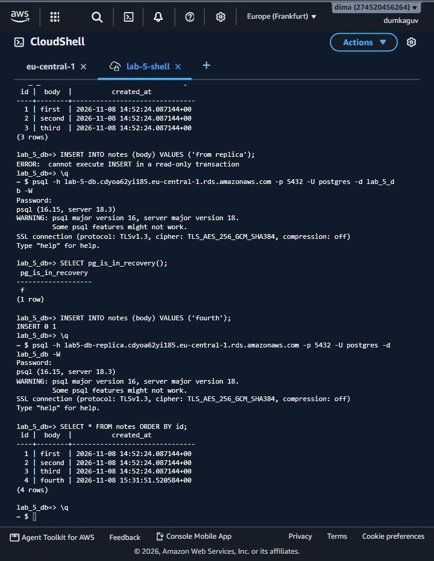

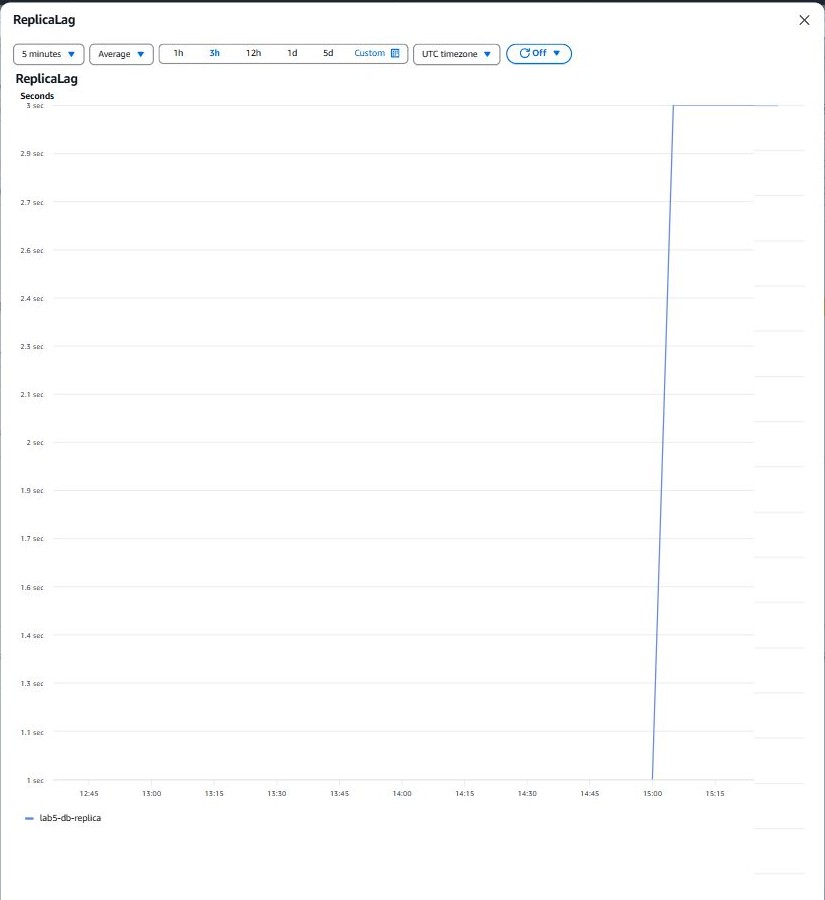

**Ограничение доказательства:** SQL-команды выполнены из VPC-среды CloudShell, а инструкция ЛР5 требует подключаться с `web-server` или `app-server` и запрещает CloudShell. Кроме того, учебная RDS находится в `lab5-db-subnets-vpc`, тогда как серверы ЛР3 находятся в `timecapsule-dev-vpc`; проверку с сервера приложения пока выполнить нельзя без исправления архитектуры. Скриншоты выше подтверждают поведение RDS, но не заданный путь доступа.

**Контрольные вопросы:** `INSERT` не выполняется, потому что реплика работает в режиме восстановления и обслуживает только чтение; изменения приходят от основной базы. Реплика для чтения имеет собственный endpoint для `SELECT` и обновляется асинхронно. Резервный экземпляр обычной Multi-AZ-конфигурации предназначен для автоматического переключения при отказе, а не для чтения запросов приложения.

## Задание 5. Восстановление после удаления

**Ход проверки:** записать `SELECT now() AT TIME ZONE 'UTC';`, через минуту удалить строки в основной базе, посмотреть реплику, удалить реплику, дождаться подходящего `Latest restore time` и восстановить `lab5-db-restore` на момент до удаления. После проверки строк копию по заданию следовало удалить; по решению пользователя она оставлена.

| Проверка | Результат |
| --- | --- |
| Момент до удаления, UTC | `2026-11-08 15:39:47.244822` |
| Момент `DELETE`, UTC | `DELETE 4`; следующая проверка времени — `2026-11-08 15:40:59.506445` |
| Таблица на реплике после `DELETE` | `SELECT * FROM notes ORDER BY id;` → `0 rows` |
| `Latest restore time` | Сначала было 17:39 (UTC+02:00), то есть до зафиксированного момента. После ожидания RDS показал 19:54:44 (UTC+02:00), и выбранное время стало доступно. |
| Точка восстановления | `2026-11-08 17:39:47 UTC+02:00` = `2026-11-08 15:39:47 UTC`. Форма RDS принимает секунды без долей; это на 0,244822 секунды раньше записанного `now()`. |
| Параметры копии | `lab5-db-restore`, `db.t4g.micro`, Single-AZ, `lab5-db-subnets`, VPC `lab5-db-subnets-vpc`, `Public access: No`, SG `lab-5-db-sg`, защита от удаления выключена. |
| Строки в восстановленной базе | После статуса `Available` подключение к `lab5-db-restore` прошло по TLS 1.3. `SELECT * FROM notes ORDER BY id;` вернул `first`, `second`, `third`, `fourth` — 4 строки. |
| Итоговое состояние | Реплика удалена. На 8 ноября 2026 в RDS `lab-5-db` и `lab5-db-restore` имеют статус `Available`; копия и основная база оставлены по прямому решению пользователя. |

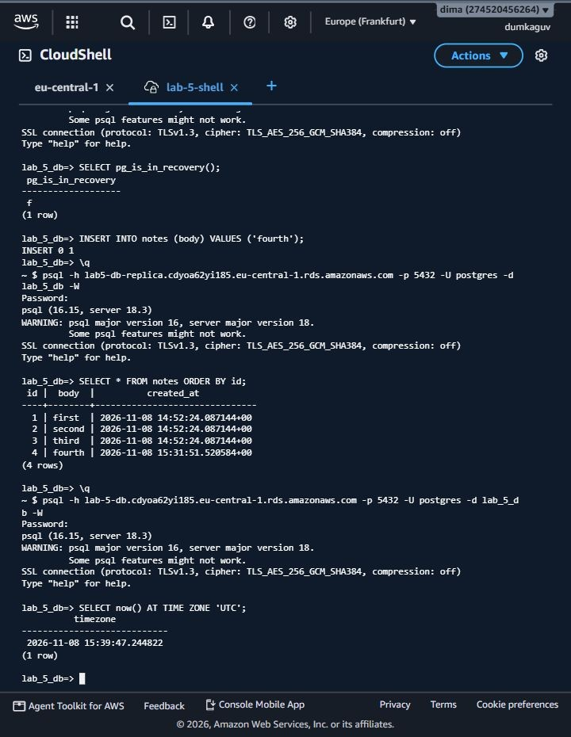

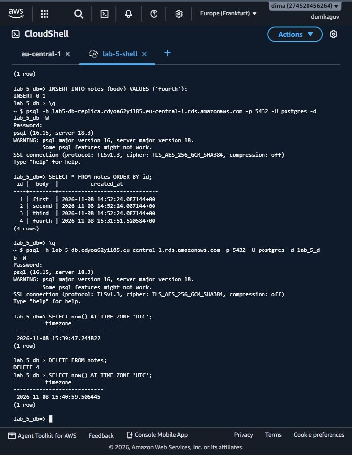

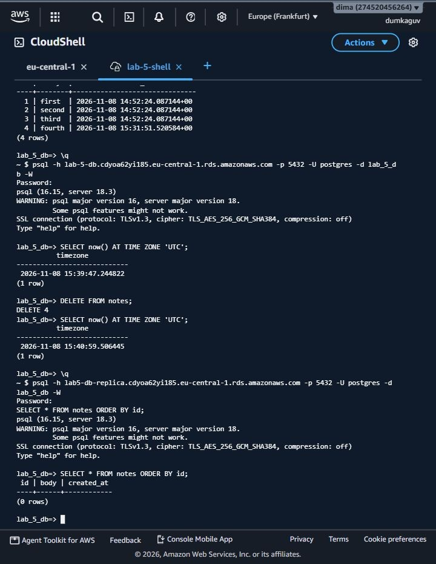

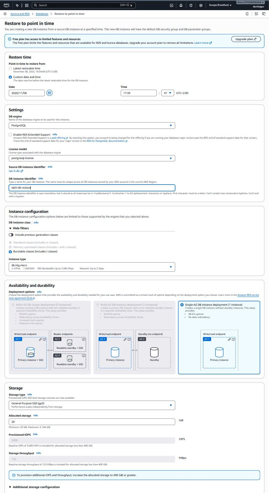

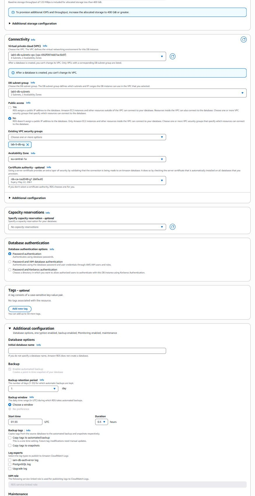

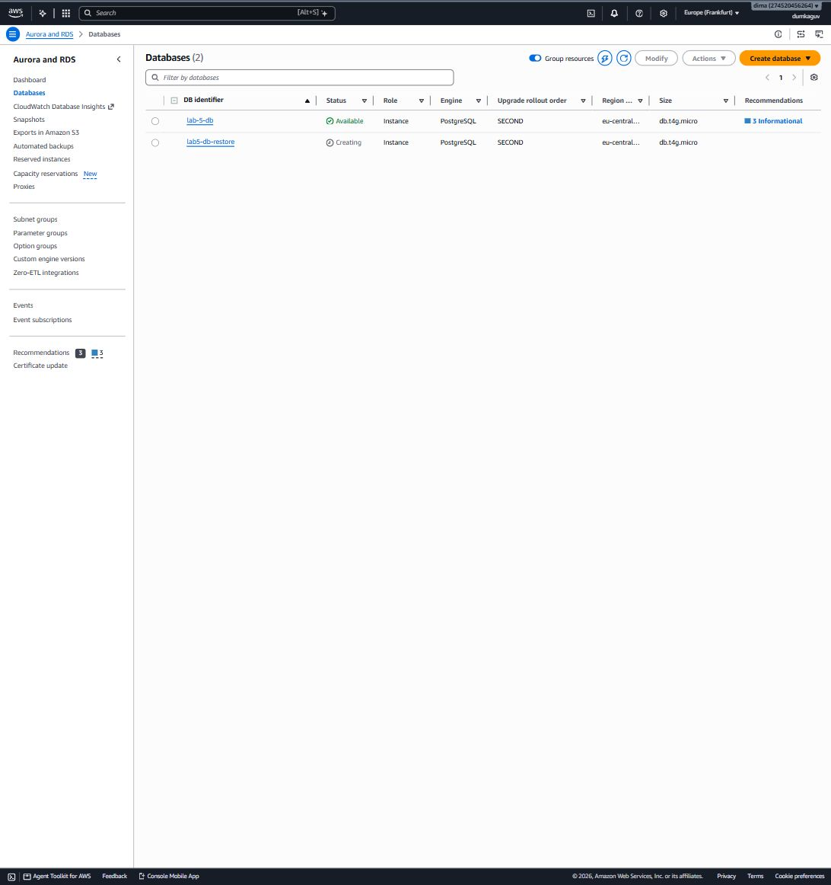

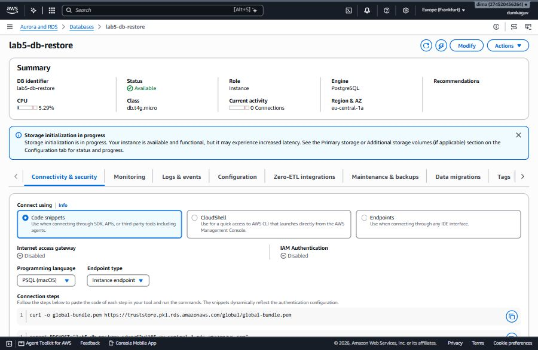

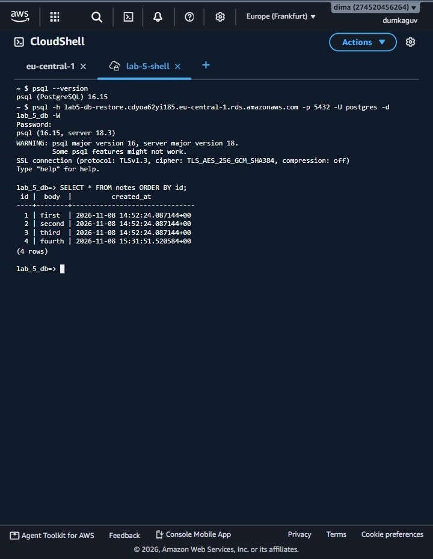

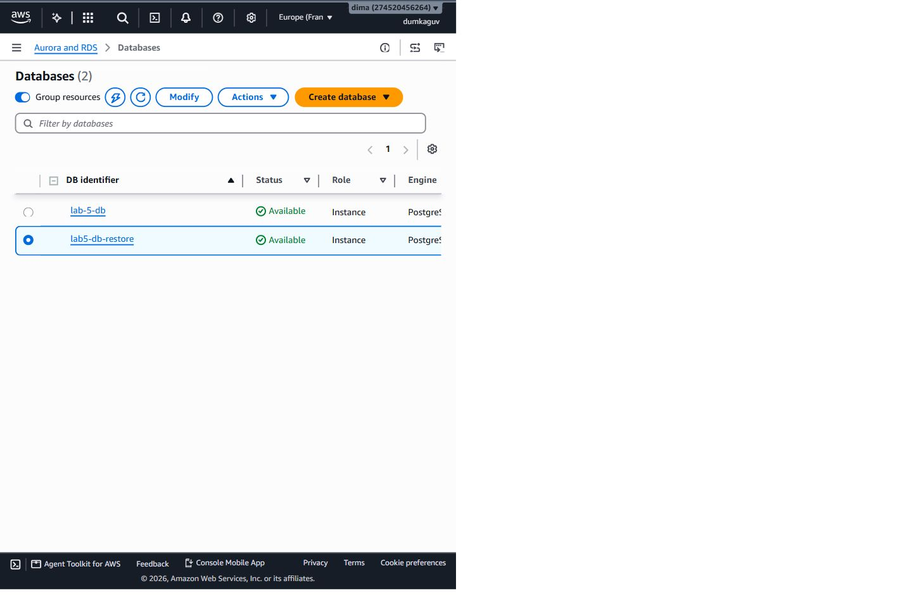

**Контрольные вопросы:** Реплика получает изменения основной базы, включая `DELETE`, поэтому после удаления на ней тоже `0 rows`. Восстановление на момент времени использует резервную копию и журнал изменений до выбранной секунды и создаёт отдельный экземпляр. Основная база остаётся в текущем состоянии, поэтому восстановленные строки можно проверить без перезаписи основной базы.

## Завершение и расхождения с заданием

По Moodle в конце части 1 требуется удалить восстановленную копию, основную базу, группу подсетей RDS и SG базы. Пользователь прямо распорядился оставить эти ресурсы. Поэтому заключительная очистка **не выполнена**: обе базы `Available`, группа `lab5-db-subnets` и SG `lab-5-db-sg` остаются. Реплика удалена. Работа двух экземпляров RDS продолжает тарифицироваться AWS.

Результаты чтения с реплики, ошибка записи в неё, метрика `ReplicaLag` и восстановление четырёх строк подтверждены. Для строгого соответствия базовому уровню не хватает размещения в VPC ЛР3, подключения с `web-server`/`app-server`, сравнения DNS на сервере и компьютере, заданных имени/пользователя БД, 7-дневного срока backup, включённой защиты от удаления и тега `Lab=lab5`. Эти пункты не подменены результатами CloudShell.
