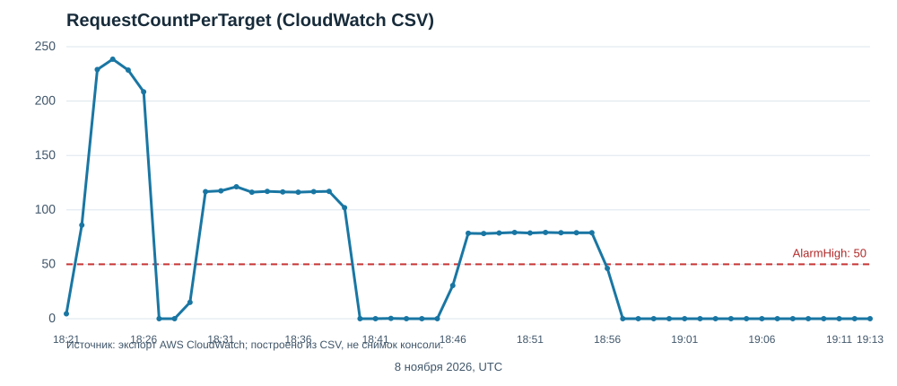

# Лабораторная работа №6

## Масштабирование и балансировка нагрузки: базовый уровень

| Данные | Значение |
| --- | --- |
| ФИО | Дмитрий Головичихин |
| Группа | IA2403 |
| Специальность | Informatică aplicată |
| Уровень | Базовый, часть 1: задания 1–3 |
| Репозиторий отчёта | [dumkaguv/cloud](https://github.com/dumkaguv/cloud) |
| Регион | eu-central-1 (Frankfurt) |
| Дата проверки | 8 ноября 2026 года |

> **Статус:** задания 1–3 выполнены и проверены в AWS Console и локальными HTTP-запросами. По решению владельца ресурсы ЛР6 оставлены в AWS вместо удаления. Скриншоты консоли в этой версии отчёта не приложены; вместо них сохранены исходные ответы и экспорт метрики CloudWatch. Номер аккаунта, ключи и cookie в отчёт не включены.

## Задание 1. Балансировщик

Использована VPC `timecapsule-dev-vpc` (`vpc-09b9beee88ce9816c`) из ЛР3. Целевая группа `lab6-tg` имеет тип `Instances`, протокол HTTP, порт 80 и проверку `GET /health` каждые 10 секунд с ожидаемым кодом 200. Балансировщик `lab6-alb` типа Application Load Balancer размещён в публичных подсетях `timecapsule-dev-public-a` (`eu-central-1a`) и `timecapsule-dev-public-b` (`eu-central-1b`); публичный listener HTTP/80 направляет запросы в `lab6-tg`.

Адрес балансировщика во время проверки: `lab6-alb-2016584846.eu-central-1.elb.amazonaws.com`. До запуска серверов запрос вернул `HTTP/1.1 503 Service Temporarily Unavailable`: целевая группа ещё не содержала исправных целей. Две зоны позволяют балансировщику принимать трафик и направлять его к доступным серверам при проблеме в одной зоне.

Для ALB создана группа `lab6-alb-sg`: входящий TCP/80 разрешён из `0.0.0.0/0`, исходящий HTTP/80 — в CIDR VPC `10.16.0.0/16`. Для серверов создана `lab6-web-sg`: входящий TCP/80 разрешён только от `lab6-alb-sg`, SSH/22 — только от группы bastion. Все созданные для этой части ресурсы помечены `Lab=lab6`.

## Задание 2. Группа Auto Scaling

Шаблон `lab6-lt` запускает Amazon Linux 2023 (`ami-01376afa3e7def694`) на `t3.micro` с существующей парой ключей `keypair` и группой `lab6-web-sg`. Подсеть в шаблоне не указана. [User data](evidence/user-data.sh) устанавливает nginx, записывает в `/usr/share/nginx/html/index.html` имя сервера и его зону из IMDSv2, создаёт `/health` с ответом `OK` и запускает nginx.

Группа `lab6-asg` выбирает обе публичные подсети, подключает `lab6-tg` и использует проверки EC2 и ELB с периодом начальной настройки 300 секунд. Размеры: желаемый 2, минимум 2, максимум 4. Политика target tracking `lab6-requests-per-target` настроена на целевое значение 50 для `Application Load Balancer request count per target`; уменьшение группы включено. При создании группы консоль сообщила, что не смогла создать политику, поэтому она была добавлена отдельно на вкладке **Automatic scaling** и затем проверена там.

После запуска две цели в разных зонах получили состояние `Healthy`. Через ALB путь `/health` вернул HTTP 200 и `OK`, а обычные запросы получили ответы двух разных серверов:

```text
ip-10-16-0-146.eu-central-1.compute.internal — eu-central-1a
ip-10-16-1-114.eu-central-1.compute.internal — eu-central-1b
```

Исходные ответы HTTP сохранены в [evidence/http-checks.txt](evidence/http-checks.txt). Группа Auto Scaling создаёт и удаляет экземпляры, поддерживая заданную численность; целевая группа регистрирует их как адресатов трафика и проверяет работоспособность. Подсеть задаётся группе, чтобы экземпляры распределялись между двумя зонами, а не закреплялись за одной подсетью в шаблоне.

## Задание 3. Нагрузка

Нагрузка отправлялась с локального компьютера на DNS-имя ALB. В Git Bash непрерывный десятиминутный запуск длился с 20:46:37 до 20:56:36 (UTC+02:00): **3146 запросов, 3146 ответов HTTP 200, других кодов нет**; [журнал Git Bash](evidence/load-test-git-bash.txt). Ранее полный десятиминутный запуск из PowerShell (20:29:53–20:39:53) дал **4668 ответов HTTP 200 из 4668 запросов**; [поминутный журнал PowerShell](evidence/load-test.txt).

Для нагрузки использован цикл из задания с локального компьютера; в фактическом запуске дополнительно считались коды ответов:

```bash
ALB=lab6-alb-2016584846.eu-central-1.elb.amazonaws.com
end=$((SECONDS+600))
while [ "$SECONDS" -lt "$end" ]; do
  curl -s -o /dev/null "http://$ALB/"
done
```

Первый запуск начался в 20:22:40 (UTC+02:00) и был прерван после как минимум 1800 успешных HTTP 200 из-за остановки управления браузером. По этим запросам CloudWatch перевёл `AlarmHigh` из `OK` в `In alarm` в 18:27:24 UTC и успешно вызвал политику масштабирования. На вкладке **Activity** причина запуска двух новых экземпляров прямо связывает изменение желаемой ёмкости с тревогой: **2 → 4** в 18:27:35 UTC. Все четыре цели затем стали `Healthy`; ответы четырёх серверов сохранены в [evidence/four-target-responses.txt](evidence/four-target-responses.txt).

Экспорт [RequestCountPerTarget](evidence/request-count-per-target.csv) из CloudWatch показывает 229, 238,5 и 228,5 запроса на цель за минуту в 18:23–18:25 UTC. Порог `AlarmHigh` — более 50 в трёх точках за три минуты. `AlarmLow` использует 15 точек за 15 минут, поэтому уменьшение ёмкости ожидаемо запаздывает. Зафиксированное падение метрики до нуля в 18:27–18:28 UTC связано с прерыванием первой нагрузки; его нельзя выдавать за эффект одного лишь добавления серверов.



Во втором запуске при четырёх целях метрика держалась примерно на 116–121 запросе на цель за минуту при потоке около 467 запросов в минуту. Это примерно вдвое меньше пика 229–238,5 при двух целях, что соответствует распределению потока между большим числом серверов. График выше построен из официального CSV, а не снят с экрана AWS Console.

Во время прогона из Git Bash при четырёх целях метрика составляла около 79 запросов на цель за минуту. После его остановки экспорт CloudWatch содержит нулевые минутные точки начиная с 18:57 UTC. `AlarmLow` оценивает 15 точек за 15 минут при пороге менее 35 запросов на цель. В 19:14:36 UTC тревога перешла из `OK` в `In alarm`, успешно вызвала политику, а история ASG зафиксировала автоматическое изменение желаемого размера **4 → 3** в 19:14:39 UTC и **3 → 2** в 19:16:49 UTC. Во время проверки два удаляемых экземпляра ещё проходили ELB connection draining; желаемый размер уже вернулся к исходному значению 2.

При неизменном общем потоке распределение запросов между большим числом исправных целей уменьшает число запросов на одну цель. Верхняя граница `max=4` не позволяет группе запустить больше четырёх экземпляров. Для уменьшения группа ждёт более длительного периода низкой нагрузки и учитывает время прогрева, чтобы избежать частых переключений размера.

## Ответы на контрольные вопросы

1. **Какой ответ вернул ALB до запуска серверов и почему?** Он вернул HTTP 503. Listener был создан, но у целевой группы ещё не было исправных экземпляров, которым можно передать запрос.
2. **Зачем ALB подсети в двух зонах?** Он размещает узлы в обеих зонах и принимает запросы через единое DNS-имя. Если одна зона недоступна, оставшаяся может продолжить обслуживание при наличии исправных целей.
3. **Чем ASG отличается от целевой группы?** ASG запускает, заменяет и удаляет EC2, поддерживая желаемую ёмкость. Целевая группа хранит зарегистрированные цели, проверяет их состояние и предоставляет ALB список доступных серверов.
4. **Почему в шаблоне нет подсети?** Подсети задаются в ASG, которая выбирает место запуска каждого экземпляра. Если зафиксировать одну подсеть в шаблоне, распределение между `public-a` и `public-b` не получится.
5. **Сколько серверов добавила группа и почему не больше?** При срабатывании `AlarmHigh` желаемое количество изменилось с двух до четырёх: группа добавила два сервера. Параметр `max=4` ограничил дальнейший рост даже при сохранявшейся нагрузке.
6. **Почему запросов на цель стало меньше без сопоставимого снижения общего потока?** После добавления двух серверов ALB распределял запросы уже между четырьмя целями. При потоке около 467 запросов в минуту CloudWatch показывал примерно 116–121 на цель вместо пика 229–238,5 на двух целях.
7. **Почему уменьшение группы происходит медленнее увеличения?** `AlarmHigh` оценивает три минутные точки, а `AlarmLow` — пятнадцать. Более длительное подтверждение низкой нагрузки и прогрев экземпляров помогают избежать постоянных изменений размера группы.

## Завершение и ограничения доказательств

На момент последней проверки группа вернулась к желаемой ёмкости **2** и состоянию **At desired capacity**. В `lab6-tg` две цели, по одной в `eu-central-1a` и `eu-central-1b`, имели состояние `Healthy`; ещё одна ранее выбранная для удаления цель временно находилась в `Draining`. Владелец попросил оставить ресурсы ЛР6, поэтому предписанная заданием очистка и проверка отсутствия ресурсов с префиксом `lab6-` не выполнялись. Оставлены `lab6-asg` с двумя EC2, `lab6-alb`, `lab6-tg`, `lab6-lt` и две группы безопасности.

Скриншоты двух здоровых целей, ответов, графика, истории тревоги и истории группы требуются заданием, но в отчёт не включены: инструмент браузера не позволил сохранить их в файлы проекта. Сохранённые текстовые журналы, [наблюдения AWS Console](evidence/aws-events.txt) и CSV отражают только наблюдавшиеся результаты и не заменяют требуемые снимки.
